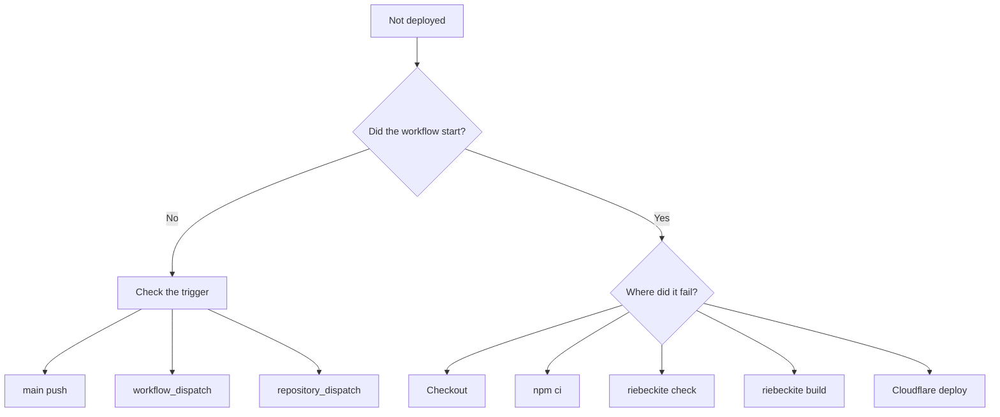

# Troubleshooting

## When deployment does not work

First, separate "the workflow did not start" from "the workflow started but failed".



## The workflow does not start

For a push to the site repository, check that you pushed to:

```text
main
```

For a push to the content repository, check:

```text
notify-site.yml
SITE_DISPATCH_TOKEN
repository_dispatch
content-updated
```

A push to the content repository alone does not start the site workflow.

## `npm ci` fails

The generated workflow uses:

```sh
npm ci
```

so check that `package-lock.json` is committed to the repository.

## Content checkout fails

For a private content repository, check:

```text
RIEBECKITE_CONTENT_READ_TOKEN
```

The site repository's workflow must be able to read the content repository with that token.

## `check` fails

Run the same command locally:

```sh
npm exec riebeckite check
```

Fix the config or plugin problem before pushing.

## `build` fails

Check whether you can reproduce it locally with:

```sh
npm exec riebeckite build
```

If you split repositories, also check that the content exists in the same place CI expects it.

## Cloudflare deployment fails

If the build succeeded, check:

```text
CLOUDFLARE_API_TOKEN
CLOUDFLARE_ACCOUNT_ID
wrangler.jsonc
```

Riebeckite's build and the Cloudflare deployment are separate stages, so determining which one failed makes the cause easier to find.
