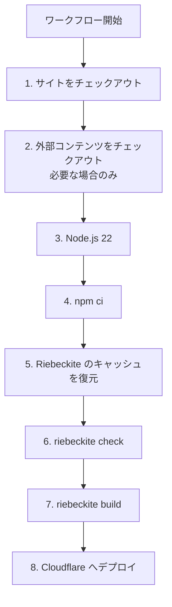
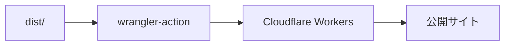
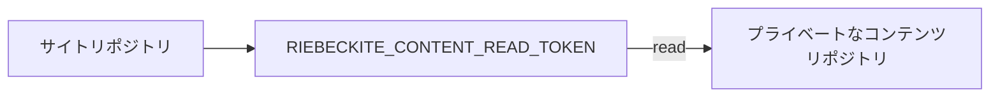
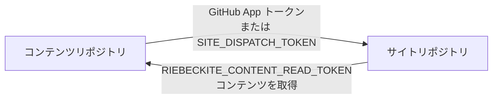

# ワークフロー

## ワークフローの処理順

生成されるデプロイワークフローは、おおむね次の順に処理を進めます。



### 1. サイトリポジトリをチェックアウトする

最初にサイトリポジトリを取得します。

```text id="cq3r5o"
GitHub ランナー
    ↓
サイトリポジトリ
```

ここには次のものが含まれます。

- Riebeckite の設定
- アプリケーション
- [[glossary/plugin|プラグイン]]／[[glossary/theme|テーマ]]の設定
- `package.json`
- `package-lock.json`

### 2. 外部コンテンツをチェックアウトする

コンテンツが同じリポジトリにある場合、この追加手順は不要です。

別リポジトリを使っている場合は、コンテンツリポジトリを `content/` へチェックアウトします。

```text id="1rhw6a"
ランナー

サイトリポジトリ
├─ app/
├─ riebeckite.config.ts
├─ package.json
└─ content/          ← 外部のコンテンツリポジトリ
```

その場合、Riebeckite 側では次のように読み込めます。

```ts id="k2zv1m"
content: {
  directory: "content",
},
```

### 3. Node.js をセットアップする

生成されるワークフローでは Node.js 22 をセットアップします。

```text id="db4q7u"
GitHub ランナー
      ↓
Node.js 22
```

以降の依存パッケージのインストールと Riebeckite CLI は、この環境で実行されます。

### 4. パッケージをインストールする

次のコマンドを実行します。

```sh id="82x1ig"
if [ -f package-lock.json ]; then npm ci; else npm install; fi
```

`package-lock.json` がコミットされていれば、`npm ci` がそのロックファイルどおりにインストールします。ない場合は失敗せず `npm install` にフォールバックします。

### 5. Riebeckite のビルド状態を復元する

生成されるワークフローは、増分 [[glossary/ssg|SSG]] に必要な状態を1つの `actions/cache` 手順で復元します。

- `.riebeckite/cache`：Markdown とプラグインの処理キャッシュ
- `.riebeckite/build/content-state.json`：[[glossary/incremental-build|増分ビルド]]の状態
- `.riebeckite/ssg-output-cache.json` と `.riebeckite/ssg-output-cache.entries`：SSG [[glossary/output-cache|出力キャッシュ]]。描画済みのルートとファイル、およびそのエントリの blob を保持します
- `.riebeckite/ssg-output-cache.fast-path.json`：変更なしのファストパスを検証するためのサイドカー

キャッシュキーは、ランナーの OS、Node.js のバージョン、`package-lock.json` のハッシュ、`riebeckite.config.ts` のハッシュで範囲を絞り、実行ごとの世代として保存されます。

```text
riebeckite-build-v2-<os>-node<node>-<lockfile hash>-<config hash>-<run id>-<run attempt>
```

`restore-keys` は、互換性のある直近の世代へ2段階でフォールバックします。まず lockfile と config のハッシュが一致する世代、次に lockfile のハッシュだけが一致する世代です。lockfile のハッシュはインストールされる Riebeckite のバージョンを、config のハッシュは[[glossary/preset|プリセット]]とプラグインの設定を反映します。どちらかが変わると新しいキャッシュ系列が始まりますが、実際に再利用するかどうかは Riebeckite 自身のフィンガープリント検証（スキーマバージョン、アプリ／[[glossary/pipeline|パイプライン]]／コンテンツの[[glossary/fingerprint|フィンガープリント]]、プラグインの `cacheVersion`）が決めます。

エントリがその場で上書きされることはありません。各実行が新しい世代を保存し、古い世代は GitHub が自動的に削除します。[[glossary/cache|キャッシュ]]は OS や Node.js のバージョンをまたいで共有されないため、環境が変われば互換性のないエントリを再利用せず、コールドビルドになります。`dist/` はキャッシュしません。

Riebeckite が復元した出力キャッシュを拒否した場合（キャッシュがない、キャッシュが壊れている、アプリケーションのフィンガープリントが変わった、`unknown` の[[glossary/output-dependency|出力依存関係]]がある、全体を再生成する必要がある、キャッシュされたエントリのない出力がある）は、すべての出力を描画し直して `dist/` を最初から書き直します。そのため、古いキャッシュや不完全なキャッシュがデプロイに混入することはありません。キャッシュミスは安全で、コールドビルドになるだけです。

ビルド後は、新しいキャッシュ世代が自動的に保存されます。ビルドログの `Persistent content cache` 行にある `hits`、`misses`、`bypasses` はコンテンツ処理を再利用したかどうかを、`SSG outputs` 行の `rendered`、`reused`、`removed` は描画済み出力を再利用したかどうかを示します。

`.riebeckite/` を削除するか、ワークフローのキャッシュ手順を外すと、次回はコールドビルドになりますが、出力の正しさには影響しません。コンテンツキャッシュは残したまま、出力キャッシュの転送だけを省きたい場合は、キャッシュ手順から `.riebeckite/ssg-output-cache*` の3つのパスを外してください。次回はすべての出力が再描画されます。

ワークフローは復元・保存したキャッシュのサイズも出力するので、転送コストを確認できます。キャッシュの保存に失敗した場合や省略された場合でも、デプロイは実行されます。

### 6. サイトを検証する

次のコマンドを実行します。

```sh id="e8v6ki"
npm exec riebeckite check
```

設定やプラグインの解決に問題があれば、デプロイ前にここで失敗します。

```text id="ryypt0"
チェックアウト
   ↓
インストール
   ↓
check
   ↓
問題があれば停止
```

壊れた設定のままデプロイしないための確認です。

### 7. サイトをビルドする

`check` が成功したら、次のコマンドを実行します。

```sh id="4brn9u"
npm exec riebeckite build
```

Riebeckite が公開用の `dist/` を生成します。

```text id="k2bc05"
コンテンツ
設定
プラグイン
テーマ
   ↓
riebeckite build
   ↓
dist/
```

### 8. Cloudflare Workers へデプロイする

最後に、`cloudflare/wrangler-action@v3` を使って Cloudflare Workers へデプロイします。

```text id="b6nmf8"
cloudflare/wrangler-action@v3
```



ここでは次の値が使われます。

```text id="7y1w2d"
CLOUDFLARE_API_TOKEN   （Secret）
CLOUDFLARE_ACCOUNT_ID  （Actions Variable）
```

ワークフローは `vars.CLOUDFLARE_ACCOUNT_ID` を読み、すでに Secret として保存しているリポジトリのために `secrets.CLOUDFLARE_ACCOUNT_ID` へフォールバックします。

## 公開状態

ワークフローは、最後に成功した公開スナップショットを `main` ではなく専用の `publication-state` ブランチに保存します。ビルド前にそのブランチの `state.json` を runner の一時ディレクトリへコピーし、`RIEBECKITE_PUBLICATION_STATE` をそこへ向けます。デプロイ成功後にだけ1つのコミットをブランチへ push し、失敗時は何も書きません。ワークフローがソースブランチを進めることはないため、次の `git push` に pull や rebase は不要です。`publication-state` を開発ブランチへマージしないでください。`publication/state.json` をコミットしていた旧ワークフローからの移行は [公開ワークフロー](../publication-workflow.ja.md) を参照してください。

## プライベートなコンテンツリポジトリを使う

コンテンツリポジトリがパブリックかプライベートかで、チェックアウト時の認証方法が異なります。

プライベートなコンテンツリポジトリを読むには、サイトリポジトリに `RIEBECKITE_CONTENT_READ_TOKEN` を設定します。

```text id="c2wnxd"
RIEBECKITE_CONTENT_READ_TOKEN
```



このトークンは、**サイトのワークフローからプライベートなコンテンツリポジトリを読み込むためのもの**です。

## 2つのトークンを使い分ける

リポジトリを分離すると、名前の似た認証情報が登場します。用途が異なるので、混同しないよう注意してください。

| 認証情報 | 保存する場所 | 役割 |
| --- | --- | --- |
| `RIEBECKITE_CONTENT_READ_TOKEN` | サイトリポジトリ | プライベートなコンテンツリポジトリを読む |
| `RIEBECKITE_APP_ID` + `RIEBECKITE_APP_PRIVATE_KEY` | コンテンツリポジトリ | 短期トークンを発行してサイトへ通知する |
| `SITE_DISPATCH_TOKEN`（フォールバック） | コンテンツリポジトリ | GitHub App を使わずにサイトへ通知する |

方向で整理すると区別しやすくなります。

```text id="xklxpf"
RIEBECKITE_CONTENT_READ_TOKEN

サイト ─────read─────> コンテンツ
```

```text id="50j8kg"
RIEBECKITE_APP_ID + RIEBECKITE_APP_PRIVATE_KEY
（または SITE_DISPATCH_TOKEN）

コンテンツ ───notify───> サイト
```

つまり、次の関係です。



## サイト更新時とコンテンツ更新時のデプロイ経路

リポジトリを分けると、デプロイ経路は2つになります。

### サイトを変更した場合

```text id="z48j9w"
サイトリポジトリ
      ↓
main へプッシュ
      ↓
publish.yml
      ↓
コンテンツをチェックアウト
      ↓
ビルド
      ↓
デプロイ
```

サイトの `push` が直接ワークフローを起動します。

### コンテンツを変更した場合

```text id="rqr5jk"
コンテンツリポジトリ
      ↓
main へプッシュ
      ↓
notify-site.yml
      ↓
repository_dispatch
      ↓
サイトの publish.yml
      ↓
コンテンツをチェックアウト
      ↓
ビルド
      ↓
デプロイ
```

こちらは、コンテンツリポジトリからサイトリポジトリへの通知が1段階増えます。

どちらの場合も、最終的に**サイトリポジトリ側でビルドする**点は同じです。

## デプロイワークフローを手動で実行する

生成されるワークフローは `workflow_dispatch` にも対応しているため、GitHub の画面から手動で実行できます。

```text id="25pv89"
workflow_dispatch
```

実行手順は次のとおりです。

```text id="0coc2a"
GitHub
  ↓
Actions
  ↓
デプロイワークフロー
  ↓
Run workflow
```

コンテンツやサイトに新しいコミットを作らず、現在の状態でもう一度デプロイしたいときに便利です。
