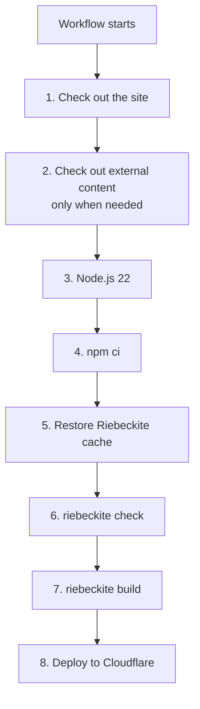
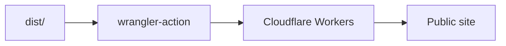
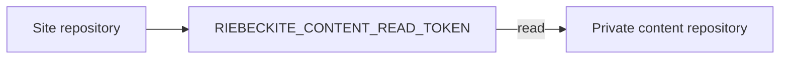
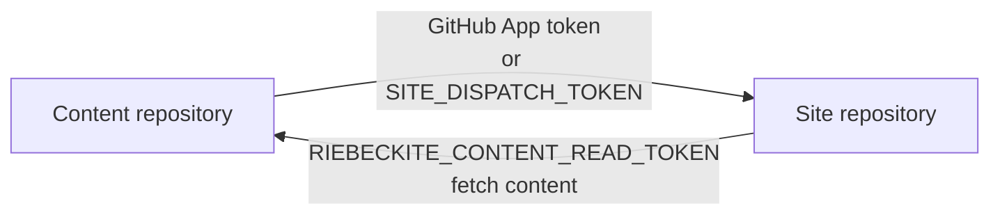

# Workflow

## How the workflow flows

The generated deployment workflow roughly processes in this order:



### 1. Check out the site repository

First the site repository is fetched.

```text
GitHub runner
    ↓
Site repository
```

This contains the Riebeckite config, the application, plugin/theme settings, `package.json`, and `package-lock.json`.

### 2. Check out external content

When the content is in the same repository, this extra step is not needed.

When you use a separate repository, the content repository is checked out into:

```text
content/
```

```text
Runner

Site repository
├─ app/
├─ riebeckite.config.ts
├─ package.json
└─ content/          ← external content repository
```

In that case Riebeckite can read it as:

```ts
content: {
  directory: "content",
},
```

### 3. Set up Node.js

The generated workflow sets up Node.js 22.

```text
GitHub runner
      ↓
Node.js 22
```

The subsequent dependency install and Riebeckite CLI run in this environment.

### 4. Install packages

It runs:

```sh
if [ -f package-lock.json ]; then npm ci; else npm install; fi
```

When `package-lock.json` is committed, `npm ci` installs exactly that lockfile. Without one, the workflow falls back to `npm install` instead of failing.

### 5. Restore Riebeckite build state

The generated workflow restores everything incremental [[glossary/ssg|SSG]] needs between runs with a single `actions/cache` step:

- `.riebeckite/cache` — the Markdown and plugin processing cache
- `.riebeckite/build/content-state.json` — incremental build state
- `.riebeckite/ssg-output-cache.json` and `.riebeckite/ssg-output-cache.entries` — the SSG output cache (rendered routes and files, plus their entry blobs)
- `.riebeckite/ssg-output-cache.fast-path.json` — the no-change fast-path validation sidecar

The cache key is scoped by the runner OS, the Node.js version, the `package-lock.json` hash, and the `riebeckite.config.ts` hash, then saved under a per-run generation:

```text
riebeckite-build-v2-<os>-node<node>-<lockfile hash>-<config hash>-<run id>-<run attempt>
```

`restore-keys` fall back to the newest compatible generation in two steps: first a generation with the same lockfile and config hashes, then one with the same lockfile hash. The lockfile hash covers the installed Riebeckite version and the config hash covers preset and plugin settings, so changing either starts a new cache lineage, while Riebeckite's own fingerprint checks (schema version, app/pipeline/content fingerprints, plugin `cacheVersion`) decide the actual reuse. An entry is never overwritten in place: each run saves a new generation and GitHub evicts old ones automatically. Caches are not shared across operating systems or Node.js versions, so a different environment starts cold instead of reusing an incompatible entry. `dist/` is not cached.

When Riebeckite rejects a restored output cache — a missing or malformed cache, a changed application fingerprint, an `unknown` output dependency, a full-regeneration reason, or an output without a cached entry — it renders every output and rewrites `dist/` from scratch, so a stale or partial cache never reaches the deployment. A cache miss is safe and simply performs a cold build.

After the build, a new cache generation is saved automatically. The `hits`, `misses`, and `bypasses` on the build log's `Persistent content cache` line show whether Riebeckite reused content processing, and the `SSG outputs` line's `rendered`, `reused`, and `removed` counts show whether it reused rendered outputs. Deleting `.riebeckite/` or removing the workflow's cache step makes the next run cold, but does not affect output correctness. To keep the content cache but skip the output-cache transfer, remove the three `.riebeckite/ssg-output-cache*` paths from the cache step; the next run re-renders every output. The workflow also prints the restored and saved cache sizes so you can watch the transfer cost. If saving the cache fails or is skipped, the deploy still runs.

### 6. Validate the site

Then it runs:

```sh
npm exec riebeckite check
```

If config or plugin resolution has a problem, it fails here before deploying.

```text
Checkout
   ↓
Install
   ↓
check
   ↓
stop if there is a problem
```

This is a guard against deploying a broken configuration.

### 7. Build the site

Once `check` succeeds, it runs:

```sh
npm exec riebeckite build
```

Riebeckite generates the publishable:

```text
dist/
```

```text
Content
Config
Plugin
Theme
   ↓
riebeckite build
   ↓
dist/
```

### 8. Deploy to Cloudflare Workers

Finally it deploys to Cloudflare Workers using:

```text
cloudflare/wrangler-action@v3
```



Here:

```text
CLOUDFLARE_API_TOKEN   (secret)
CLOUDFLARE_ACCOUNT_ID  (Actions variable)
```

are used. The workflow reads the account ID from `vars.CLOUDFLARE_ACCOUNT_ID`, falling back to `secrets.CLOUDFLARE_ACCOUNT_ID` for repositories that already stored it as a secret.

## Publication state

The workflow stores the last successful publication snapshot on a dedicated `publication-state` branch, not on `main`. Before the build it copies that branch's `state.json` into the runner's temporary directory and points `RIEBECKITE_PUBLICATION_STATE` there. After a successful deploy it pushes one commit to the branch; a failed deploy writes nothing. The source branch is never advanced by the workflow, so your next `git push` does not need a pull or rebase. Do not merge `publication-state` into a development branch. If you migrate from an older workflow that committed `publication/state.json`, see [Publication workflow](../publication-workflow.md).

## Using a private content repository

Checkout authentication differs between a public and a private content repository.

To read a private content repository, set this on the site repository:

```text
RIEBECKITE_CONTENT_READ_TOKEN
```



This token's role is **to read the private content repository from the site's workflow**.

## Do not confuse the two tokens

In a split layout, two similarly named credentials appear.

| Credential | Where to store it | Role |
| --- | --- | --- |
| `RIEBECKITE_CONTENT_READ_TOKEN` | Site repository | Read the private content repository |
| `RIEBECKITE_APP_ID` + `RIEBECKITE_APP_PRIVATE_KEY` | Content repository | Mint a short-lived token that dispatches to the site |
| `SITE_DISPATCH_TOKEN` (fallback) | Content repository | Notify the site repository without a GitHub App |

It helps to think in terms of direction.

```text
RIEBECKITE_CONTENT_READ_TOKEN

Site ─────read─────> Content
```

```text
RIEBECKITE_APP_ID + RIEBECKITE_APP_PRIVATE_KEY
(or SITE_DISPATCH_TOKEN)

Content ───notify───> Site
```

That is:



## Site pushes vs. content pushes

With separate repositories there are two deployment paths.

### When you change the site

```text
Site repository
      ↓
push to main
      ↓
publish.yml
      ↓
check out content
      ↓
Build
      ↓
Deploy
```

The site's `push` starts the workflow directly.

### When you change the content

```text
Content repository
      ↓
push to main
      ↓
notify-site.yml
      ↓
repository_dispatch
      ↓
Site publish.yml
      ↓
check out content
      ↓
Build
      ↓
Deploy
```

Here one extra step — the notification from the content repository to the site repository — is added.

In both cases, the build ultimately runs **on the site repository side**.

## Running the deploy workflow manually

The generated workflow also supports:

```text
workflow_dispatch
```

so you can run the workflow manually from GitHub.

```text
GitHub
  ↓
Actions
  ↓
Deploy workflow
  ↓
Run workflow
```

This is useful when you want to deploy the current state again without making a new commit to the content or site.
