# コンテンツとサイトを分離する（詳細編）

[コンテンツとサイトを分ける](../content-repositories.ja.md) では、別リポジトリで運用する流れを順を追って説明しました。このページはその詳細編です。なぜこの設定で動くのかを説明し、後で必要になるルート解決、アセットのコピー、CI の認証、サブモジュールの運用まで扱います。

初めて分離構成を作る場合は、先に [コンテンツとサイトを分ける](../content-repositories.ja.md) を読んでください。仕組みを理解したいときや、運用で問題が起きたときに、このページに戻ってくるとよいでしょう。

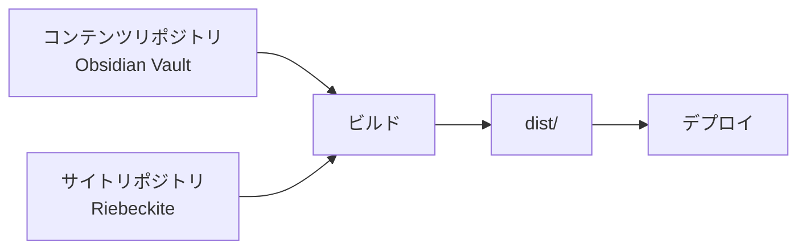

**コンテンツの保存場所と Riebeckite アプリケーションは、別々の場所に置けます。**

## 1. なぜサイトの外に置いてもうまくいくのか

`riebeckite.config.ts` の `content.directory` は、次のルールで解決されます。

| 名前 | 役割 | 既定値 / 解決の基準 |
| --- | --- | --- |
| `appRoot` | HonoX/Vite アプリケーション。`app/`、`public/`、ルート、生成されるスタイル、ビルド出力を管理する | Vite の `root` |
| `configRoot` | `riebeckite.config.ts` を含むディレクトリ | `appRoot` |
| `contentRoot` | 設定したコンテンツディレクトリ、または Obsidian Vault のファイルシステム上の絶対ルート | `path.resolve(appRoot, content.directory)` |

ここで押さえたいのは、相対パスの `content.directory` が常に `appRoot` を基準に解決され、`configRoot` や作業ディレクトリが変わっても基準が動かないことです。統合側はコンテンツやプラグインを実行する前に3つのルートを解決し、CLI も同じ結果を使います。そのため、入れ子のディレクトリから実行しても、CI の作業ディレクトリから実行しても、エディタのタスクから実行しても、同じ Vault を読みます。

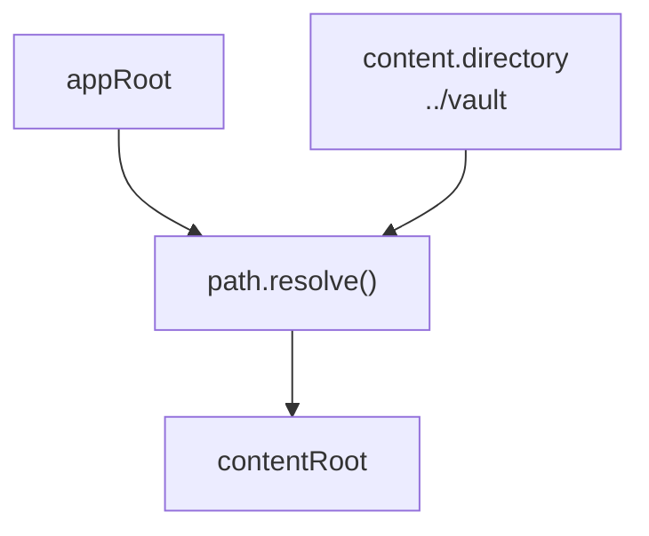

```ts
// site/riebeckite.config.ts
export default defineConfig({
  content: {
    directory: "../vault", // relative to appRoot
  },
});
```

この値は `process.cwd()` から組み立てないでください。`appRoot` を Vault に向けるのも避けます。Vault はソースデータであり、Vite アプリケーションのルートはサイトのままにします。

### 1-1. ルートはどの順番で決まるか

順番を追うと、よくあるつまずきどころが見えてきます。

1. **CLI** は作業ディレクトリから親方向へ `riebeckite.config.ts` / `.js` / `.mjs` を探します。最初に見つかったファイルのディレクトリが `configRoot` です。見つからなければ `Could not find riebeckite.config.*` で失敗します。
2. **appRoot** は `configRoot` の下を走査して `vite.config.ts` / `.js` / `.mjs` を探して決まります（`node_modules`、`.git`、`tests` は除外）。見つからなくても、複数見つかってもエラーです。
3. **contentRoot** は `path.resolve(appRoot, content.directory)` で解決します。`directory` が絶対パスでも、ここでたどり着く値は同じです。

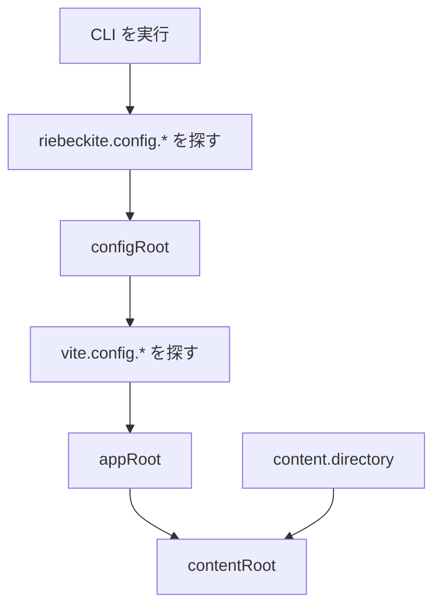

`riebeckite.config.ts` を意図的に Vite アプリケーションの外に置く場合は、`riebeckiteVite()` に `configRoot` と `appRoot` を渡してください。どちらの場合も、相対 `content.directory` の基準は `appRoot` のままです。

つまり、「どこから実行しても同じ Vault を読む」というのは、設定がサイトの中（またはその親）にあり、`appRoot` が一意に決まる場合に限り成り立ちます。関係のないディレクトリから実行すれば設定ファイル自体が見つかりませんし、`vite.config.*` が複数あるモノレポでは `Found multiple Vite applications` で失敗します。どちらも、どのサイトの設定を使うべきかをツールが特定できなかった、という意味です。

### 1-2. アプリケーション側からコンテンツを読む

統合側は、解決済みの設定と利用可能な `ContentManager` を、フレームワーク側が管理するモジュールとして公開しています。アプリケーションのコードは `riebeckite.config.ts` を読み直すのではなく、これらを import します。

```ts
import { config } from "virtual:riebeckite/config";
import { content } from "virtual:riebeckite/content";
```

`config.content.directory` はすでに絶対パスです。これを別の基準で解決し直すのが、よくある不具合の原因になります。Vite の外で動くスクリプトでは、`@riebeckite/honox/runtime` の `resolveHonoxConfig` を使えば同じ値を解決できます。

### 1-3. やってはいけないこと

- `content.directory` を `process.cwd()` から組み立てる。実行場所によって結果が変わります。
- `appRoot`（Vite の `root`）を Vault に向ける。サイトの `app/`、`public/`、ビルド出力まで移動してしまいます。
- 相対 `directory` が `configRoot` 基準だと思う。基準は常に `appRoot` です。

判断の目安は次のとおりです。

```text
使わない
  → process.cwd()

基準
  → appRoot
```

## 2. 3つの構成から選ぶ

| 構成 | レイアウト | 選ぶ条件 | デプロイ時の注意 |
| --- | --- | --- | --- |
| A. 1つのリポジトリにまとめる | サイトと記事を1つの Git リポジトリに置く（`content/` を使う） | 個人ブログを1つのリポジトリで管理したい | 追加の設定は不要 |
| B. 1つのリポジトリでフォルダを分ける | `site/` と `vault/` を同じリポジトリに並べる | 履歴は共有したいが、場所は分けたい | サイト側で `content.directory: "../vault"` を設定する |
| C. リポジトリを分ける（推奨） | 記事は非公開、サイトは公開 | 記事を非公開にしたい、更新を切り離したい | CI で記事リポジトリを取得する設定が必要 |

### 2-1. A: 1つのリポジトリにまとめる

```text
blog/
├─ riebeckite.config.ts     ← appRoot (directory: "content")
├─ app/
├─ public/
└─ content/                 ← articles live here
   └─ index.md
```

最も単純な構成で、`create-riebeckite` が生成するのもこの形です。記事の公開範囲はリポジトリの公開範囲と同じになります。

### 2-2. B: 1つのリポジトリでフォルダを分ける

```text
notes-repo/
├─ site/                ← appRoot (contains riebeckite.config.ts)
│  └─ riebeckite.config.ts
└─ vault/               ← referenced by directory: "../vault"
```

リポジトリも履歴も1つで、置き場所だけを分けます。公開範囲は A と同じくリポジトリ単位のままです。A との違いは `content.directory: "../vault"` だけです。

### 2-3. 1つの Vault を複数のサイトで共有する

C の応用です。Vault を独立した場所に置き、複数のサイトから参照します。

```text
workspace/
├─ notes/           ← shared vault (its own private repository)
├─ blog/            ← site 1 (directory: "../notes")
└─ docs/            ← site 2 (directory: "../notes")
```

Vault は読み取り専用のソースデータとして扱い、`exclude`、`publishStrategy`、プラグインはサイトごとに変えます。どのサイトも Vault に書き戻さないため、同じノートを異なる形で公開できます。各サイトは個別にデプロイし、それぞれの CI に 3-2 で説明する追加チェックアウトを設定してください。

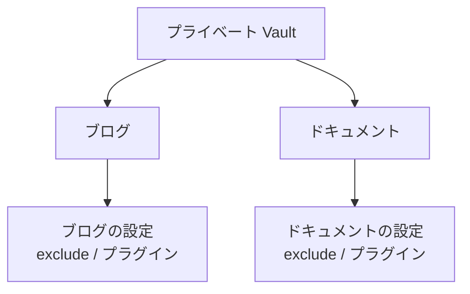

各サイトは `exclude`、`publishStrategy`、プラグイン、テーマ、デプロイを独立して設定できます。そのため、同じノートでもサイトごとに公開範囲や見せ方を変えられます。

### 2-4. どの構成を選ぶか

1. 記事を非公開にしたい、更新を切り離したい → **C**。
2. 記事とサイトの公開範囲が同じで構わない → 次へ。
3. 場所と設定だけを分けたい → **B**。1つのリポジトリにまとめたい → **A**。
4. 1つの Vault を複数のサイトで使いたい → **C + Vault の共有**（2-3）。

## 3. C: リポジトリを分ける場合の詳細

基本的な流れは [コンテンツとサイトを分ける](../content-repositories.ja.md) にあります。ここでは、その手順では触れていない点を補います。

### 3-1. Vault をプライベートリポジトリに置く

- `git init` の後、最初の push より前に GitHub に**プライベート**リポジトリを作ります。
- `.obsidian/` は Obsidian が Vault を開いたときに生成されます。push してしまっても、`content.exclude` に `.obsidian/**` を入れればサイトのビルドには含まれません。Git で追跡したくない場合は、`.obsidian/workspace*.json` だけを gitignore する折衷案もあります。
- 非公開ノートの基本は `publish: true` を付けないことです。さらに、`content.exclude` で非公開フォルダ（例: `private/**`）を除外し、読み込み自体を防ぐ二重の対策を取ります。
- `publishStrategy` は既定の `explicit` のままにします。`selective` は「ほぼすべてを公開し、例外だけ隠す」モデルで、非公開の Vault ではリスクが高くなります。

### 3-2. コンテンツの取得とデプロイの起動は別に考える

`--github-actions` で生成される既定のデプロイワークフローは、**サイトリポジトリだけ**をチェックアウトします。

**方法1: 追加チェックアウトと repository dispatch を組み合わせる（自動デプロイならこちらを推奨）**

```yaml
- name: Check out the site
  uses: actions/checkout@v4

- name: Check out the notes
  uses: actions/checkout@v4
  with:
    repository: <you>/notes
    token: ${{ secrets.RIEBECKITE_CONTENT_READ_TOKEN || github.token }}
    path: content
```

- `path: content` にしたら、`content.directory` は `"content"` にします。
- このチェックアウトでは、サイトのワークフローが始まった後にしかファイルを利用できません。サイトのワークフローに `repository_dispatch: types: [content-updated]` を追加し、コンテンツリポジトリ側には、`main` への push でサイトのワークフローを起動する通知ワークフローを置きます。
- 記事の更新で既定ブランチの最新コンテンツをデプロイしたい場合は、`ref` を指定しないでください。チェックアウトはその時点の先頭を読みます。既定の `fetch-depth: 1` で十分です。

コンテンツのチェックアウトとデプロイの起動は、別の話です。

```text
コンテンツリポジトリをチェックアウトする
        ≠
コンテンツが更新されたらビルドを開始する
```

チェックアウトは、ワークフローが始まった後にコンテンツを読めるようにするだけです。コンテンツリポジトリへの push でサイトも自動デプロイしたいなら、**サイトのワークフローを起動する**仕組みが別に必要です。

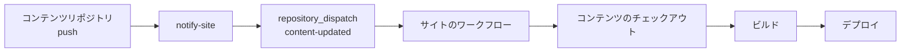

追加チェックアウトで `ref` を固定しなければ、コンテンツリポジトリの既定ブランチの最新状態を取得します。記事の更新をそのままサイトに反映したい場合に便利です。

```text
コンテンツの main
   ↓
push
   ↓
サイトのワークフロー
   ↓
その時点の最新コンテンツ
```

既定の `fetch-depth: 1` で足ります。サイトが使うコンテンツのコミットを厳密に固定したい場合は、Git サブモジュールを使ってください。

**方法2: Git サブモジュールを使う**

```sh
cd my-site
git submodule add git@github.com:<you>/notes.git content
```

- `content` は記事リポジトリへのリンクになります。`riebeckite.config.ts` の `directory` は `content` に合わせます。
- ワークフローの `actions/checkout@v4` に `submodules: recursive` を追加し、CI が依存先を取得するようにします。
- サブモジュールが参照するコミットは**サイトリポジトリに記録されます**。記事を更新するには、サイト側で参照を更新し、コミットして push するという2段階の操作が必要です。

```sh
cd content && git pull
cd ..
git add content
git commit -m "update articles"
```

`git submodule update --remote` を使えばリモートの最新に追従できますが、サイト側のコミットはやはり必要です。

**2つの方法を比べる**

| 観点 | 方法1（追加チェックアウト） | 方法2（サブモジュール） |
| --- | --- | --- |
| 記事の push で自動デプロイ | repository dispatch を設定すれば可能 | 不可（参照を更新する必要がある） |
| 取得先 | `path: content`、`directory: "content"` | `directory: "content"` に固定 |
| 履歴の固定 | ブランチの先頭に追従する | 特定のコミットを固定できる |
| ローカルでの操作 | 通常の clone で済むことが多い | `submodule update` が必要 |
| 向いているケース | 記事の更新が中心のワークフロー | 記事のリビジョンをサイト側で固定したい場合 |

記事の更新が多いなら方法1が扱いやすく、サイト側で履歴を固定したいなら方法2が向いています。

### 3-3. CI からプライベートリポジトリを読むための認証

- `github.token` の権限は現在のリポジトリに限定されます。別の**公開** GitHub リポジトリは読めますが、別のプライベートまたは内部リポジトリは読めません。
- Vault がプライベートまたは内部にある場合は、サイトリポジトリに `RIEBECKITE_CONTENT_READ_TOKEN` を登録します。Vault だけに権限を絞った fine-grained PAT に **Contents: read** を付けるか、同等の読み取り専用 GitHub App インストールトークンを使います。
- コンテンツ側の通知には、コンテンツリポジトリだけに保存する `SITE_DISPATCH_TOKEN` が別に必要です。fine-grained PAT はサイトリポジトリだけに絞って **Contents: read and write** を付けてください。クラシック PAT では `repo` スコープ、GitHub App トークンでは **Contents: write** が必要です。
- サブモジュールを SSH URL（`git@github.com:...`）で追加した場合、CI には SSH キーが必要です。HTTPS URL に切り替えて `token:` を渡すほうが設定は簡単です。

読み取りトークンと dispatch トークンは、使う向きが逆です。

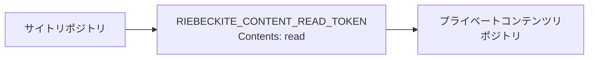

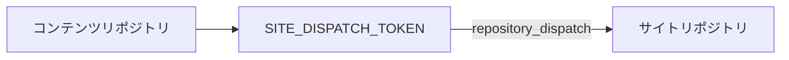

```text
RIEBECKITE_CONTENT_READ_TOKEN
  → サイトからプライベートコンテンツを読む

SITE_DISPATCH_TOKEN
  → コンテンツリポジトリからサイトのワークフローを起動する
```

PAT は [GitHub の Settings → Developer settings → Personal access tokens](https://github.com/settings/tokens) で作成し、各リポジトリの **Settings → Secrets and variables → Actions** に値を登録します。

```yaml
- name: Check out the notes
  uses: actions/checkout@v4
  with:
    repository: <you>/notes
    token: ${{ secrets.NOTES_READ_TOKEN }}
    path: notes
```

### 3-4. ローカルと CI でディレクトリ構成を揃える

相対 `directory` は `appRoot` 基準なので、ローカルと CI で構成が違えば解決先も変わります。

| 環境 | 配置 | `directory` |
| --- | --- | --- |
| ローカル（並列） | `workspace/notes` と `workspace/my-site` | `"../notes"` |
| CI（追加チェックアウト） | `my-site/notes` | `"notes"` |
| サブモジュール | `my-site/content` | `"content"` |

ローカルでは `../notes`、CI では `notes` と値を変えれば、どちらも同じ Vault を指します。1つの値に統一したい場合は、ローカルでも Vault を `my-site` の下に置くか、CI 側で `../notes` になるように配置してください。

## 4. 公開ルールとアセットをどう扱うか

### 4-1. 公開するかどうかは何で決まるか

`content.filters.publishStrategy` は2つの値を取ります。

| 値 | 公開される条件 | 意味 |
| --- | --- | --- |
| `explicit`（既定） | frontmatter の `publish` が `true` | 公開を明示したノートだけ |
| `selective` | `private` と `draft` のどちらも `true` でない | 非公開を明示したノート以外すべて |

公開判定は `isPublished` / `isPublishable` に集約されており、ノートのレンダリング、診断、prebuild でのアセット収集はすべて同じルールを使います。サイト側で公開判定を独自に実装しないでください。「プレビューでは見えるのに本番には出ない」という食い違いは、そこから生まれます。

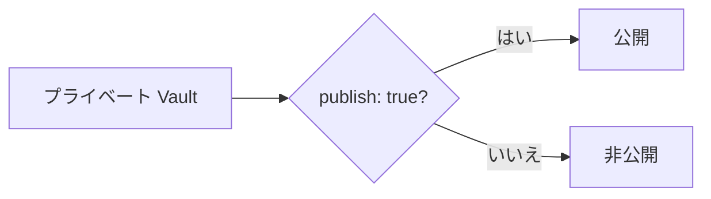

プライベート Vault では、既定の `explicit` が最も考えやすいモデルです。

### 4-2. `exclude` はどう書くか

`exclude` は `contentRoot` からの相対パス（`/` 区切りに正規化）に対して glob パターンを照合します。パターンが**パス全体にアンカーされる**点に注意してください。

| パターン | 一致する | 一致しない |
| --- | --- | --- |
| `.obsidian/**` | `.obsidian/app.json` | `notes/.obsidian/app.json` |
| `**/.obsidian/**` | 上記の両方 | — |
| `Templates/**` | `Templates/daily.md` | `notes/Templates/daily.md` |
| `**/Templates/**` | 上記の両方 | — |
| `private/**` | `private/secret.md` | `notes/private/secret.md` |

`*` は1つのセグメント内にとどまり、`**` はセグメントをまたぎます。同名のフォルダがサブフォルダにも現れる可能性があるなら、`**/` を付けると安全です。スキャフォールドの既定値が `**/templates/**` と `**/private/**` になっているのはそのためです。

`exclude` は読み込み前に絞り込むため、除外されたノートはリンク解決やグラフに現れません。非公開にしたいノートは、`publish: true` を付けないことに加えて、可能ならフォルダごと除外してください。

### 4-3. コンテンツ画像と添付ファイルは公開のされ方が違う

Vault 内のファイルは3種類に分かれ、それぞれ公開する主体が異なります。

| 種類 | 対象 | 公開 URL | 公開する主体 |
| --- | --- | --- | --- |
| コンテンツ画像 | 画像（`png`、`jpg`、`svg` など） | `/<Vault からの相対論理パス>` | ビルド（生成物として出力） |
| 添付ファイル / メディア | Markdown でも画像でもないファイル | `/assets/attachments/<Vault からの相対論理パス>` | サイト側の prebuild 手順 |
| 静的アセット | サイトアプリケーションが管理するファイル | `/` 以下の任意の場所 | Vite の `public/` ディレクトリ |

コンテンツ画像については、サイト側で何もする必要がありません。`obsidianMarkdown()` が公開ページから参照されている画像を、論理パスを保ったままビルド出力に書き出します。開発サーバーも同じ論理パスでコンテンツから直接配信します。どこからも参照されていない画像や、非公開ページだけから参照されている画像は書き出されません。

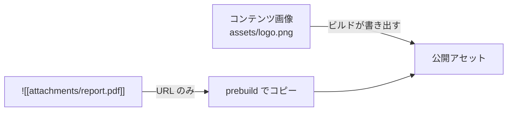

添付ファイルとメディアは別です。次のような埋め込みは、

```md
![[attachments/report.pdf]]
```

URL を生成しますが、**ファイル自体は公開ディレクトリにコピーされません**。サイト側に、公開するファイルだけをコピーする prebuild 手順を追加してください。参照実装は `apps/web/scripts/build_images.ts` です（`prebuild` スクリプトから `tsx scripts/build_images.ts` として呼び出し、`public/assets/attachments/` へコピーします）。

この実装の流れは次のとおりです。

1. `contentRoot` を走査して、画像（`IMAGE_EXTENSIONS`）と添付ファイル（`isAttachmentPath`）を列挙します。
2. `ContentManager` でコンテンツをビルドし、公開ノートから参照されているアセットだけを集めます。参照元はリンクと、レンダリング後の HTML にある `src` / `href` です。
3. 参照されたアセットだけを `public/assets/attachments/<Vault からの相対パス>` にコピーします（画像は `public/<相対パス>` にコピーし、初回ビルド前でも開発サーバーが配信できるようにします）。サイズと mtime が変わっていなければコピーを省略します。
4. 公開ディレクトリにだけ存在し、コンテンツにない孤立した添付ファイルを削除します。

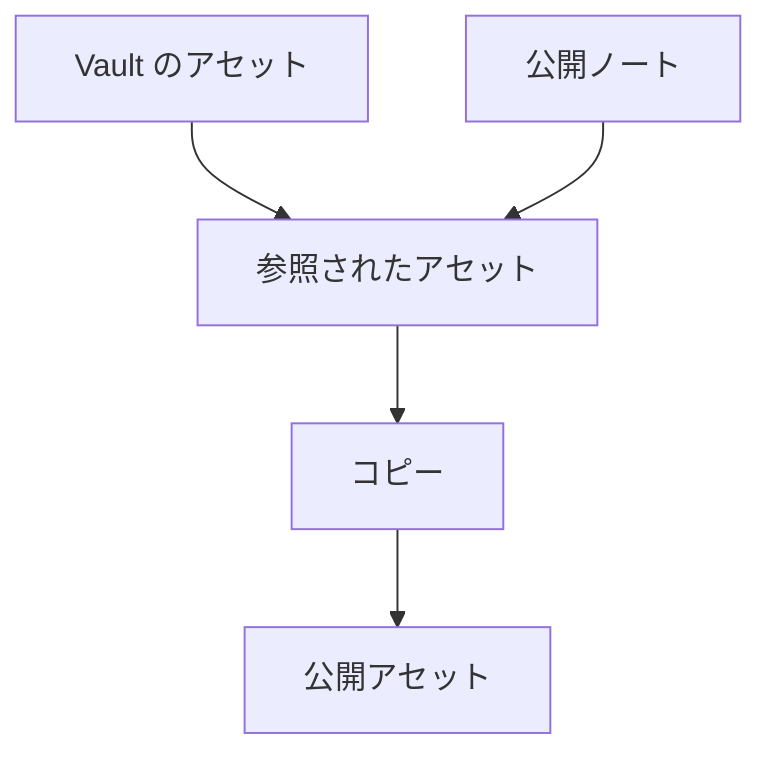

要するに、「Vault にあるからコピーする」のではなく、「**公開ノートが参照しているからコピーする**」というルールです。Vault 全体をコピーする近道は取らないでください。非公開ノート、非公開ページだけから参照される画像、未参照の添付ファイル、`.obsidian` のメタデータが漏れる恐れがあります。コンテンツ画像はビルドがすでに絞り込んで出力します。添付ファイルとメディアの公開はサイトアプリケーションの責任なので、**公開**ノートが参照するファイルだけをコピーします。公開ノートが非公開ノートへリンクして境界を越えていないか確認するには、`@riebeckite/plugin-diagnostics` の `riebeckite-diagnostics` を実行してください。該当する参照を `publish-boundary` 警告として報告します。`runDiagnostics()` を使えば、同じ結果をプログラムから取得できます。詳しくは [診断](../../plugins/diagnostics.ja.md) を参照してください。

### 4-4. 生成される URL

コンテンツ画像は Vault からの論理パスをそのまま保ちます。

```text
Vault:
assets/logo.png

公開 URL:
/assets/logo.png
```

添付ファイルとメディアには専用のプレフィックスを付けるため、同名のファイルと画像が衝突しません。

```text
/assets/attachments/<Vault からの相対論理パス>
```

たとえば、次のようになります。

```text
Vault:
attachments/report.pdf

公開 URL:
/assets/attachments/attachments/report.pdf
```

- `attachment()` は解決済みの Vault ルートから埋め込みファイルのサイズを読み、ルート外のパスは拒否します。
- `media()` は同じ論理パスに対応する音声・動画を描画します。

`public/` 下の実際の配置と公開 URL を一致させておくと、ビルド後の 404 を減らせます。

### 4-5. リポジトリの公開範囲と公開境界は別物

リポジトリをプライベートにすることと、Riebeckite が何を公開するかは別の話です。

```text
リポジトリの公開範囲
  → Git リポジトリを誰が読めるか

Riebeckite の公開
  → サイトに何が出るか
```

プライベート Vault でも、非公開情報を公開出力にコピーするビルドをすれば、それは公開されたことになります。次の3つを揃えてください。

```text
exclude
      +
publishStrategy
      +
公開ノートだけを対象にしたアセットコピー
```

特に、Vault 全体を `public/` にコピーしないでください。prebuild のコピーが参照済みアセットだけを選ぶ仕組みは [4-3](#4-3-コンテンツ画像と添付ファイルは公開のされ方が違う) で説明しています。

## 5. ビルド前にルートと公開境界を検証する

ルートと公開境界は、ビルド前に CLI で確認できます。作業ディレクトリに依存しないことは、入れ子のディレクトリから実行すると確かめられます。

```sh
cd site/app
npm exec riebeckite check
npm exec riebeckite doctor
npm exec riebeckite inspect config
npm exec -- riebeckite inspect content --list
npm exec riebeckite inspect graph
npm exec riebeckite build
```

結果は次の順に確認します。

1. `check` は設定とプラグインの取り決めを検証します。
2. `doctor` は読み取れない、または不正なファイルシステムのコンテンツソースを報告します。
3. `inspect config` では、`Directory` が解決済みの絶対パス、`Publishing` が `publishStrategy`、`Exclude` がパターン数です。まずここで、Vault がどこを指しているかを確定させます。
4. WikiLink や埋め込みを調べる前に、`inspect content --list` で期待する論理パスが読み込まれているか確認します。
5. `inspect graph` で、除外したノートがノードとして現れていないか確認します。
6. `build` は統合とルートのレンダリングを検証します。

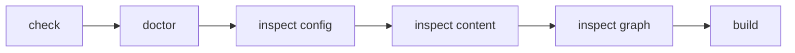

### 5-1. 作業ディレクトリに依存しないことを確かめる

ルート解決の問題を調べるときは、サイトのルートだけでなく、入れ子のディレクトリからも CLI を実行します。

```sh
cd site/app

npm exec riebeckite inspect config
npm exec -- riebeckite inspect content --list
```

どちらも同じアプリケーションと Vault を解決するはずです。関係のないディレクトリから実行すると、設定ファイル自体が見つからないことがあります。

## 6. 症状から原因を切り分ける

| 症状 | 対処 |
| --- | --- |
| 記事が表示されない | `publish: true`、`exclude` のパターン、`inspect content --list` を確認する |
| `doctor` がソースの問題を報告する | `inspect config` で解決済みディレクトリを確認し、相対 `directory` を基準（`appRoot`）と照らし合わせる |
| `Could not find riebeckite.config.*` | サイトの外から実行していないか確認する。CLI は親ディレクトリをたどって設定を探す |
| `Found multiple Vite applications` | `vite.config.*` が複数ある。対象のサイトを絞るか、`riebeckiteVite()` に `appRoot` / `configRoot` を渡す |
| CI のビルドで Vault が見つからない | ワークフローに追加チェックアウト、または `submodules: recursive` があるか確認する |
| `github.token` で解決できないプライベートリポジトリ（別ホストなど） | 専用のシークレット（PAT など）を `token:` で渡しているか確認する |
| CI でサブモジュールが取得されない | `actions/checkout@v4` に `submodules: recursive` があり、SSH URL ならキーが利用できるか確認する |
| サブモジュールの記事が更新されない | サイト側で `cd content && git pull` → `git add content` → コミット → push を行う |
| デプロイ後に画像が 404 になる | 公開ページが画像を参照し、ビルド出力に含まれているか確認する |
| デプロイ後に添付ファイルやメディアが 404 になる | prebuild のコピーがビルド前に実行され、`public/assets/attachments/` を対象にしているか確認する |
| Vault に画像があるのにコピーされない | 参照元のノートが公開されているか（`publish: true`）、参照が `link.kind` として収集されているか確認する |
| ローカルでは動くが CI ではパスが違う | CI の作業ディレクトリと相対パスの基準（`appRoot`）を確認する。`../notes` と `notes` の違いはよくある原因 |
| 除外したフォルダが読み込まれる | パターンはパス全体にアンカーされるため、必要なら `**/` を付ける（4-2） |

### 6-1. パスの問題はどこを見るか

コンテンツが見つからないときは、「今どこからコマンドを実行しているか」ではなく、「Riebeckite がどの `appRoot` を解決したか」から確認します。

```sh
npm exec riebeckite inspect config
```

相対 `content.directory` の基準は常に `appRoot` です。

```text
process.cwd()
  ×

configRoot
  ×

appRoot
  ○
```

### 6-2. CI の問題は2つに分ける

まず、「ワークフローが起動しなかった」のか、「起動したがコンテンツがない」のかを切り分けます。

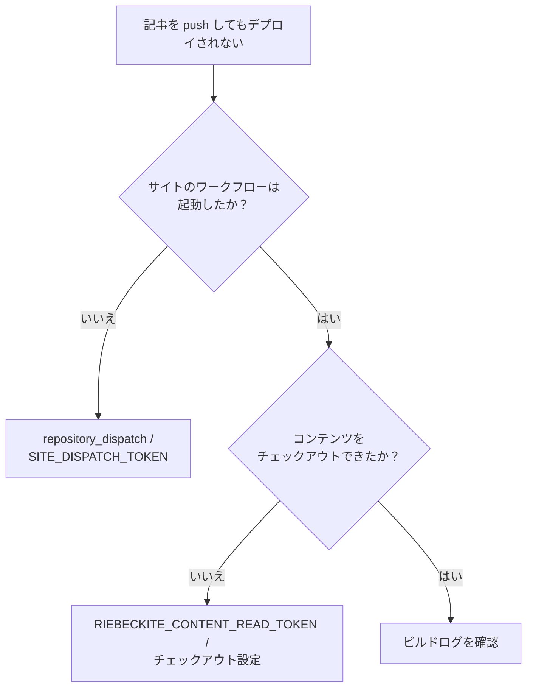

この2つは別の仕組みなので、どちらが失敗しているか切り分けてください。

## 7. 4つの境界に分けて整理する

コンテンツとサイトの分離は、次の4つの境界を分けて考えると整理しやすくなります。

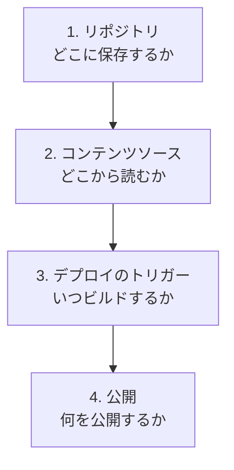

それぞれに対応する設定があります。

```text
リポジトリ
  → コンテンツとサイトをどこに保存するか

content.directory
  → Riebeckite がどこからコンテンツを読むか

checkout / repository_dispatch
  → CI がどう取得し、いつビルドするか

publishStrategy / exclude / アセットコピー
  → 公開サイトに何を出すか
```

特に、次の関係に注意してください。

```text
コンテンツリポジトリをプライベートにする
        ≠
公開境界が自動的に安全になる
```

プライベート Vault でも、`publishStrategy`、`exclude`、アセットコピーの3つで公開境界を維持してください。

## 関連資料

- [コンテンツとサイトを分ける](../content-repositories.ja.md)：手順を追った導入
- [設定](../../reference/configuration.ja.md)：ルート解決と外部 Vault の詳細
- [利用ガイド](../README.ja.md)：外部 Vault の例とアセット
- Cloudflare デプロイテンプレート：デプロイワークフローの詳細
