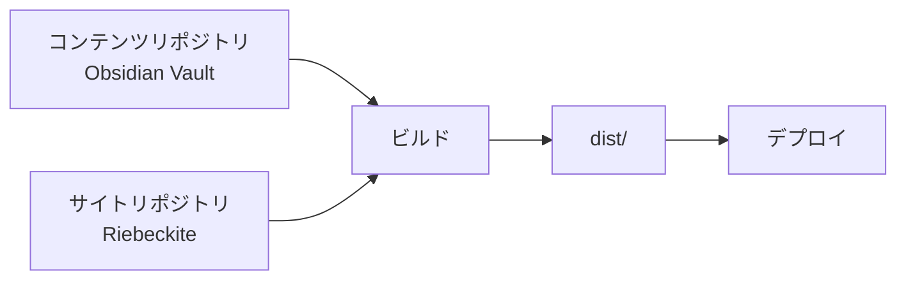

# コンテンツとサイトを分離する（詳細編）

[コンテンツとサイトを分ける](../content-repositories.ja.md) では、別リポジトリで運用する流れを順を追って説明しました。このページはその詳細編です。なぜこの設定で動くのかを説明し、後で必要になるルート解決、アセットのコピー、CI の認証、サブモジュールの運用まで扱います。

初めて分離構成を作る場合は、先に [コンテンツとサイトを分ける](../content-repositories.ja.md) を読んでください。仕組みを理解したいときや、運用で問題が起きたときに、このページに戻ってくるとよいでしょう。

**コンテンツの保存場所と Riebeckite アプリケーションは、分けて置けます。**

## このページの構成

- [仕組みと構成](./separate-content-repository/concepts.ja.md)
- [リポジトリ分離](./separate-content-repository/repository-split.ja.md)
- [公開ルールと検証](./separate-content-repository/publishing.ja.md)
- [トラブルシューティング](./separate-content-repository/troubleshooting.ja.md)

## 関連資料

- [コンテンツとサイトを分ける](../content-repositories.ja.md)：手順を追った導入
- [設定](../../reference/configuration.ja.md)：ルート解決と外部 Vault の詳細
- [利用ガイド](../README.ja.md)：外部 Vault の例とアセット
- Cloudflare デプロイテンプレート：デプロイワークフローの詳細
