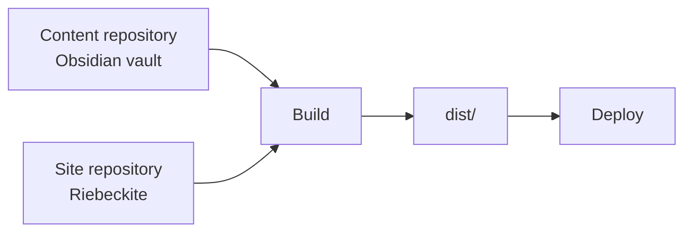

# Separating Content and the Site (In Depth)

[Separating Content from the Site](../content-repositories.md) explains separate-repository operation as a walkthrough. This page is its "in depth" companion: it explains **why the configuration works this way** and covers the cases you dig into later — root resolution, copying assets, authenticating CI, and running submodules.

If you are new, read [separating content from the site](../content-repositories.md) first, and use this page when you want to understand the mechanics or when operations go wrong.

**Content storage and the Riebeckite application can live in separate places.**

## In this section

- [How it works](./separate-content-repository/concepts.md)
- [Repository split](./separate-content-repository/repository-split.md)
- [Publication and verification](./separate-content-repository/publishing.md)
- [Troubleshooting](./separate-content-repository/troubleshooting.md)

## Further reading

- [Separating Content from the Site](../content-repositories.md) — a step-by-step introduction
- [Configuration](../../reference/configuration.md) — root resolution and external vaults in detail
- [Usage Guide](../README.md) — external vault examples and assets
- Cloudflare deploy template — deployment workflow details
