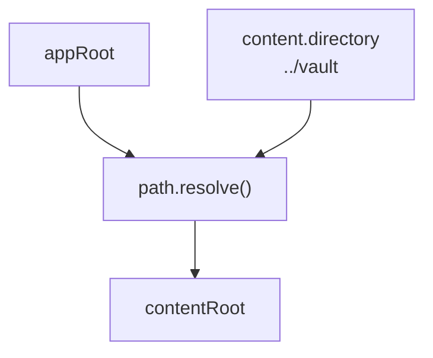
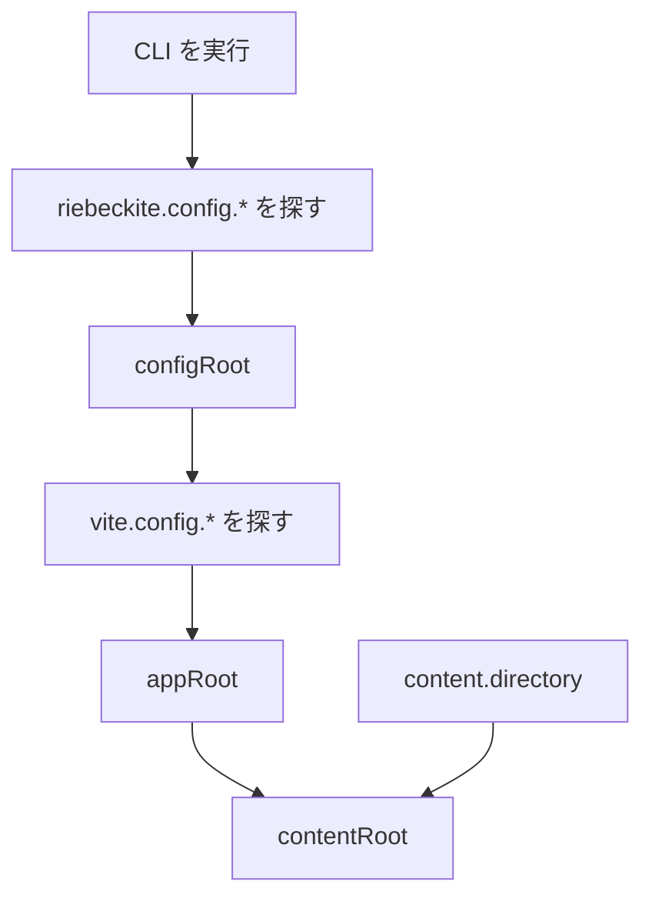
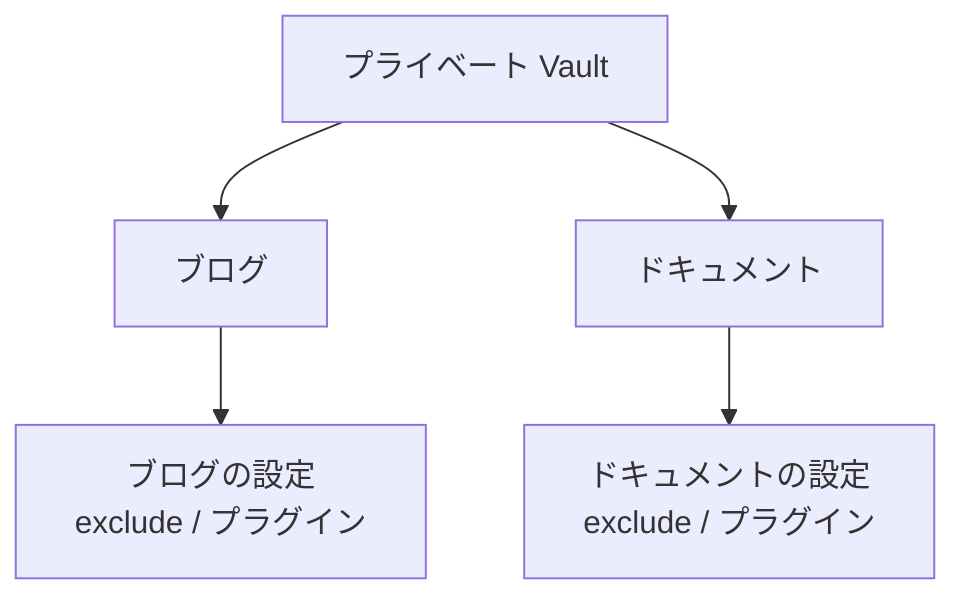

# 仕組みと構成

## 1. なぜサイトの外に置いてもうまくいくのか

`riebeckite.config.ts` の `content.directory` は、次のルールで解決されます。

| 名前 | 役割 | 既定値 / 解決の基準 |
| --- | --- | --- |
| `appRoot` | [[framework/honox-integration|HonoX]]/Vite アプリケーション。`app/`、`public/`、ルート、生成されるスタイル、ビルド出力を管理する | Vite の `root` |
| `configRoot` | `riebeckite.config.ts` を含むディレクトリ | `appRoot` |
| `contentRoot` | 設定したコンテンツディレクトリ、または [[glossary/obsidian-vault|Obsidian Vault]] のファイルシステム上の絶対ルート | `path.resolve(appRoot, content.directory)` |

ここで押さえたいのは、相対パスの `content.directory` が常に `appRoot` を基準に解決され、`configRoot` や作業ディレクトリが変わっても基準が動かないことです。統合側はコンテンツや[[glossary/plugin|プラグイン]]を実行する前に3つのルートを解決し、CLI も同じ結果を使います。そのため、入れ子のディレクトリから実行しても、CI の作業ディレクトリから実行しても、エディタのタスクから実行しても、同じ Vault を読みます。



```ts
// site/riebeckite.config.ts
export default defineConfig({
  content: {
    directory: "../vault", // relative to appRoot
  },
});
```

この値は `process.cwd()` から組み立てないでください。`appRoot` を Vault に向けるのも避けてください。Vault はソースデータであり、Vite アプリケーションのルートはサイトのままにします。

### 1-1. ルートはどの順番で決まるか

順番を追うと、よくあるつまずきどころが見えてきます。

1. **CLI** は作業ディレクトリから親方向へ `riebeckite.config.ts` / `.js` / `.mjs` を探します。最初に見つかったファイルのディレクトリが `configRoot` です。見つからなければ `Could not find riebeckite.config.*` で失敗します。
2. **appRoot** は `configRoot` の下を走査して `vite.config.ts` / `.js` / `.mjs` を探して決まります（`node_modules`、`.git`、`tests` は除外）。見つからなくても、複数見つかってもエラーです。
3. **contentRoot** は `path.resolve(appRoot, content.directory)` で解決します。`directory` が絶対パスでも、解決結果は同じです。



`riebeckite.config.ts` を意図的に Vite アプリケーションの外に置く場合は、`riebeckiteVite()` に `configRoot` と `appRoot` を渡してください。どちらの場合も、相対 `content.directory` の基準は `appRoot` のままです。

つまり、「どこから実行しても同じ Vault を読む」というのは、設定がサイトの中（またはその親）にあり、`appRoot` が一意に決まる場合に限り成り立ちます。関係のないディレクトリから実行すれば設定ファイル自体が見つかりませんし、`vite.config.*` が複数あるモノレポでは `Found multiple Vite applications` で失敗します。どちらも、どのサイトの設定を使うべきかをツールが特定できなかったという意味です。

### 1-2. アプリケーション側からコンテンツを読む

統合側は、解決済みの設定と、そのまま使える `ContentManager` を、フレームワーク側が管理するモジュールとして公開しています。アプリケーションのコードは `riebeckite.config.ts` を読み直すのではなく、これらを import します。

```ts
import { config } from "virtual:riebeckite/config";
import { content } from "virtual:riebeckite/content";
```

`config.content.directory` はすでに絶対パスです。これを別の基準で解決し直すのが、よくある不具合の原因になります。Vite の外で動くスクリプトでは、`@riebeckite/honox/runtime` の `resolveHonoxConfig` を使えば同じ値を解決できます。

### 1-3. やってはいけないこと

- `content.directory` を `process.cwd()` から組み立てる。実行場所によって結果が変わります。
- `appRoot`（Vite の `root`）を Vault に向ける。サイトの `app/`、`public/`、ビルド出力まで移動してしまいます。
- 相対 `directory` が `configRoot` 基準だと思う。基準は常に `appRoot` です。

判断の目安は次のとおりです。

```text
使わない
  → process.cwd()

基準
  → appRoot
```

## 2. 3つの構成から選ぶ

| 構成 | レイアウト | 選ぶ条件 | デプロイ時の注意 |
| --- | --- | --- | --- |
| A. 1つのリポジトリにまとめる | サイトと記事を1つの Git リポジトリに置く（`content/` を使う） | 個人ブログを1つのリポジトリで管理したい | 追加の設定は不要 |
| B. 1つのリポジトリでフォルダを分ける | `site/` と `vault/` を同じリポジトリに並べる | 履歴は共有したいが、場所は分けたい | サイト側で `content.directory: "../vault"` を設定する |
| C. リポジトリを分ける（推奨） | 記事は非公開、サイトは公開 | 記事を非公開にしたい、更新を切り離したい | CI で記事リポジトリを取得する設定が必要 |

### 2-1. A: 1つのリポジトリにまとめる

```text
blog/
├─ riebeckite.config.ts     ← appRoot (directory: "content")
├─ app/
├─ public/
└─ content/                 ← articles live here
   └─ index.md
```

最も単純な構成で、`create-riebeckite` が生成するのもこの形です。記事の[[glossary/visibility|公開範囲]]はリポジトリの公開範囲と同じになります。

### 2-2. B: 1つのリポジトリでフォルダを分ける

```text
notes-repo/
├─ site/                ← appRoot (contains riebeckite.config.ts)
│  └─ riebeckite.config.ts
└─ vault/               ← referenced by directory: "../vault"
```

リポジトリも履歴も1つで、置き場所だけを分けます。公開範囲は A と同じくリポジトリ単位のままです。A との違いは `content.directory: "../vault"` だけです。

### 2-3. 1つの Vault を複数のサイトで共有する

C の応用です。Vault を独立した場所に置き、複数のサイトから参照します。

```text
workspace/
├─ notes/           ← shared vault (its own private repository)
├─ blog/            ← site 1 (directory: "../notes")
└─ docs/            ← site 2 (directory: "../notes")
```

Vault は読み取り専用のソースデータとして扱い、`exclude`、`publishStrategy`、プラグインはサイトごとに変えます。どのサイトも Vault に書き戻さないため、同じノートを異なる形で公開できます。各サイトは個別にデプロイし、それぞれの CI に 3-2 で説明する追加チェックアウトを設定してください。



各サイトは `exclude`、`publishStrategy`、プラグイン、[[glossary/theme|テーマ]]、デプロイを独立して設定できます。そのため、同じノートでもサイトごとに公開範囲や見せ方を変えられます。

### 2-4. どの構成を選ぶか

1. 記事を非公開にしたい、更新を切り離したい → **C**。
2. 記事とサイトの公開範囲が同じで構わない → 次へ。
3. 場所と設定だけを分けたい → **B**。1つのリポジトリにまとめたい → **A**。
4. 1つの Vault を複数のサイトで使いたい → **C + Vault の共有**（2-3）。
