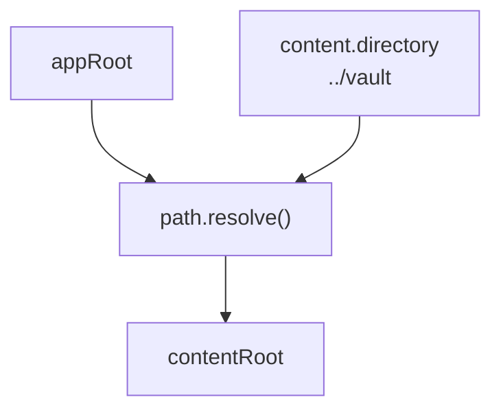
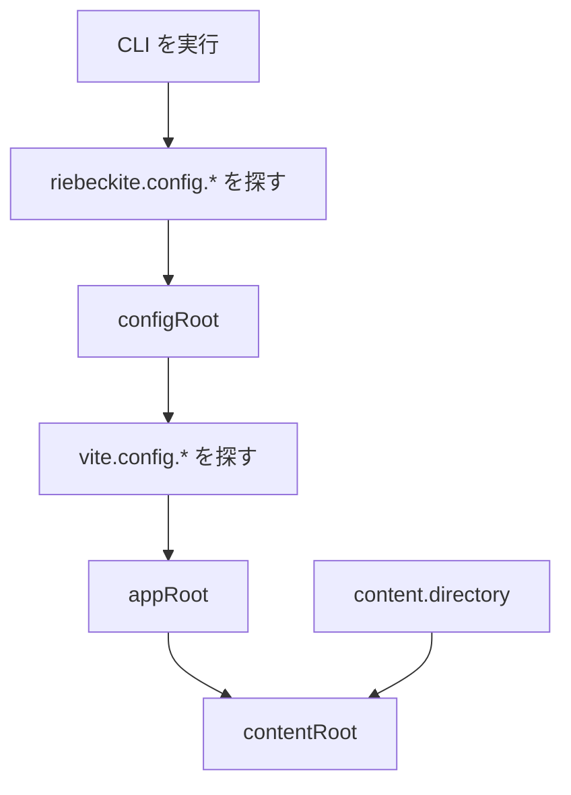
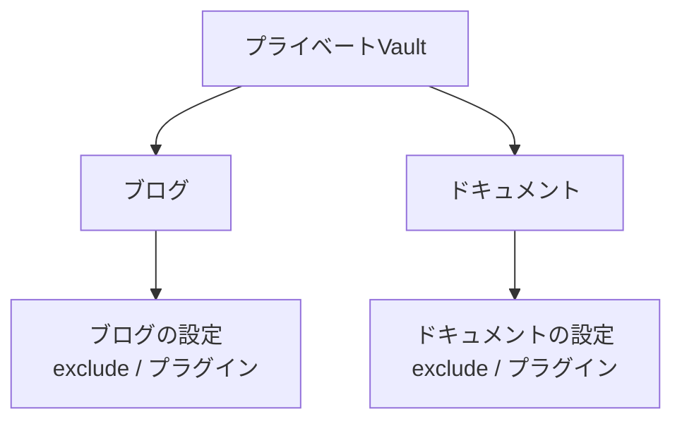

# 仕組み

## なぜサイトの外に置くとうまくいくのか

`riebeckite.config.ts` の `content.directory` は、次のルールで解決されます。

| 名前 | 役割 | 既定値 / 解決の基準 |
| --- | --- | --- |
| `appRoot` | [[framework/honox-integration|HonoX]]/Vite アプリケーション。`app/`、`public/`、ルート、生成されるスタイル、ビルド出力を管轄する | Vite の `root` |
| `configRoot` | `riebeckite.config.ts` を含むディレクトリ | `appRoot` |
| `contentRoot` | 設定したコンテンツディレクトリまたはObsidian Vaultのファイルシステム上の絶対ルート | `path.resolve(appRoot, content.directory)` |

重要なのは、相対パスの `content.directory` は常に `appRoot` を基準に解決され、`configRoot` や作業ディレクトリが変わっても基準が動かない点です。統合時はコンテンツやプラグインを実行する前に3つのルートを解決し、CLI も同じ結果を使います。そのため、少し子ディレクトリから実行しても、CI の作業ディレクトリから実行しても、エディタのタスクから実行しても、常に同じ Vault が読み込まれます。



```ts
// site/riebeckite.config.ts
export default defineConfig({
  content: {
    directory: "../vault", // relative to appRoot
  },
```

こ`process.cwd()` から値を組み立てないでください。`appRoot` をVault に向けないでください。Vault はソースデータであり、Vite アプリケーションのルートはサイトのままにします。

### ルートがどのように決まるか

頁を追うと、よくあるつまずきどころが見えてきます。

1. **CLI** は作業ディレクトリから親方向へ `riebeckite.config.ts` / `.js` / `.mjs` を探します。最初に見つかったファイルのディレクトリが `configRoot` です。見つからなければ `Could not find riebeckite.config.*` で失敗します。
2. **appRoot** は `configRoot` の下を走査して `vite.config.ts` / `.js` / `.mjs` を探して決まります！node_modules`、`.git`、`tests` は除外）。見つからなくても、見つかってもエラーです。
3. **contentRoot** は `path.resolve(appRoot, content.directory)` で解決します。`directory` が絶対パスでも、解決結果は同じです。



`riebeckite.config.ts` を意図的にViteアプリケーションの外に置く場合は、`riebeckiteVite()` に `configRoot` と `appRoot` を渡してください。どちらの場合も、相対 `content.directory` の基準は `appRoot` のままです。

つまり、「どこから実行しても同じVaultを読む」と成立するのは、設定がサイトの中(またはその親)にあり、`appRoot` が一意に決まる場合に限ります。関係のないディレクトリから実行すると設定ファイル自体が見つからず、`vite.config.*` が1つだけないモノレポでは `Found multiple Vite applications` で失敗します。どちらも、ツールがどのサイトの設定を使えばよいか特定できなかったことを意味します。

### アプリケーション側からコンテンツを読む

統合部は、解決済みの設定と準備済みの `ContentManager` をフレームワークが管轄するモジュールとして公開しているため、アプリケーションコードは `riebeckite.config.ts` を再読み込みするのではなく、これらをimportします。

```ts
import { config } from "virtual:riebeckite/config";
import { content } from "virtual:riebeckite/content";
```

`config.content.directory` はすでに絶対パスです。これを別の基準で解決し直すと、よくある不整合の原因になります。Vite の外で動くスクリプトでは、`@riebeckite/honox/runtime` の `resolveHonoxConfig` を使って同じ値を解決できます。

### こうしないでください

- `content.directory` を `process.cwd()` から組み立てる。実行場所によって結果が変わります。
- `appRoot` (Viteの`root`) をVaultに向ける。サイトの`app/`、`public/`、ビルド出力まで移動してしまいます。
- 相対`directory` が`configRoot`基準だと思う。基準は常に `appRoot` です。

判断の目安は次のとおりです。

```text
使わないで  ⇅ process.cwd()

基準      ⇅ appRoot
```

### 3つの構造から選ぶ

| 構造 | レイアウト | 選ぶ条件 | デプロイ時の注意 |
| --- | --- | --- | --- |
| 一体型 | サイトと記事を1つのGitリポジトリに置く！Econtent/` を使う個人ブログを管理したい | 追加の設定不要 | |
| ディレクトリ分離型 | `site/` と `vault/` を同じリポジトリに並べる | 履歴は共有したいが、場所は分けたい | サイトで `content.directory: "../vault"` を設定する | |
| リポジトリ分離型（推奨） | 記事とサイトを別リポジトリに置く | 記事を非公開にしたい、更新を分離したい | CI で記事リポジトリを取得する設定が必要 | |

#### 一体型

```text
blog/
├─ riebeckite.config.ts     ⇅appRoot (directory: "content")
├─ app/
├─ public/
└─ content/                 ⇅記事はここにライブする
   └─ index.md
```

最も単純な構成で、`create-riebeckite` が生成するものと同じです。記事の可視性はリポジトリの可視性と同じです。

#### ディレクトリ分離型

```text
notes-repo/
├─ site/                ⇅appRoot (riebeckite.config.ts を含む)
━ └─ riebeckite.config.ts
└─ vault/               ⇅directory: "../vault" で参照
```

リポジトリも履歴もそのままに、場所だけを分離します。[[glossary/visibility|可視性]]は一体型と同じくリポジトリ単位でそのままです。一体型との違いは `content.directory: "../vault"` だけです。

#### 1つの Vault を複数のサイトで共有する

リポジトリ分離型の応用です。Vault を独立した場所に置き、複数のサイトから参照します。

```text
workspace/
├─ notes/           ⇅shared vault (its own private repository)
├─ blog/            ⇅site 1 (directory: "../notes")
└─ docs/            ⇅site 2 (directory: "../notes")
```

Vault を読み取り専用のソースデータとして扱い、`exclude`、`content.filters.publishStrategy`、プラグインはサイトごとに変えます。どのサイトもVaultに書き戻さないため、同じノートを異なる形で公開できます。各サイトを独立してデプロイし、CI の設定は [セットアップ](./setup.ja.md) または [トラブルシューティング](./troubleshooting.ja.md) を参照してください。



各サイトは `exclude`、`content.filters.publishStrategy`、プラグイン、テーマ、デプロイを独立して設定できます。そのため、同じノートでもサイトごとに公開範囲とプレゼンテーションを変えられます。

### 決定の流れ

1. 記事を非公開にしたい、または更新を分離したい ⇅**リポジトリ分離型**、
2. 記事とサイトの可視性が同じでよければ次へ、
3. 場所と設定だけを分けたい ⇅**ディレクトリ分離型**。1つのリポジトリにまとめたい ⇅**一体型**、
4. 1つのVaultを複数のサイトで使いたい ⇅**リポジトリ分離型+Vaultの共有**、