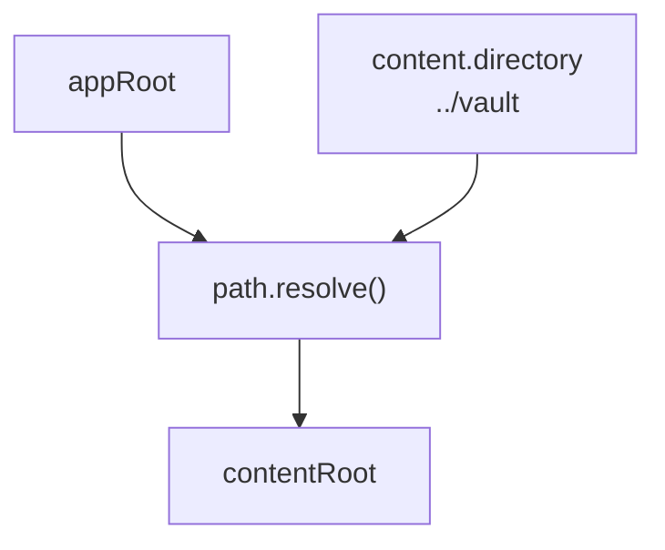
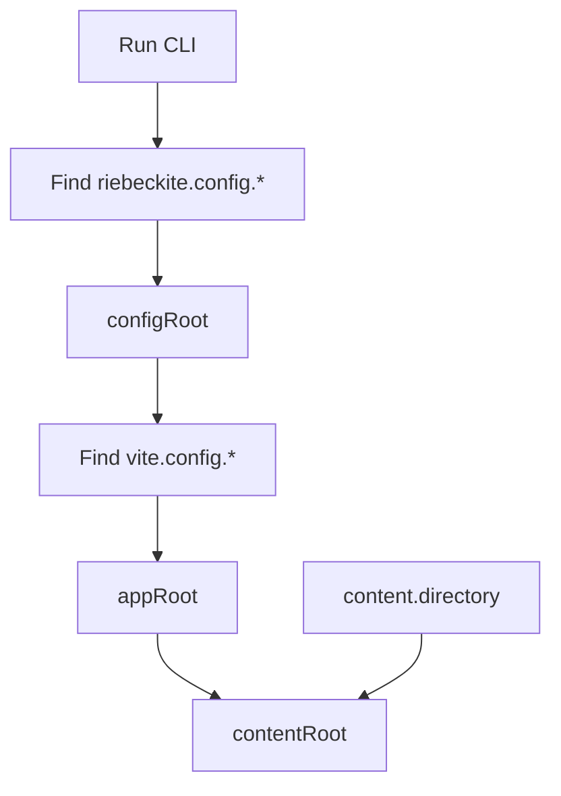
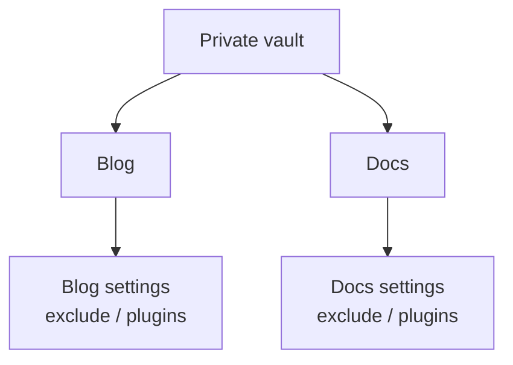

# How it works

## Why "outside the site" works

The resolution rules for `content.directory` in `riebeckite.config.ts`:

| Name | Role | Default / resolution base |
| --- | --- | --- |
| `appRoot` | The [[framework/honox-integration|HonoX]]/Vite application. Owns `app/`, `public/`, routes, generated styles, and build output | Vite's `root` |
| `configRoot` | The directory that contains `riebeckite.config.ts` | `appRoot` |
| `contentRoot` | The absolute filesystem root of the configured content directory or Obsidian vault | `path.resolve(appRoot, content.directory)` |

The key point: a relative `content.directory` is **always relative to `appRoot`**, and does not change when `configRoot` or the working directory changes. The integration resolves all three roots before running content or plugins, and the CLI uses the same result. So from a nested directory, a CI working directory, or an editor task, the same vault is always read.



```ts
// site/riebeckite.config.ts
export default defineConfig({
  content: {
    directory: "../vault", // relative to appRoot
  },
});
```

Do not assemble the value from `process.cwd()`, and do not point `appRoot` at the vault. The vault is source data; the Vite application root stays the site.

### How the roots are determined

Walking through the order reveals the common pitfalls.

1. **The CLI** walks up from the working directory looking for `riebeckite.config.ts` / `.js` / `.mjs`. The directory of the first match becomes `configRoot`. If none is found it fails with `Could not find riebeckite.config.*`.
2. **appRoot** is found by scanning under `configRoot` for `vite.config.ts` / `.js` / `.mjs` (skipping `node_modules`, `.git`, and `tests`). Finding none is an error, and finding more than one is also an error.
3. **contentRoot** resolves as `path.resolve(appRoot, content.directory)`. An absolute `directory` lands on the same value here.



If you intentionally keep `riebeckite.config.ts` outside the Vite application, pass `configRoot` and `appRoot` to `riebeckiteVite()`. Either way, the base for a relative `content.directory` stays `appRoot`.

In other words, "the same vault from anywhere" holds as long as **the config is inside (or above) the site and `appRoot` is unambiguous**. Running from an unrelated directory finds no config at all, and a monorepo with multiple `vite.config.*` files fails with `Found multiple Vite applications`. Both mean the tool could not pin down which site's config applies.

### Reading content from the application side

The integration exposes the resolved config and a ready `ContentManager` as
framework-owned modules, so application code imports them rather than
re-reading `riebeckite.config.ts`:

```ts
import { config } from "virtual:riebeckite/config";
import { content } from "virtual:riebeckite/content";
```

`config.content.directory` is already absolute, so resolving it again against
another base is a common source of errors. A script that runs outside Vite can
resolve the same values with `resolveHonoxConfig` from
`@riebeckite/honox/runtime`.

### What not to do

- Build `content.directory` from `process.cwd()`. The result changes with where you run.
- Point `appRoot` (Vite's `root`) at the vault. That moves the site's `app/`, `public/`, and build output.
- Assume a relative `directory` is relative to `configRoot`. The base is always `appRoot`.

The rule of thumb:

```text
Do not use
  → process.cwd()

Base
  → appRoot
```

## The three layouts

| Layout | Structure | Choose it when | Deployment consideration |
| --- | --- | --- | --- |
| Integrated | Site and articles in one Git repository (use `content/`) | You want a single repository for a personal blog | No extra setup |
| Separate directories | `site/` and `vault/` side by side in one repository | You share history but want locations and visibility apart | Set `content.directory: "../vault"` on the site side |
| Separate repositories (recommended) | Site and articles in separate repositories | You want articles private or updates decoupled | CI needs setup to fetch the articles repository |

### Integrated layout

```text
blog/
├─ riebeckite.config.ts     ← appRoot (directory: "content")
├─ app/
├─ public/
└─ content/                 ← articles live here
   └─ index.md
```

The simplest option, and exactly what `create-riebeckite` generates. Article visibility matches the repository.

### Separate directories layout

```text
notes-repo/
├─ site/                ← appRoot (contains riebeckite.config.ts)
│  └─ riebeckite.config.ts
└─ vault/               ← referenced by directory: "../vault"
```

One repository and one history, with the locations split. [[glossary/visibility|Visibility]] is still per repository, as in the integrated layout. The only change from the integrated layout is `content.directory: "../vault"`.

### Sharing one vault across several sites

An extension of the separate-repositories layout: keep the vault in its own place and have several sites reference it.

```text
workspace/
├─ notes/           ← shared vault (its own private repository)
├─ blog/            ← site 1 (directory: "../notes")
└─ docs/            ← site 2 (directory: "../notes")
```

Treat the vault as read-only source data and vary `exclude`, `content.filters.publishStrategy`, and plugins per site. No site writes back, so the same notes can be published in different shapes. Deploy each site independently, giving each CI the additional checkout described in [Fetching content is separate from triggering a deployment](./repository-split.md#fetching-content-is-separate-from-triggering-a-deployment).



Each site can set `exclude`, `content.filters.publishStrategy`, plugins, theme, and deployment independently, so the same note can have a different publication range and presentation per site.

### Decision flow

1. You want articles private, or updates decoupled → **separate repositories**.
2. Articles and site can share visibility → next.
3. You only want locations and settings apart → **separate directories**. You want one repository → **integrated**.
4. You want one vault for several sites → **separate repositories + shared vault**.
