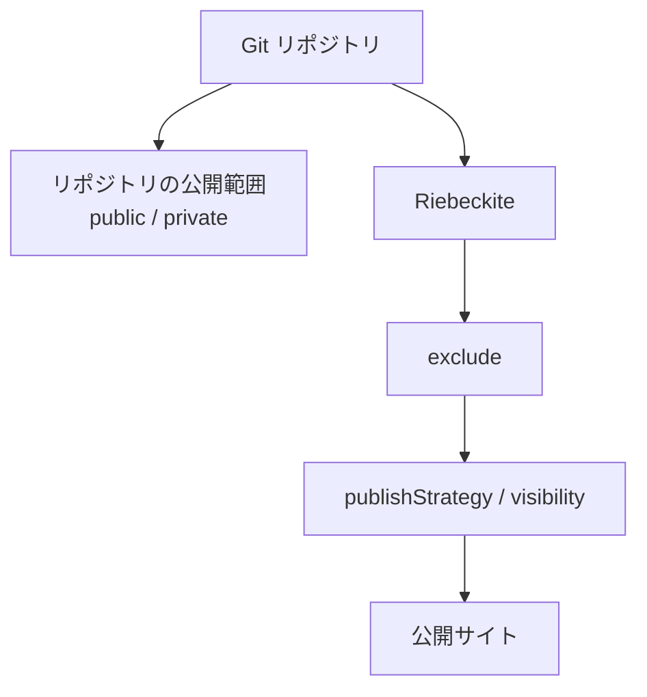
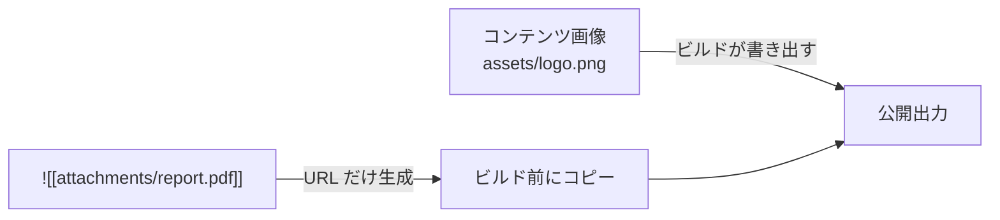
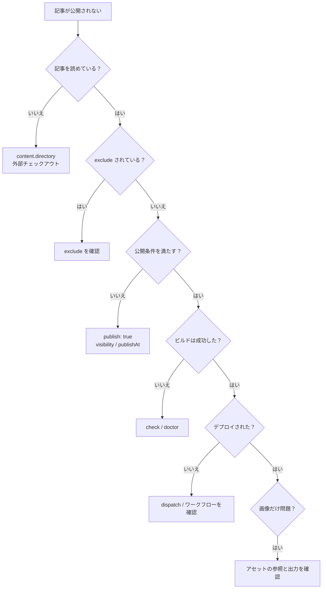
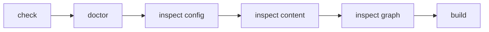

# 公開とトラブルシューティング

## 公開の境界を決める

記事とサイトを分けたら、何を公開し、何を公開しないかを明確にします。

### 公開はどう決まるか

`content.filters.publishStrategy` は、frontmatter で公開状態を指定していないノートの扱いを決めます。既定は `explicit` です。

| 戦略 | 公開される条件 | 向いている用途 |
| --- | --- | --- |
| `explicit`（既定・推奨） | `publish: true` があるノートのみ | 公開する記事を明示的に選ぶ |
| `selective` | `private: true` も `draft: true` もないノート | ほぼすべて公開し、例外だけ隠す |

frontmatter の `visibility` と `publishAt` は、`publishStrategy` より優先されます。

| frontmatter | 結果 |
| --- | --- |
| `visibility: public` | URL で表示でき、一覧や[[glossary/search|検索]]にも出る |
| `visibility: unlisted` | URL を直接開けば表示できるが、一覧や検索には出ない |
| `visibility: draft` | URL を直接開いても表示されず、一覧や検索にも出ない |
| `publishAt: 2026-01-01T00:00:00.000Z` | ビルド時刻がその日時より前なら非公開、それ以降のビルドで公開される |
| `visibility` / `publishAt` なし | `publishStrategy` に従う |

`visibility` や `publishAt` が不正な場合、推測せずにビルドを失敗させます。`publishAt` はビルド時刻だけで判定するため、Riebeckite が実行時にタイマーを起動することはありません。公開時刻を過ぎても記事が出ない場合は、次のビルドかデプロイを実行してください。

非公開の Vault で `explicit` を使うのが最も安全です。公開し忘れることはあっても、意図しないノートが公開される可能性は低くなります。

リポジトリの公開範囲と Riebeckite の公開判定は別です。



### 公開時に守るルール

- 非公開のノートに `publish: true` や `visibility: public` を付けない。非公開用のディレクトリは `content.exclude` で丸ごと除外する。
- `.obsidian/` を `exclude` に入れ、Obsidian の設定やワークスペースの状態をサイトに混ぜない。
- `Templates/**` などのテンプレート用ディレクトリを除外し、テンプレートが記事として公開されないようにする。
- アセットは種類ごとに公開方法が違うと把握しておく。コンテンツ画像（png、jpg、svg など）はビルドが生成するため、手動でコピーする必要はない。添付ファイルとメディアは URL が生成されるだけで自動ではコピーされないため、サイト側の `prebuild` で公開するファイルだけをコピーする（参考実装は後述の `website/scripts/build_images.ts`）。静的ファイルは `public/` 以下に置く。Vault 全体をコピーすると、非公開記事や未参照のファイルまで公開される可能性がある。

### アセットは種類ごとに公開方法が違う

Vault 内のアセットは3種類に分かれ、公開を担当する場所も異なります。

| 種類 | 対象 | 公開 URL | 公開する場所 |
| --- | --- | --- | --- |
| コンテンツ画像 | Vault 内の画像（png、jpg、svg など） | `/<Vault からの相対論理パス>` | Riebeckite のビルド |
| 添付ファイル / メディア | Markdown でも画像でもないファイル | `/assets/attachments/<Vault からの相対論理パス>` | サイト側の `prebuild` |
| 静的アセット | サイト自身が管理するファイル | `/` 以下任意場所 | Vite の `public/` ディレクトリ |

コンテンツ画像は、公開ページから参照されているものだけがビルドの出力に含まれます。`public/` へ手動でコピーする必要はありません。

添付ファイルやメディアは URL が生成されるだけで、実ファイルは自動ではコピーされません。

```md
![[attachments/report.pdf]]
```

この参照が URL に変換されても、`report.pdf` が公開出力になければ、ブラウザでは `404` になります。



公開する添付ファイルやメディアだけを `public/assets/attachments/` へコピーする `prebuild` 処理を、サイト側に用意してください。Vault 全体を `public/` へコピーすると、非公開記事や未参照のファイルまで公開される可能性があります。

参考になる実装は Riebeckite リポジトリ自身の `website/scripts/build_images.ts` です。生成されるサイトにはこのファイルは含まれないので、同等の `prebuild` スクリプトを自分で用意してください。アセットの種類と公開方法の詳細は [Attachment・Media と公開](../../../reference/configuration/assets.ja.md) を参照してください。

要するに、「Vault にあるからコピーする」のではなく、「公開ノートが参照しているからコピーする」のがルールです。公開ノートが非公開ノートへリンクして境界を越えていないか確認するには、`@riebeckite/plugin-diagnostics` の `riebeckite-diagnostics` を実行してください。該当する参照は `publish-boundary` 警告として報告されます。`runDiagnostics()` を使えば、同じ結果をプログラムから取得できます。詳しくは [診断](../../../plugins/diagnostics.ja.md) を参照してください。

### よくある質問

**サイト内の `content/` のまま、一部だけ非公開にできる？**

できます。`content.directory` を既定の `content` のままにして、非公開ノートから `publish: true` を外し、必要に応じてディレクトリを `exclude` へ追加します。リポジトリを分けるのは Vault を物理的に別の場所へ置くための方法で、公開の制御は `publishStrategy`、`visibility`、`exclude` の役割です。

**Vault を移動したら記事が表示されなくなった**

`content.directory` は相対パスなので、Vault を動かすとサイトのルートからの距離が変わります。`inspect config` で解決済みの `Directory` を確認し、`../` の数を直してください。絶対パスも使えますが、開発端末と CI でずれやすいため、通常は相対パスが扱いやすくなります。

**記事は表示されるのにアセットだけ `404` になる**

まずアセットの種類を確認します。画像が `404` なら、公開ページから実際に参照されているかを見てください。コンテンツ画像は、公開ページからの参照があるものだけがビルドの出力に含まれます。

添付ファイルやメディアが `404` なら、`prebuild` のコピー処理を確認します。ビルドより前に実行され、`public/assets/attachments/` へコピーされる必要があります。

**CI でだけ Vault が見つからない**

CI には、追加のチェックアウトかサブモジュールを設定しない限り Vault がありません。手順5の設定を確認し、相対パスの `directory` が CI 上の配置と一致しているかを見てください。たとえば CI で `content/` にチェックアウトするなら `directory: "content"`、`notes/` に置くなら `directory: "notes"` です。

**Windows でも同じ？**

同じです。`exclude` のパターンは `/` 区切りで書いてください。プラットフォームのパス区切りには依存しません。

**`publishAt` の時刻を過ぎたのに公開されない**

`publishAt` はビルド時の時刻で判定します。時刻を過ぎた後にビルドとデプロイを実行してください。定期実行したい場合は、サイトのワークフローに `schedule` を追加します。

### 原因を切り分ける

記事が公開されないときは、次の順番で確認すると原因を絞れます。



問題が解決しない場合は、統合された[トラブルシューティング](./troubleshooting.ja.md)を参照してください。

## ビルド前にルートと公開境界を検証する

ルートと[[glossary/publication-boundary|公開境界]]は、ビルド前に CLI で確認できます。作業ディレクトリに依存しないことは、入れ子のディレクトリから実行すると確かめられます。

```sh
cd site/app
npm exec riebeckite check
npm exec riebeckite doctor
npm exec riebeckite inspect config
npm exec -- riebeckite inspect content --list
npm exec riebeckite inspect graph
npm exec riebeckite build
```

結果は次の順番で確認します。

1. `check` は設定とプラグインの契約を検証します。
2. `doctor` は読み取れない、または不正なファイルシステムの[[glossary/content-source|コンテンツソース]]を報告します。
3. `inspect config` では、`Directory` が解決済みの絶対パス、`Publishing` が `publishStrategy`、`Exclude` が設定済みの除外パターンの一覧です（カンマ区切り、空なら `-`）。まずここで、Vault がどこを指しているかを確定させます。
4. [[glossary/wikilink|WikiLink]] や埋め込みを調べる前に、`inspect content --list` で期待する論理パスが読み込まれているか確認します。
5. `inspect graph` で、除外したノートがノードとして現れていないか確認します。
6. `build` は統合とルートのレンダリングを検証します。



### 作業ディレクトリに依存しないことを確かめる

ルート解決の問題を調べるときは、サイトのルートだけでなく、入れ子のディレクトリからも CLI を実行します。

```sh
cd site/app

npm exec riebeckite inspect config
npm exec -- riebeckite inspect content --list
```

どちらも同じアプリケーションと Vault を解決するはずです。関係のないディレクトリから実行すると、設定ファイル自体が見つからないことがあります。
