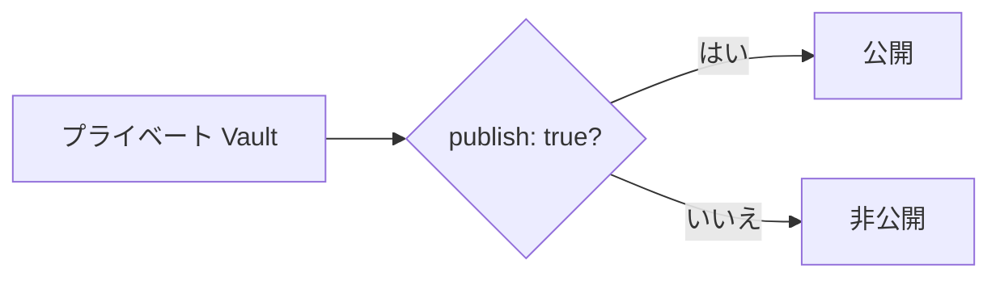
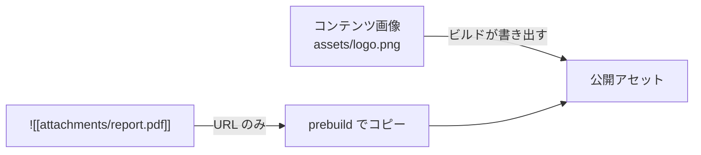
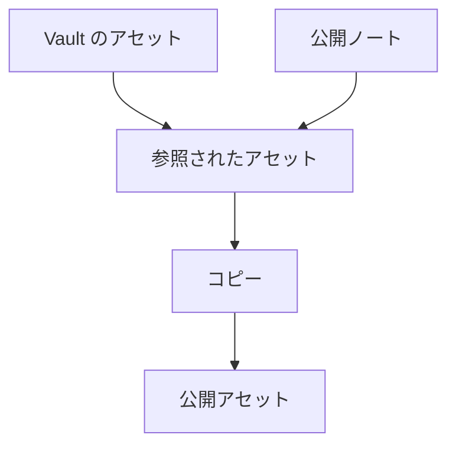
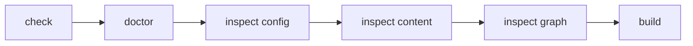

# 公開ルールと検証

## 公開ルールとアセットをどう扱うか

### 公開するかどうかは何で決まるか

`content.filters.publishStrategy` は2つの値を取ります。

| 値 | 公開される条件 | 意味 |
| --- | --- | --- |
| `explicit`（既定） | frontmatter の `publish` が `true` | 公開を明示したノートだけ |
| `selective` | `private` と `draft` のどちらも `true` でない | 非公開を明示したノート以外すべて |

公開判定は `isPublished` / `isPublishable` に集約されており、ノートのレンダリング、診断、prebuild でのアセット収集はすべて同じルールを使います。サイト側で公開判定を独自に実装しないでください。「プレビューでは見えるのに本番には出ない」という食い違いは、そこから生まれます。



プライベート Vault では、既定の `explicit` が最も理解しやすいモデルです。

### `exclude` はどう書くか

`exclude` は `contentRoot` からの相対パス（`/` 区切りに正規化）に対して glob パターンを照合します。パターンが**パス全体にアンカーされる**点に注意してください。

| パターン | 一致する | 一致しない |
| --- | --- | --- |
| `.obsidian/**` | `.obsidian/app.json` | `notes/.obsidian/app.json` |
| `**/.obsidian/**` | 上記の両方 | — |
| `Templates/**` | `Templates/daily.md` | `notes/Templates/daily.md` |
| `**/Templates/**` | 上記の両方 | — |
| `private/**` | `private/secret.md` | `notes/private/secret.md` |

`*` は1つのセグメント内にとどまり、`**` はセグメントをまたぎます。同名のフォルダがサブフォルダにも現れる可能性があるなら、`**/` を付けると安全です。スキャフォールドはこれらのパターンを設定しないため、必要なら `**/templates/**` と `**/private/**` を自分で追加してください。

`exclude` は読み込み前に絞り込むため、除外されたノートはリンク解決やグラフに現れません。非公開にしたいノートは、`publish: true` を付けないことに加えて、可能ならフォルダごと除外してください。

### コンテンツ画像と添付ファイルは公開のされ方が違う

Vault 内のファイルは3種類に分かれ、それぞれ公開する主体が異なります。

| 種類 | 対象 | 公開 URL | 公開する主体 |
| --- | --- | --- | --- |
| コンテンツ画像 | 画像（`png`、`jpg`、`svg` など） | `/<Vault からの相対論理パス>` | ビルド（[[glossary/generated-output|生成物]]として出力） |
| 添付ファイル / メディア | Markdown でも画像でもないファイル | `/assets/attachments/<Vault からの相対論理パス>` | サイト側の prebuild 手順 |
| 静的アセット | サイトアプリケーションが管理するファイル | `/` 以下の任意の場所 | Vite の `public/` ディレクトリ |

コンテンツ画像については、サイト側で何もする必要がありません。`obsidianMarkdown()` が公開ページから参照されている画像を、[[glossary/logical-path|論理パス]]を保ったままビルド出力に書き出します。開発サーバーも同じ論理パスでコンテンツから直接配信します。どこからも参照されていない画像や、非公開ページだけから参照されている画像は書き出されません。



添付ファイルとメディアは別です。次のような埋め込みは、

```md
![[attachments/report.pdf]]
```

URL を生成しますが、**ファイル自体は公開ディレクトリにコピーされません**。サイト側に、公開するファイルだけをコピーする prebuild 手順を追加してください。参照実装は `website/scripts/build_images.ts` です（`prebuild` スクリプトから `tsx --conditions=source scripts/build_images.ts` として呼び出し、`public/assets/attachments/` へコピーします）。

この実装の流れは次のとおりです。

1. `contentRoot` を走査して、画像（`IMAGE_EXTENSIONS`）と添付ファイル（`isAttachmentPath`）を列挙します。
2. `ContentManager` でコンテンツをビルドし、公開ノートから参照されているアセットだけを集めます。参照元はリンクと、レンダリング後の HTML にある `src` / `href` です。
3. 参照されたアセットだけを `public/assets/attachments/<Vault からの相対パス>` にコピーします（画像は `public/<相対パス>` にコピーし、初回ビルド前でも開発サーバーが配信できるようにします）。サイズと mtime が変わっていなければコピーを省略します。
4. 公開ディレクトリにだけ存在し、コンテンツにない孤立した添付ファイルを削除します。



要するに、「Vault にあるからコピーする」のではなく、「**公開ノートが参照しているからコピーする**」というルールです。Vault 全体をコピーする近道は取らないでください。非公開ノート、非公開ページだけから参照される画像、未参照の添付ファイル、`.obsidian` のメタデータが漏れる恐れがあります。コンテンツ画像はビルドがすでに絞り込んで出力します。添付ファイルとメディアの公開はサイトアプリケーションの責任なので、**公開**ノートが参照するファイルだけをコピーします。公開ノートが非公開ノートへリンクして境界を越えていないか確認するには、`@riebeckite/plugin-diagnostics` の `riebeckite-diagnostics` を実行してください。該当する参照を `publish-boundary` 警告として報告します。`runDiagnostics()` を使えば、同じ結果をプログラムから取得できます。詳しくは [診断](../../../plugins/diagnostics.ja.md) を参照してください。

### 生成される URL

コンテンツ画像は Vault からの論理パスをそのまま保ちます。

```text
Vault:
assets/logo.png

公開 URL:
/assets/logo.png
```

添付ファイルとメディアには専用のプレフィックスを付けるため、同名のファイルと画像が衝突しません。

```text
/assets/attachments/<Vault からの相対論理パス>
```

たとえば、次のようになります。

```text
Vault:
attachments/report.pdf

公開 URL:
/assets/attachments/attachments/report.pdf
```

- `attachment()` は解決済みの Vault ルートから埋め込みファイルのサイズを読み、ルート外のパスは拒否します。
- `media()` は同じ論理パスに対応する音声・動画を描画します。

`public/` 下の実際の配置と公開 URL を一致させておくと、ビルド後の 404 を減らせます。

### リポジトリの公開範囲と公開境界は別物

リポジトリをプライベートにすることと、Riebeckite が何を公開するかは別の話です。

```text
リポジトリの公開範囲
  → Git リポジトリを誰が読めるか

Riebeckite の公開
  → サイトに何が出るか
```

プライベート Vault でも、非公開情報を公開出力にコピーするビルドをすれば、それは公開されたことになります。次の3つを揃えてください。

```text
exclude
      +
publishStrategy
      +
公開ノートだけを対象にしたアセットコピー
```

特に、Vault 全体を `public/` にコピーしないでください。prebuild のコピーが参照済みアセットだけを選ぶ仕組みは前述のとおりです。

## ビルド前にルートと公開境界を検証する

ルートと[[glossary/publication-boundary|公開境界]]は、ビルド前に CLI で確認できます。作業ディレクトリに依存しないことは、入れ子のディレクトリから実行すると確かめられます。

```sh
cd site/app
npm exec riebeckite check
npm exec riebeckite doctor
npm exec riebeckite inspect config
npm exec -- riebeckite inspect content --list
npm exec riebeckite inspect graph
npm exec riebeckite build
```

結果は次の順に確認します。

1. `check` は設定とプラグインの取り決めを検証します。
2. `doctor` は読み取れない、または不正なファイルシステムの[[glossary/content-source|コンテンツソース]]を報告します。
3. `inspect config` では、`Directory` が解決済みの絶対パス、`Publishing` が `publishStrategy`、`Exclude` がパターン数です。まずここで、Vault がどこを指しているかを確定させます。
4. [[glossary/wikilink|WikiLink]] や埋め込みを調べる前に、`inspect content --list` で期待する論理パスが読み込まれているか確認します。
5. `inspect graph` で、除外したノートがノードとして現れていないか確認します。
6. `build` は統合とルートのレンダリングを検証します。



### 作業ディレクトリに依存しないことを確かめる

ルート解決の問題を調べるときは、サイトのルートだけでなく、入れ子のディレクトリからも CLI を実行します。

```sh
cd site/app

npm exec riebeckite inspect config
npm exec -- riebeckite inspect content --list
```

どちらも同じアプリケーションと Vault を解決するはずです。関係のないディレクトリから実行すると、設定ファイル自体が見つからないことがあります。
