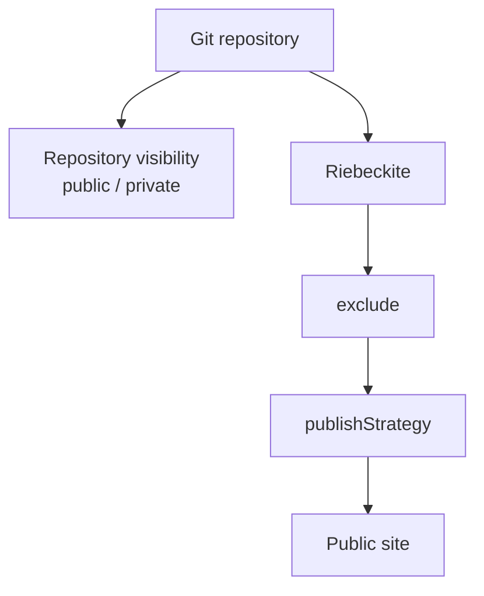
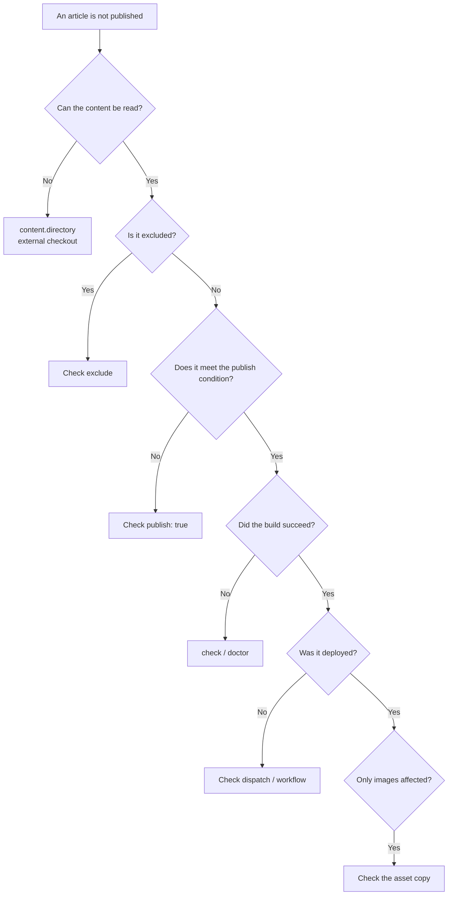
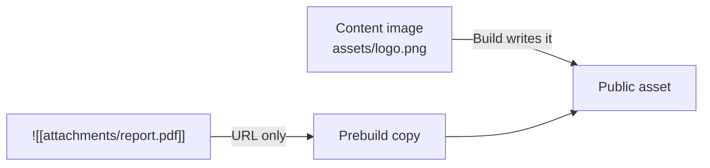
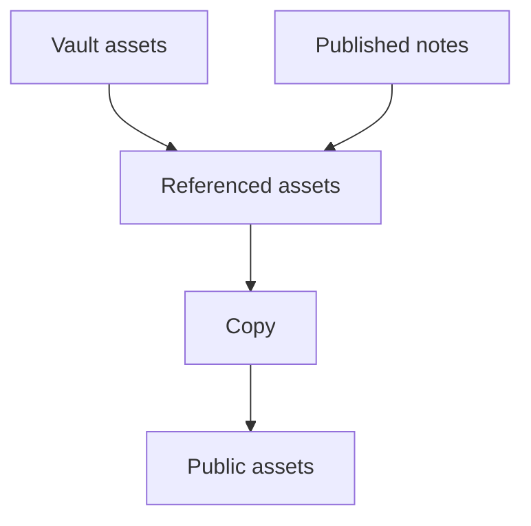
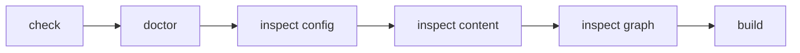

# Publication and verification

## Publication rules

When articles and the site are separate, be explicit about where the publication boundary lies.

### How publication is decided

`content.filters.publishStrategy` decides which notes are published when frontmatter does not set an explicit state. The default is `explicit`.

| Strategy | Published when | Choose it when |
| --- | --- | --- |
| `explicit` (default, recommended) | Only notes with `publish: true` | You want to opt articles in deliberately |
| `selective` | Notes without `private: true` or `draft: true` | You publish almost everything and hide only exceptions |

[[glossary/frontmatter|Frontmatter]] `visibility` and `publishAt` take precedence over the strategy.

| Frontmatter | Result |
| --- | --- |
| `visibility: public` | [[glossary/routable|Routable]] and discoverable |
| `visibility: unlisted` | Routable by direct URL, but excluded from discovery surfaces |
| `visibility: draft` | Not routable and not discoverable |
| `publishAt: 2026-01-01T00:00:00.000Z` | Hidden before the build time, public on the first build after that time |
| no `visibility` / `publishAt` | Falls back to `publishStrategy` |

Malformed `visibility` or `publishAt` values fail the build instead of being guessed. `publishAt` is evaluated against the build time only; Riebeckite does not start a runtime timer. If the time has passed and the article is still missing, run another build or deploy.

Using `explicit` with a private vault is the safest arrangement: you may forget to publish something, but you are unlikely to publish something by accident.

Repository visibility and Riebeckite's publication decision are separate concerns:



### Rules to follow

- **Never put `publish: true` or `visibility: public` on private notes**, and exclude whole private folders with `content.exclude`.
- **Put `.obsidian/` in `exclude`** so Obsidian settings and workspace state never mix into the site.
- **Exclude template folders** (`Templates/**` and the like) so note templates are not published as articles.
- **Know which asset kind you are copying.** Content images (png, jpg, svg, and similar) are published by the build as generated output, so they need no manual copy. Attachments and media (files that are neither Markdown nor images) get URLs but are not copied, so they need a prebuild step on the site side that copies only the files you publish (reference implementation: `website/scripts/build_images.ts` in the Riebeckite repository itself — a generated site does not include that file, so add an equivalent `prebuild` script that copies the attachments you publish into `public/assets/attachments/`). Static files owned by the site belong under `public/`; never copy the whole vault there. See the assets section of the [in-depth companion](./troubleshooting.md) for how it works.

### Attachments and media

Assets inside the vault are published differently depending on their kind:

| Kind | Target | URL | Published by |
| --- | --- | --- | --- |
| Content image | Images in the vault (png, jpg, svg, and similar) | `/<logical path from the vault>` | The Riebeckite build |
| Attachment / media | Files that are neither Markdown nor images | `/assets/attachments/<logical path from the vault>` | A prebuild step on the site side |
| Static asset | Files owned by the site application | Under `/` | Vite's `public/` directory |

A content image reaches the build output only when a published page references it, so you never copy it into `public/` by hand. An attachment or media file, by contrast, gets a URL but no file:

```md
![[attachments/report.pdf]]
```

If `report.pdf` is not present in the public output, the browser gets a `404`.


Provide a prebuild step on the site side that copies only the attachments and media you publish.

### FAQ

**Can I keep articles in the site's `content/` and make only some notes private?**

Yes. Leave `content.directory` at the default `content`, remove `publish: true` from private notes, and add folders to `exclude` as needed. Repository separation is a way to place the vault physically elsewhere; publication control itself belongs to `publishStrategy` and `exclude`.

**Articles vanished after I moved the vault.**

`content.directory` is relative, so the distance from the site root changes when the vault moves. Check the resolved `Directory` with `inspect config` and fix the number of `../` levels. Absolute paths also work, but they drift between developer machines and CI, so relative paths are usually recommended.

**Articles render but assets 404.**

First identify the asset kind. If an image 404s, confirm a published page actually references it: content images reach the build output only through a reference from a published page. If an attachment or media file 404s, confirm the prebuild copy step runs before the build and targets `public/assets/attachments/`.

**CI alone says the vault was not found.**

CI does not have the vault unless you add the additional checkout or submodule. Check the step 5 setup and confirm the relative `directory` matches the CI layout (for example `notes`).

**Does this work the same on Windows?**

Yes. Write `exclude` patterns with `/` separators; they do not depend on the platform's path separator.

**`publishAt` has passed but the article is still missing.**

`publishAt` is evaluated at build time. Run a build and deploy after the scheduled time. To publish on a schedule without a manual run, add `schedule` to the site workflow.

## Isolating the problem

When something is not published, checking in this order narrows the cause quickly:



## Troubleshooting

For the consolidated troubleshooting table and in-depth diagnosis flows, see [Troubleshooting](./troubleshooting.md).

## Content images and attachments are published differently

Vault files fall into three kinds, and each one is published by a different owner:

| Kind | Subject | Public URL | Published by |
| --- | --- | --- | --- |
| Content image | An image (`png`, `jpg`, `svg`, …) | `/<relative logical path from the vault>` | The build, as generated output |
| Attachment / Media | A file that is neither Markdown nor an image | `/assets/attachments/<relative logical path from the vault>` | A prebuild step on the site side |
| Static asset | A file the site application owns | Anywhere under `/` | Vite's `public/` directory |

Content images need nothing from the site side: the core build writes every image referenced from a published page into the build output, keeping its logical path, and `obsidianMarkdown()` resolves Obsidian image and embed syntax into those references. The development server serves the same logical path straight from the content. Images that nothing references, or that only non-public pages reference, are not written.



Attachments and media are different. An embed such as:

```md
![[attachments/report.pdf]]
```

produces a URL, but **the file itself is not copied into the public directory**. Add a prebuild step on the site side that copies only the files you publish. Reference implementation: `website/scripts/build_images.ts` in the Riebeckite repository itself (called from its `prebuild` script, `tsx --conditions=source scripts/build_images.ts`, copying into `public/assets/attachments/`). A generated site does not include this file; add an equivalent `prebuild` script to your site.

That implementation works like this:

1. Walk contentRoot to enumerate images (`IMAGE_EXTENSIONS`) and attachments (`isAttachmentPath`).
2. Build the content with `ContentManager` and collect only the assets **referenced** by published notes — from links and from `src` / `href` in the rendered HTML.
3. Copy only referenced assets into `public/assets/attachments/<relative path from the vault>` (images into `public/<relative path>`, so the dev server can serve them before the first build), skipping the copy when size and mtime are unchanged.
4. Delete orphaned attachments that exist in public but not in content.



In short, the rule is "copy because a **published note references it**", not "copy because it exists in the vault". Do not take the shortcut of copying the entire vault. It risks leaking private notes, images referenced only from non-public pages, unreferenced attachments, and `.obsidian` metadata. Content images are already filtered and emitted by the build; attachment and media publishing stays the site application's responsibility, so copy only the files a **published** note references. To detect a published note that crosses the boundary by linking to an unpublished one, run `riebeckite-diagnostics` from `@riebeckite/plugin-diagnostics`; it reports those references as `publish-boundary` warnings, and `runDiagnostics()` produces the same result programmatically. See [Diagnostics](../../../plugins/diagnostics.md).

## Verification

You can confirm roots and publication boundaries before building, with the CLI. Run it from a nested directory to prove the working directory does not matter.

```sh
cd site/app
npm exec riebeckite check
npm exec riebeckite doctor
npm exec riebeckite inspect config
npm exec -- riebeckite inspect content --list
npm exec riebeckite inspect graph
npm exec riebeckite build
```

Check the results in this order:

1. `check` validates the configuration and plugin contracts.
2. `doctor` reports unreadable or invalid filesystem content sources.
3. In `inspect config`, `Directory` is the resolved absolute path, `Publishing` is `publishStrategy`, and `Exclude` lists the configured exclude patterns (comma-separated, or `-`). Settle where the vault points here first.
4. Before investigating WikiLinks or embeds, use `inspect content --list` to confirm the expected logical paths are loaded.
5. Use `inspect graph` to confirm notes you excluded are not appearing as nodes.
6. `build` validates the integration and route rendering.



### Confirming the working directory does not matter

To investigate root-resolution problems, run the CLI not only from the site root but also from a nested directory:

```sh
cd site/app

npm exec riebeckite inspect config
npm exec -- riebeckite inspect content --list
```

Both should resolve the same application and vault. Running from an unrelated directory can fail to find the config at all.

---

**If a problem persists, see the [troubleshooting table](#troubleshooting) on this page, or check the [unified troubleshooting page](./troubleshooting.md) for the consolidated view.**