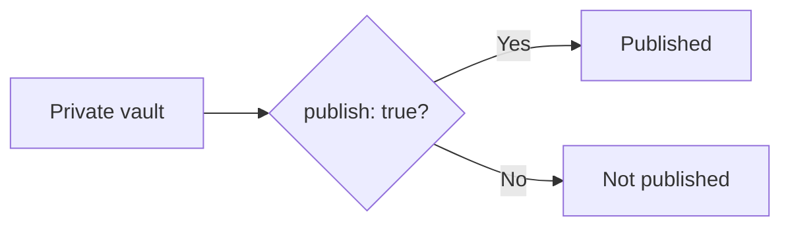
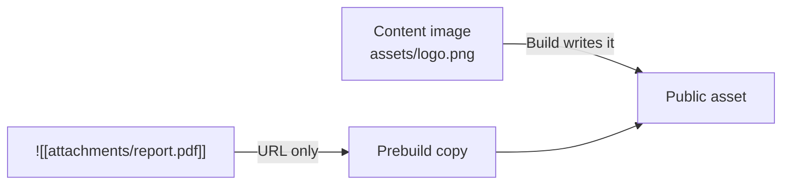
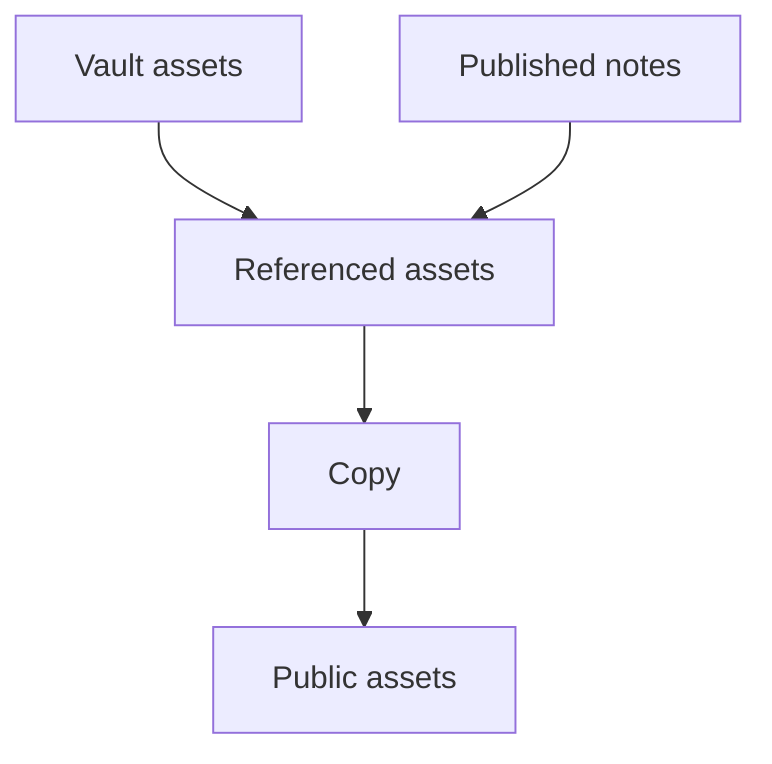
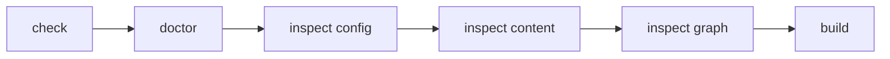

# Publication and verification

## Publication rules and assets

### How publication is decided

`content.filters.publishStrategy` takes two values.

| Value | Published when | What it means |
| --- | --- | --- |
| `explicit` (default) | The `publish` frontmatter is `true` | Only notes that opt in |
| `selective` | Neither `private` nor `draft` is `true` | Everything except notes that opt out |

The decision is centralized in `isPublished` / `isPublishable`, and note rendering, diagnostics, and the prebuild asset collection all use the same rule. Do not reimplement the publication decision on the site side; that is how "visible in preview, missing in production" disagreements start.



For a private vault, the default `explicit` is the easier model to reason about.

### How to write `exclude`

`exclude` matches glob patterns against the path relative to contentRoot (normalized to `/` separators). Note that patterns are **anchored to the whole path**.

| Pattern | Matches | Does not match |
| --- | --- | --- |
| `.obsidian/**` | `.obsidian/app.json` | `notes/.obsidian/app.json` |
| `**/.obsidian/**` | both of the above | — |
| `Templates/**` | `Templates/daily.md` | `notes/Templates/daily.md` |
| `**/Templates/**` | both of the above | — |
| `private/**` | `private/secret.md` | `notes/private/secret.md` |

`*` stays within one segment; `**` crosses segments. If a folder of the same name can appear in subfolders, prefix `**/` to be safe. The scaffold does not set these patterns, so add `**/templates/**` and `**/private/**` explicitly when you need them.

`exclude` filters before loading, so excluded notes never appear in link resolution or the graph. For notes you want private, in addition to leaving off `publish: true`, exclude the whole folder where possible.

### Content images and attachments are published differently

Vault files fall into three kinds, and each one is published by a different owner:

|Kind|Subject|Public URL|Published by|
| --- | --- | --- | --- |
|Content image|An image (`png`, `jpg`, `svg`, …)|`/<relative logical path from the vault>`|The build, as generated output|
|Attachment / Media|A file that is neither Markdown nor an image|`/assets/attachments/<relative logical path from the vault>`|A prebuild step on the site side|
|Static asset|A file the site application owns|anywhere under `/`|Vite's `public/` directory|

Content images need nothing from the site side: the core build writes every image referenced from a published page into the build output, keeping its logical path, and `obsidianMarkdown()` resolves Obsidian image and embed syntax into those references. The development server serves the same logical path straight from the content. Images that nothing references, or that only non-public pages reference, are not written.



Attachments and media are different. An embed such as:

```md
![[attachments/report.pdf]]
```

produces a URL, but **the file itself is not copied into the public directory**. Add a prebuild step on the site side that copies only the files you publish. Reference implementation: `website/scripts/build_images.ts` (called from the `prebuild` script, `tsx --conditions=source scripts/build_images.ts`, copying into `public/assets/attachments/`).

That implementation works like this:

1. Walk contentRoot to enumerate images (`IMAGE_EXTENSIONS`) and attachments (`isAttachmentPath`).
2. Build the content with `ContentManager` and collect only the assets **referenced** by published notes — from links and from `src` / `href` in the rendered HTML.
3. Copy only referenced assets into `public/assets/attachments/<relative path from the vault>` (images into `public/<relative path>`, so the dev server can serve them before the first build), skipping the copy when size and mtime are unchanged.
4. Delete orphaned attachments that exist in public but not in content.



In short, the rule is "copy because a **published note references it**", not "copy because it exists in the vault". Do not take the shortcut of copying the entire vault. It risks leaking private notes, images referenced only from non-public pages, unreferenced attachments, and `.obsidian` metadata. Content images are already filtered and emitted by the build; attachment and media publishing stays the site application's responsibility, so copy only the files a **published** note references. To detect a published note that crosses the boundary by linking to an unpublished one, run `riebeckite-diagnostics` from `@riebeckite/plugin-diagnostics`; it reports those references as `publish-boundary` warnings, and `runDiagnostics()` produces the same result programmatically. See [Diagnostics](../../../plugins/diagnostics.md).

### The generated URL

A content image keeps its logical path from the vault:

```text
Vault:
assets/logo.png

Public URL:
/assets/logo.png
```

Attachments and media use a dedicated prefix so that a file and an image with the same name cannot collide:

```text
/assets/attachments/<relative logical path from the vault>
```

For example:

```text
Vault:
attachments/report.pdf

Public URL:
/assets/attachments/attachments/report.pdf
```

- `attachment()` reads the embedded file's size from the resolved vault root and rejects paths outside the root.
- `media()` renders the matching audio/video for the same logical path.

Keeping the physical location under `public/` consistent with the visible URL reduces post-build 404s.

### Repository visibility vs. publication boundary

Making a repository private and deciding what Riebeckite publishes are separate concerns:

```text
Repository visibility
  → who can read the Git repository

Riebeckite publication
  → what ends up in the site
```

Even with a private vault, a build that copies non-public information into the public output publishes it. Keep three things aligned:

```text
exclude
      +
publishStrategy
      +
asset copy that targets only published notes
```

In particular, do not copy the whole vault into `public/`. The prebuild copy selects only referenced assets, as described above.

## Verification

You can confirm roots and publication boundaries before building, with the CLI. Run it from a nested directory to prove the working directory does not matter.

```sh
cd site/app
npm exec riebeckite check
npm exec riebeckite doctor
npm exec riebeckite inspect config
npm exec -- riebeckite inspect content --list
npm exec riebeckite inspect graph
npm exec riebeckite build
```

Check the results in this order:

1. `check` validates the configuration and plugin contracts.
2. `doctor` reports unreadable or invalid filesystem content sources.
3. In `inspect config`, `Directory` is the resolved absolute path, `Publishing` is `publishStrategy`, and `Exclude` is the pattern count. Settle where the vault points here first.
4. Before investigating WikiLinks or embeds, use `inspect content --list` to confirm the expected logical paths are loaded.
5. Use `inspect graph` to confirm notes you excluded are not appearing as nodes.
6. `build` validates the integration and route rendering.



### Confirming the working directory does not matter

To investigate root-resolution problems, run the CLI not only from the site root but also from a nested directory:

```sh
cd site/app

npm exec riebeckite inspect config
npm exec -- riebeckite inspect content --list
```

Both should resolve the same application and vault. Running from an unrelated directory can fail to find the config at all.
