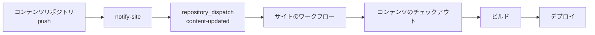
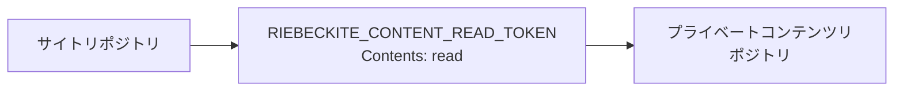
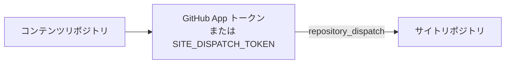

# リポジトリ分離

## リポジトリ分離型の場合の詳細

基本的な流れは [コンテンツとサイトを分ける](../../content-repositories.ja.md) にあります。ここでは、その手順で触れていない点を補います。

### Vault をプライベートリポジトリに置く

- `git init` の後、最初の push より前に GitHub に**プライベート**リポジトリを作ります。
- `.obsidian/` は Obsidian が Vault を開いたときに生成されます。push してしまっても、`content.exclude` に `.obsidian/**` を入れればサイトのビルドには含まれません。Git で追跡したくない場合は、`.obsidian/workspace*.json` だけを gitignore する折衷案もあります。
- 非公開ノートの基本は `publish: true` を付けないことです。さらに、`content.exclude` で非公開フォルダ（例: `private/**`）を除外し、読み込み自体を防ぐ二重の対策を取ります。
- `content.filters.publishStrategy` は既定の `explicit` のままにします。`selective` は「ほぼすべてを公開し、例外だけ隠す」モデルで、非公開の Vault ではリスクが高くなります。

### コンテンツの取得とデプロイの起動は別に考える

`--github-actions` で生成される既定のデプロイワークフローは、**サイトリポジトリだけ**をチェックアウトします。

**方法1: 追加チェックアウトと repository dispatch を組み合わせる（自動デプロイならこちらを推奨）**

```yaml
- name: Check out the site
  uses: actions/checkout@v4

- name: Check out the notes
  uses: actions/checkout@v4
  with:
    repository: <you>/notes
    token: ${{ secrets.RIEBECKITE_CONTENT_READ_TOKEN || github.token }}
    path: content
```

- `path: content` にしたら、`content.directory` は `"content"` にします。
- このチェックアウトでは、サイトのワークフローが始まった後にしかファイルを利用できません。サイトのワークフローに `repository_dispatch: types: [content-updated]` を追加し、コンテンツリポジトリ側には、`main` への push でサイトのワークフローを起動する通知ワークフローを置きます。
- 記事の更新で既定ブランチの最新コンテンツをデプロイしたい場合は、`ref` を指定しないでください。チェックアウトはその時点の先頭を読みます。既定の `fetch-depth: 1` で十分です。

コンテンツのチェックアウトとデプロイの起動は、別の話です。

```text
コンテンツリポジトリをチェックアウトする
        ≠
コンテンツが更新されたらビルドを開始する
```

チェックアウトは、ワークフローが始まった後にコンテンツを読めるようにするだけです。コンテンツリポジトリへの push でサイトも自動デプロイしたいなら、**サイトのワークフローを起動する**仕組みが別に必要です。



追加チェックアウトで `ref` を固定しなければ、コンテンツリポジトリの既定ブランチの最新状態を取得します。記事の更新をそのままサイトに反映したい場合に便利です。

```text
コンテンツの main
   ↓
push
   ↓
サイトのワークフロー
   ↓
その時点の最新コンテンツ
```

既定の `fetch-depth: 1` で足ります。サイトが使うコンテンツのコミットを厳密に固定したい場合は、Git サブモジュールを使ってください。

**方法2: Git サブモジュールを使う**

```sh
cd my-site
git submodule add git@github.com:<you>/notes.git content
```

- `content` は記事リポジトリへのリンクになります。`riebeckite.config.ts` の `directory` は `content` に合わせます。
- ワークフローの `actions/checkout@v4` に `submodules: recursive` を追加し、CI が依存先を取得するようにします。
- サブモジュールが参照するコミットは**サイトリポジトリに記録されます**。記事を更新するには、サイト側で参照を更新し、コミットして push するという2段階の操作が必要です。

```sh
cd content && git pull
cd ..
git add content
git commit -m "update articles"
```

`git submodule update --remote` を使えばリモートの最新に追従できますが、サイト側のコミットはやはり必要です。

**2つの方法を比べる**

| 観点 | 方法1（追加チェックアウト） | 方法2（サブモジュール） |
| --- | --- | --- |
| 記事の push で自動デプロイ | repository dispatch を設定すれば可能 | 不可（参照を更新する必要がある） |
| 取得先 | `path: content`、`directory: "content"` | `directory: "content"` に固定 |
| 履歴の固定 | ブランチの先頭に追従する | 特定のコミットを固定できる |
| ローカルでの操作 | 通常の clone で済むことが多い | `submodule update` が必要 |
| 向いているケース | 記事の更新が中心のワークフロー | 記事のリビジョンをサイト側で固定したい場合 |

記事の更新が多いなら方法1が扱いやすく、サイト側で履歴を固定したいなら方法2が向いています。

`create-riebeckite --clone-content` は、方法1で使うローカルの `content/` clone を作ります。`content/` が空でない場合、symlink / junction の場合、clone に失敗した場合は、既存のパスをそのまま残します。

### CI からプライベートリポジトリを読むための認証

- `github.token` の権限は現在のリポジトリに限定されます。別の**公開** GitHub リポジトリは読めますが、別のプライベートまたは内部リポジトリは読めません。
- Vault がプライベートまたは内部にある場合は、サイトリポジトリに `RIEBECKITE_CONTENT_READ_TOKEN` を登録します。Vault だけに権限を絞った fine-grained PAT に **Contents: read** を付けるか、同等の読み取り専用 GitHub App インストールトークンを使います。
- コンテンツ側の通知には GitHub App を優先します。サイトリポジトリだけにインストールし、**Contents: read and write** と **Metadata: read-only** を付与します。コンテンツリポジトリに `RIEBECKITE_APP_ID` と `RIEBECKITE_APP_PRIVATE_KEY` を保存し、ワークフローが短期トークンを発行します。App を使えない場合は `SITE_DISPATCH_TOKEN` を保存します。サイトリポジトリだけに絞った fine-grained PAT に **Contents: read and write** を付けてください（クラシック PAT は `repo` スコープ）。
- サブモジュールを SSH URL（`git@github.com:...`）で追加した場合、CI には SSH キーが必要です。HTTPS URL に切り替えて `token:` を渡すほうが設定は簡単です。

読み取り用の認証情報と dispatch 用の認証情報は、使う向きが逆です。





```text
RIEBECKITE_CONTENT_READ_TOKEN
  → サイトからプライベートコンテンツを読む

RIEBECKITE_APP_ID + RIEBECKITE_APP_PRIVATE_KEY
  → 短期トークンでサイトのワークフローを起動する

SITE_DISPATCH_TOKEN
  → GitHub App を使えない場合のフォールバック
```

PAT は [GitHub の Settings → Developer settings → Personal access tokens](https://github.com/settings/tokens) で作成し、各リポジトリの **Settings → Secrets and variables → Actions** に値を登録します。

```yaml
- name: Check out the notes
  uses: actions/checkout@v4
  with:
    repository: <you>/notes
    token: ${{ secrets.RIEBECKITE_CONTENT_READ_TOKEN || github.token }}
    path: notes
```

### ローカルと CI でディレクトリ構成を揃える

相対 `directory` は `appRoot` 基準なので、ローカルと CI で構成が違えば解決先も変わります。

| 環境 | 配置 | `directory` |
| --- | --- | --- |
| ローカル（並列） | `workspace/notes` と `workspace/my-site` | `"../notes"` |
| CI（追加チェックアウト） | `my-site/notes` | `"notes"` |
| サブモジュール | `my-site/content` | `"content"` |

ローカルでは `../notes`、CI では `notes` と値を変えれば、どちらも同じ Vault を指します。1つの値に統一したい場合は、ローカルでも Vault を `my-site` の下に置くか、CI 側で `../notes` になるように配置してください。
