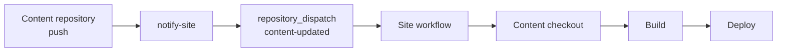
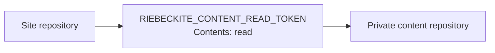
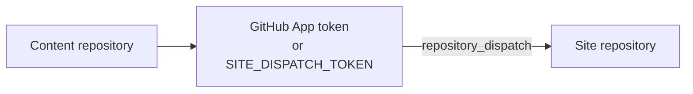

# Repository split

## Pattern C in detail

The basic flow is in [separating content from the site](../../content-repositories.md). This section adds the details that walkthrough omits.

### Keep the vault in a private repository

- After `git init`, create the **private** GitHub repository before the first push.
- `.obsidian/` is generated when Obsidian opens the vault. Even if it is pushed, putting `.obsidian/**` in `content.exclude` keeps it out of the site build. If you do not want to track it, a middle ground is to gitignore only `.obsidian/workspace*.json`.
- The baseline for private notes is: no `publish: true`. Add a second layer by excluding a private folder (for example `private/**`) in `content.exclude` so those notes are not even loaded.
- Leave `publishStrategy` at the default `explicit`. `selective` is the "publish almost everything, hide exceptions" model, which is riskier for a private vault.

### Fetching content is separate from triggering a deployment

The default deploy workflow (generated by `--github-actions`) checks out **only the site repository**.

**Option 1: extra checkout plus repository dispatch (recommended for automatic deployment)**

```yaml
- name: Check out the site
  uses: actions/checkout@v4

- name: Check out the notes
  uses: actions/checkout@v4
  with:
    repository: <you>/notes
    token: ${{ secrets.RIEBECKITE_CONTENT_READ_TOKEN || github.token }}
    path: content
```

- With `path: content`, set `content.directory` to `"content"`.
- This checkout makes files available only after the site workflow starts. Add `repository_dispatch: types: [content-updated]` to the site workflow and put a notification workflow in the content repository to start it on its `main` pushes.
- Do not set `ref` when article updates should deploy the newest default-branch content. The checkout then reads its current tip; the default `fetch-depth: 1` is enough.

Checking out content and triggering a deployment are separate concerns:

```text
Check out the content repository
        ≠
Start a build when the content updates
```

A checkout makes the content readable **after the workflow has started**. If you also want a push to the content repository to deploy the site automatically, you need a mechanism that **starts the site workflow**:



If you do not pin a `ref` in the additional checkout, you get the latest state of the content repository's default branch, which is convenient when article updates should flow straight into the site:

```text
Content main
   ↓
push
   ↓
Site workflow
   ↓
Latest content at that moment
```

The default `fetch-depth: 1` is enough. If you want to pin the exact content commit a site uses, use a Git submodule instead.

**Option 2: Git submodule**

```sh
cd my-site
git submodule add git@github.com:<you>/notes.git content
```

- `content` becomes a link to the articles repository; align `directory` in `riebeckite.config.ts` with `content`.
- Add `submodules: recursive` to `actions/checkout@v4` in the workflow so CI fetches the dependency.
- The referenced commit of a submodule is **recorded in the site repository**. Updating articles is a two-step operation: update the reference on the site side, commit, and push.

```sh
cd content && git pull
cd ..
git add content
git commit -m "update articles"
```

`git submodule update --remote` follows the latest remote, but you still need the site-side commit.

**Comparing the options**

| Aspect | Option 1 (extra checkout) | Option 2 (submodule) |
| --- | --- | --- |
| Article push deploys automatically | Yes, with repository dispatch | No (update the reference) |
| Locality | `path: content`, `directory: "content"` | Fixed at `directory: "content"` |
| History pinning | Follows the branch tip | Can pin a specific commit |
| Local operations | Often a normal clone | Requires `submodule update` |
| Best for | Article-first workflows | Pinning article revisions on the site side |

If article updates dominate, Option 1 is the easier fit; if you want the history pinned on the site side, use Option 2.

### Authentication for private repositories in CI

- `github.token` is scoped to the current repository. It can read another **public** GitHub repository, but cannot read a different private or internal repository.
- For a private/internal vault, register `RIEBECKITE_CONTENT_READ_TOKEN` in the site repository. Use a fine-grained PAT restricted to the vault with **Contents: read**, or an equivalent read-only GitHub App installation token.
- The content notification prefers a GitHub App installed only on the site repository with **Contents: read and write** and **Metadata: read-only**. Store `RIEBECKITE_APP_ID` and `RIEBECKITE_APP_PRIVATE_KEY` in the content repository; the workflow mints a short-lived token. If you cannot use an App, store `SITE_DISPATCH_TOKEN` there instead: a fine-grained PAT limited to the site repository with **Contents: read and write** (classic PATs need `repo` scope).
- If the submodule was added with an SSH URL (`git@github.com:...`), CI needs an SSH key. Switching to an HTTPS URL and passing `token:` is simpler to configure.

The read credential and the dispatch credential serve different directions:





```text
RIEBECKITE_CONTENT_READ_TOKEN
  → read private content from the site

RIEBECKITE_APP_ID + RIEBECKITE_APP_PRIVATE_KEY
  → start the site workflow with a short-lived token

SITE_DISPATCH_TOKEN
  → fallback when a GitHub App is not available
```

Create a PAT from [GitHub Settings → Developer settings → Personal access tokens](https://github.com/settings/tokens), then register the value under each repository's **Settings → Secrets and variables → Actions**.

```yaml
- name: Check out the notes
  uses: actions/checkout@v4
  with:
    repository: <you>/notes
    token: ${{ secrets.RIEBECKITE_CONTENT_READ_TOKEN || github.token }}
    path: notes
```

### Keep the local and CI layouts aligned

A relative `directory` is appRoot-relative, so different layouts locally and in CI resolve differently.

| Environment | Layout | `directory` |
| --- | --- | --- |
| Local (siblings) | `workspace/notes` and `workspace/my-site` | `"../notes"` |
| CI (extra checkout) | `my-site/notes` | `"notes"` |
| Submodule | `my-site/content` | `"content"` |

Changing the value (`../notes` locally, `notes` in CI) points both at the same vault. If you would rather use one value, either keep the vault under `my-site` locally or make CI lay it out as `../notes`.
