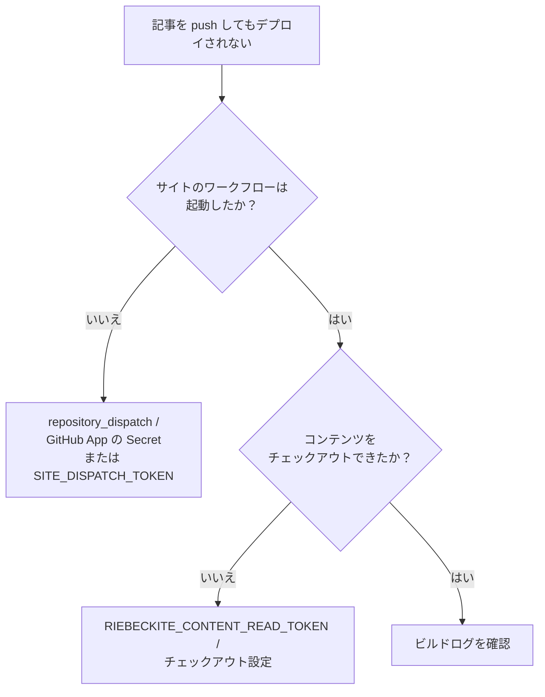
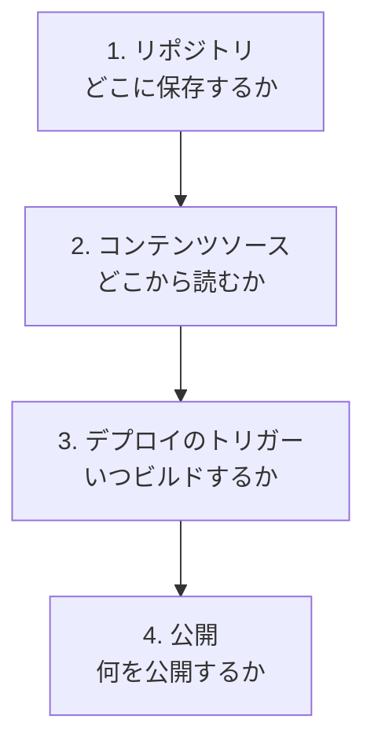

# トラブルシューティング

## 症状から原因を切り分ける

| 症状 | 対処 |
| --- | --- |
| 記事が表示されない | `publish: true`、`exclude` のパターン、`inspect content --list` を確認する |
| `doctor` がソースの問題を報告する | `inspect config` で解決済みディレクトリを確認し、相対 `directory` を基準（`appRoot`）と照らし合わせる |
| `Could not find riebeckite.config.*` | サイトの外から実行していないか確認する。CLI は親ディレクトリをたどって設定を探す |
| `Found multiple Vite applications` | `vite.config.*` が複数ある。対象のサイトを絞るか、`riebeckiteVite()` に `appRoot` / `configRoot` を渡す |
| CI のビルドで Vault が見つからない | ワークフローに追加チェックアウト、または `submodules: recursive` があるか確認する |
| `github.token` で解決できないプライベートリポジトリ（別ホストなど） | 専用のシークレット（PAT など）を `token:` で渡しているか確認する |
| CI でサブモジュールが取得されない | `actions/checkout@v4` に `submodules: recursive` があり、SSH URL ならキーが利用できるか確認する |
| サブモジュールの記事が更新されない | サイト側で `cd content && git pull` → `git add content` → コミット → push を行う |
| デプロイ後に画像が 404 になる | 公開ページが画像を参照し、ビルド出力に含まれているか確認する |
| デプロイ後に添付ファイルやメディアが 404 になる | prebuild のコピーがビルド前に実行され、`public/assets/attachments/` を対象にしているか確認する |
| Vault に画像があるのにコピーされない | 参照元のノートが公開されているか（`publish: true`）、参照が `link.kind` として収集されているか確認する |
| ローカルでは動くが CI ではパスが違う | CI の作業ディレクトリと相対パスの基準（`appRoot`）を確認する。`../notes` と `notes` の違いはよくある原因 |
| 除外したフォルダが読み込まれる | パターンはパス全体にアンカーされるため、必要なら `**/` を付ける |

### パスの問題はどこを見るか

コンテンツが見つからないときは、「今どこからコマンドを実行しているか」ではなく、「Riebeckite がどの `appRoot` を解決したか」から確認します。

```sh
npm exec riebeckite inspect config
```

相対 `content.directory` の基準は常に `appRoot` です。

```text
process.cwd()
  ×

configRoot
  ×

appRoot
  ○
```

### CI の問題は2つに分ける

まず、「ワークフローが起動しなかった」のか、「起動したがコンテンツがない」のかを切り分けます。



この2つは別の仕組みなので、どちらが失敗しているか切り分けてください。

## 4つの境界に分けて整理する

コンテンツとサイトの分離は、次の4つの境界を分けて考えると整理しやすくなります。



それぞれに対応する設定があります。

```text
リポジトリ
  → コンテンツとサイトをどこに保存するか

content.directory
  → Riebeckite がどこからコンテンツを読むか

checkout / repository_dispatch
  → CI がどう取得し、いつビルドするか

content.filters.publishStrategy / exclude / アセットコピー
  → 公開サイトに何を出すか
```

特に、次の関係に注意してください。

```text
コンテンツリポジトリをプライベートにする
        ≠
公開境界が自動的に安全になる
```

プライベート Vault でも、`content.filters.publishStrategy`、`exclude`、アセットコピーの3つで公開境界を維持してください。
