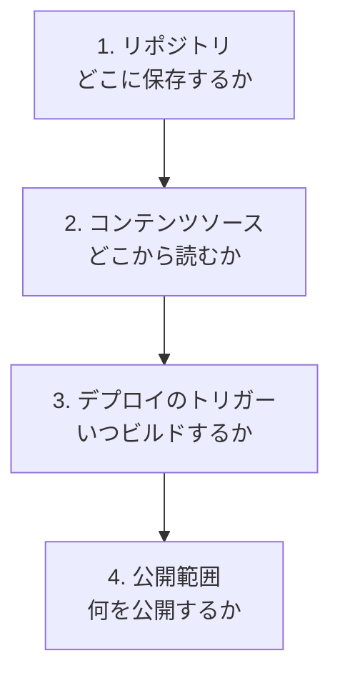

# トラブルシューティング

## 症状から原因を探る

| 症状 | 対処 |
| --- | --- |
| 記事が表示されない | `publish: true`、`exclude` のパターン、`inspect content --list` を確認する |
| `doctor` がソースの問題を報告する | `inspect config` で解決済みディレクトリを確認し、相対 `directory` を基準の `appRoot` と照らし合わせる |
| `Could not find riebeckite.config.*` | サイトの外から実行していないか確認する。CLI は親ディレクトリをたどって設定を探す、E|
| `Found multiple Vite applications` | `vite.config.*` が複数存在する。対象のサイトを絞るか、`riebeckiteVite()` に `appRoot` / `configRoot` を渡す、E|
| CI のビルドで Vault が見つからない | ワークフローに追加チェックアウト、`submodules: recursive` があるか確認する、E|
| `github.token` で解決できないプライベートリポジトリ（ほかホストなど） | 専用のシークレット（PAT など）を `token:` で渡しているか確認する、E|
| CI でサブモジュールが取得されない | `actions/checkout@v4` に `submodules: recursive` があり、SSH URL ならキーが利用できるか確認する、E|
| サブモジュールの記事が更新されない | サイト側で `cd content && git pull` → `git add content` → コミット → push を行う、E|
| デプロイ後に画像が 404 になる | 公開ページが画像を参照し、ビルド出力に含まれているか確認する、E|
| デプロイ後に添付ファイル・メディアが 404 になる | prebuild のコピーがビルド前に実行され、`public/assets/attachments/` を対象にしているか確認する、E|
| Vault に画像があるのにコピーされない | 参考参照ノートが公開されて (`publish: true`)、参照が `link.kind` として収集されているか確認する、E|
| ローカルでは動くのにCIではパスが違う | CI の作業ディレクトリと相対パスの基準！EappRoot` ーを確認する。`../notes` と `notes` の違いはよくある原因、E|
| 除外したフォルダが読み込まれる | パターンはパス全体にアンカーされるため、必要に応じて `**/` を付け足す、E|

### パスの問題はどこを見るか

コンテンツが見つからないときは、「今どこからコマンドを実行しているか」ではなく、「Riebeckite がどの `appRoot` を解決したか」から確認します、E

```sh
npm exec riebeckite inspect config
```

相対 `content.directory` の基準は常に `appRoot` です、E

```text
process.cwd()
  ⇅
configRoot
  ⇅
appRoot
  ◁
```

### CI の問題は2つに分けて考える

まず、「ワークフローが起動しなかった」か、「起動したがコンテンツがない」の2つに分離します、E

```mermaid
flowchart TD
    Problem["記事を push してもデプロイされない"]

    Problem --> Running{"サイトのワークフローは<br/>起動したか？"]

    Running -->|"いいえ"| Dispatch["repository_dispatch /<br/>GitHub App の Secret<br/>またはい SITE_DISPATCH_TOKEN"]
    Running -->|"はい"| Content{"コンテンツを<br/>チェックアウトできたか？"]

    Content -->|"いいえ"| Token["RIEBECKITE_CONTENT_READ_TOKEN /<br/>チェックアウト設定"]
    Content -->|"はい"| Build["ビルドログを確認する"]
```

この2つは別の仕組みなので、どちらが失敗しているか特定してください、E

## 4つの境界に沿って整理する

コンテンツをサイトから分離すると、次の4つの境界を意識すると整理しやすくなります、E



それぞれに対応する設定があります、E

```text
リポジトリ
  ⇅コンテンツとサイトをどこに保存するか

content.directory
  ⇅Riebeckite がどこからコンテンツを読むか

checkout / repository_dispatch
  ⇅CI がどのように取得し、いつビルドするか

content.filters.publishStrategy / exclude / アセットコピー
  ⇅公開サイトに何を出すか
```

特に、次の点に注意してください、E

```text
コンテンツリポジトリをプライベートにする
        ≠
公開境界が自動的に安全になるわけではない
```

プライベートVaultでも、`content.filters.publishStrategy`、`exclude`、アセットコピーの3つで公開境界を維持してください、E