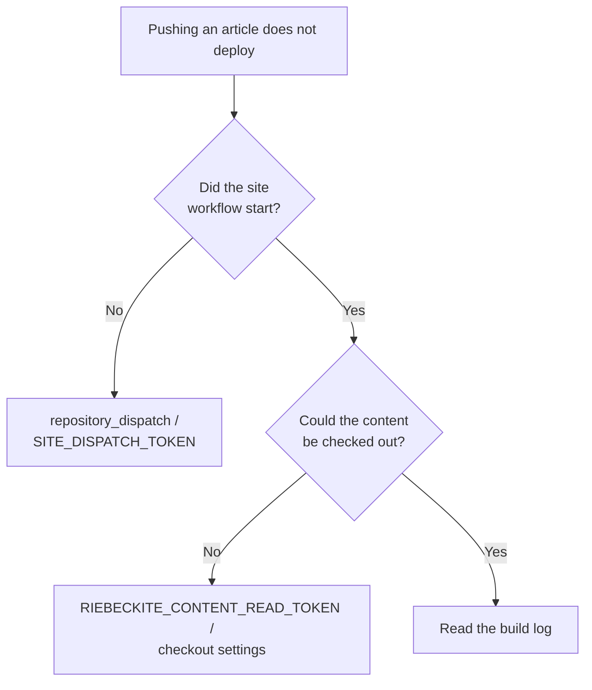
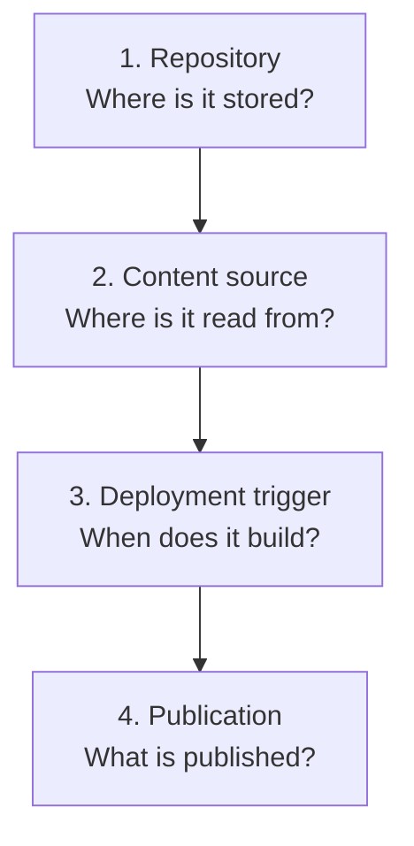

# Troubleshooting

## 6. Troubleshooting (in depth)

| Symptom | Fix |
| --- | --- |
| Articles do not appear | Check `publish: true`, `exclude` patterns, and `inspect content --list` |
| `doctor` reports a source problem | Check the resolved directory with `inspect config`; verify the relative `directory` against its base (appRoot) |
| `Could not find riebeckite.config.*` | Confirm you are not running from outside the site. The CLI walks ancestors to find the config |
| `Found multiple Vite applications` | More than one `vite.config.*` exists. Narrow the target site, or pass `appRoot` / `configRoot` to `riebeckiteVite()` |
| CI build cannot find the vault | Confirm the workflow has the extra checkout or `submodules: recursive` |
| A private repository not resolvable via `github.token` (e.g., another host) | Confirm a dedicated secret (PAT, etc.) is passed with `token:` |
| The submodule is not fetched in CI | Confirm `actions/checkout@v4` has `submodules: recursive`, and that an SSH URL has a key available |
| Submodule articles do not update | On the site side: `cd content && git pull` → `git add content` → commit → push |
| Images 404 after deploy | Confirm a published page references the image and that it is in the build output |
| Attachments or media 404 after deploy | Confirm the prebuild copy runs before the build and targets `public/assets/attachments/` |
| An image exists in the vault but is not copied | Confirm the referencing note is published (`publish: true`) and that the reference is collected as a `link.kind` |
| Works locally but the path differs in CI | Check the CI working directory and the relative base (appRoot). `../notes` vs `notes` is a common source of drift |
| An excluded folder is still loaded | Remember patterns are anchored; add `**/` if needed (4-2) |

### 6-1. Common path problems

When content is not found, do not start with "where am I running the command from" but with "which `appRoot` did Riebeckite resolve":

```sh
npm exec riebeckite inspect config
```

A relative `content.directory` is always based on `appRoot`:

```text
process.cwd()
  ×

configRoot
  ×

appRoot
  ○
```

### 6-2. Common CI problems

Split the problem first into "the workflow did not start" versus "the workflow started but there is no content":



These are two separate mechanisms, so isolate which one is failing.

## 7. Summary

Separating content from the site is easier to reason about when you keep four boundaries apart:



Each boundary has its own setting:

```text
Repository
  → where content and the site are stored

content.directory
  → where Riebeckite reads content from

checkout / repository_dispatch
  → how CI fetches it and when it builds

publishStrategy / exclude / asset copy
  → what is exposed on the public site
```

In particular, note that:

```text
Making the content repository private
        ≠
Automatically making the publication boundary safe
```

Even with a private vault, keep the public boundary intact across `publishStrategy`, `exclude`, and the asset copy.
