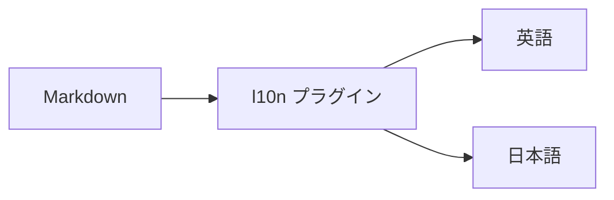
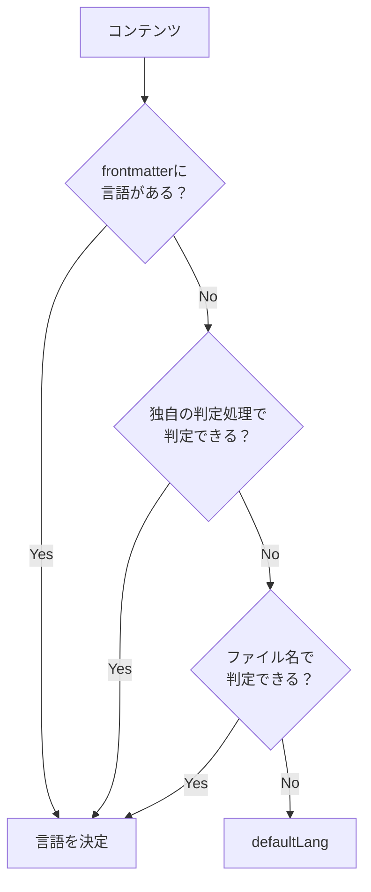
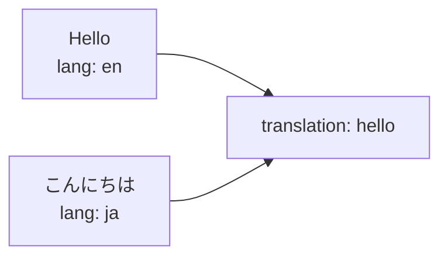
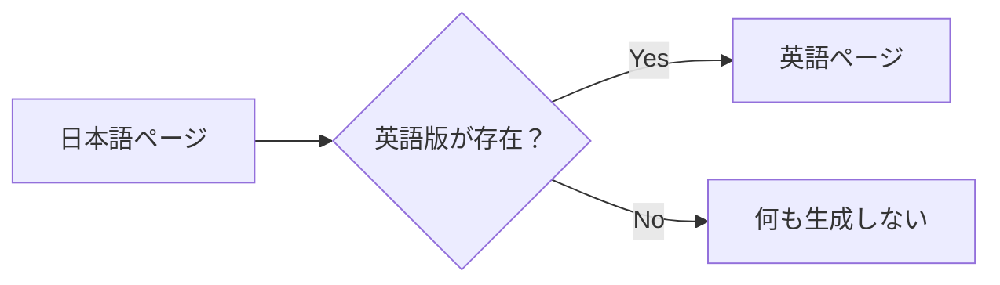
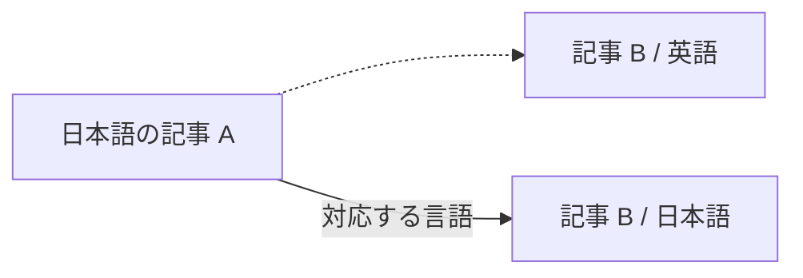
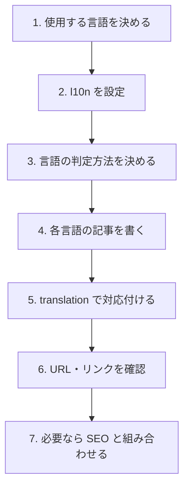

# 多言語サイト

Riebeckite では、`@riebeckite/plugin-l10n` を使って多言語サイトを構築できます。翻訳の対象はコンテンツです。Riebeckite 自身の画面に表示される文字列は翻訳しません。

l10n プラグインは、コンテンツごとの言語を判定し、

- 言語ごとの URL
- 同じコンテンツの翻訳版
- サイト内リンク
- 言語切り替え
- SEO と組み合わせた `hreflang`

などを扱います。



`showcase` プリセットでは、次の7言語が設定されます。

```text
en
ja
zh-CN
es
de
fr
ko
```

`starter` はサイトのロケールに応じた1言語のページを生成し、`minimal` は英語のみです。翻訳済みのルートが必要になったら l10n を追加してください。すべての言語の記事を用意する必要はありません。実際に利用する言語に合わせて設定できます。

## 基本設定

`riebeckite.config.ts` に `l10n` プラグインを追加します。

```ts
import { l10n } from "@riebeckite/plugin-l10n";

export default defineConfig({
  plugins: [
    l10n({
      defaultLang: "ja",
      languages: ["ja", "en", "zh-CN"],
    }),
  ],
});
```

この例では、既定の言語が `ja`、利用する言語が `ja`、`en`、`zh-CN` です。`defaultLang` は `languages` に含める必要があります。

`defaultLang` は、コンテンツの言語を他の方法で判定できなかった場合にも使われます。

## コンテンツの言語を決める

l10n プラグインは、それぞれのコンテンツが何語なのかを判定します。

判定には優先順位があります。



優先順位は次のとおりです。

1. frontmatter
2. 独自の判定処理
3. ファイル名
4. `defaultLang`

上の方法で判定できた時点で、そのコンテンツの言語が決まります。

## frontmatter で指定する

最も明示的なのは frontmatter の `lang` です。

```md
---
title: こんにちは
lang: ja
publish: true
---

日本語の記事です。
```

このコンテンツは日本語として扱われます。

ファイルの場所や名前とは別に言語を明示したい場合に利用できます。

## ファイル名で分ける

同じディレクトリに複数言語の記事を置く場合は、ファイル名の末尾で分けます。

たとえば、

```text
README.md
README.ja.md
```

のように配置します。

`README.ja.md` の `.ja` から、そのコンテンツが日本語だと判定できます。`defaultLang` の言語には接尾辞を付けません。

推奨は `.言語` ですが、`-言語` と `_言語` も同じ意味で扱われます。`note.en-US.md` や `note.zh-CN.md` のような BCP 47 タグも使えます。

この方式なら、

```text
docs/
├─ README.md
├─ README.ja.md
├─ installation.md
└─ installation.ja.md
```

のように、元の記事と翻訳版を近くに置いて管理できます。

## ディレクトリでは分けない

言語ごとにディレクトリを分ける構成（`en/note.md`、`ja/note.md`）は、言語判定には使われません。

言語判定の暗黙ルールをファイル名の接尾辞だけに絞ることで、同じ名前の記事が複数言語で存在しても WikiLink が一意に解決されます。言語はファイル名の接尾辞か、frontmatter の `lang` で指定してください。複数の判定材料が食い違う場合は `L10N_LANGUAGE_CONFLICT` が報告されます。`strict: true` を設定している場合、この警告はビルドの失敗になります。

## 翻訳同士を対応付ける

「この日本語記事と、この英語記事は同じコンテンツの翻訳版」という関係は、frontmatter の `translation` で表します。

たとえば日本語版を、

```md
---
title: こんにちは
publish: true
lang: ja
translation: hello
---

日本語の記事です。
```

とします。

対応する英語版にも同じ `translation` を指定します。

```md
---
title: Hello
publish: true
lang: en
translation: hello
---

This is the English version.
```

両方に、

```yaml
translation: hello
```

があるため、同じコンテンツの翻訳として扱われます。



同じ翻訳グループと言語の組み合わせが重複すると、`L10N_DUPLICATE_TRANSLATION` が報告されます。`strict: true` ではビルドが失敗します。パスや名前が無関係なファイル同士を対応付ける場合は `translation` を使ってください。

翻訳グループの ID を読み取る frontmatter プロパティは、l10n プラグインの `translationKey` で変更できます。既定値は `translation` です。

```ts
l10n({
  defaultLang: "ja",
  languages: ["ja", "en"],
  translationKey: "translationId",
});
```

プラグインが知らない独自の規則を使う場合は、`detect` を指定します。`detect` が返す言語は frontmatter の次、ファイル名より前に検討されます。翻訳グループの ID も明示できます。

```ts
l10n({
  defaultLang: "ja",
  languages: ["ja", "en", "fr"],
  detect: ({ path }) =>
    path.startsWith("French/") ? { lang: "fr", translationId: "hello" } : undefined,
});
```

## `lang` と `translation` の違い

この2つは役割が異なります。

| フィールド | 意味 |
| --- | --- |
| `lang` | このページが何語なのか |
| `translation` | どのページ同士が翻訳関係なのか |

たとえば、

```yaml
lang: ja
translation: getting-started
```

なら、

```text
このページの言語
  → 日本語

翻訳グループ
  → getting-started
```

という意味になります。

`translation` 自体は言語名ではありません。

同じ内容を表すページ同士で共通の値を使います。

## 翻訳が存在しない場合

すべてのコンテンツにすべての言語版を用意する必要はありません。

たとえば、

```text
article-a.md       日本語
article-a.en.md    English
article-b.md       日本語
```

のように、一部の言語版だけが存在しても構いません。

`article-b` の英語版が存在しない場合、Riebeckite が英語ページを自動生成することはありません。



l10n プラグインは既存の翻訳関係を扱いますが、コンテンツ自体を翻訳する機能ではありません。

## URL

l10n プラグインはコンテンツの言語情報を使って公開 URL を扱います。

つまり、多言語化は単に画面へ言語名を表示するだけではなく、

```text
コンテンツ
  ↓
言語判定
  ↓
Public Location
  ↓
URL
```

まで含めて処理されます。

既定の言語は Core が解決した URL（`/about` など）をそのまま使います。それ以外の言語には接頭辞が付きます（`/en/about` など）。プラグインは既存の公開位置リゾルバーを拡張するもので、新しいルーターを追加するわけではありません。そのため `@riebeckite/plugin-permalink` などの URL プラグインと組み合わせられます。

サイト側でファイル名から独自に URL を組み立てるのではなく、Riebeckite が解決した Public Location を利用してください。公開位置の仕組みについては [コンテンツシステム](../framework/content-system.ja.md) を参照してください。

翻訳が存在しない場合のフォールバックページは生成されません。内部のヘルパーは、翻訳の欠落を次のように報告します。

- `getLocalization(manifest, slug)` は、実在するノートについてのみ `availableLanguages` と言語ごとのリンク `translations` を返します。
- `getLocalizedContent(manifest, slug, lang)` は、翻訳がなければ `null` を返します。

## サイト内リンク

多言語サイトでは、本文中のリンクも言語を考慮して扱われます。

たとえば日本語の記事から別の記事へ移動するとき、対応する日本語版が存在する場合は、その言語に対応したリンクとして扱えます。



これによって、記事本文のリンクだけ別言語のページへ戻ってしまう、といった問題を避けられます。

コンテンツグラフを構築する前に、WikiLink のリンク先は、対応する翻訳が存在すればリンク元の記事と同じ言語へ切り替えられます。存在しなければ元のリンク先のままです。描画時には、Obsidian の WikiLink（`@riebeckite/plugin-obsidian-markdown` が解決した後）と Markdown リンクの両方が、現在のページと同じ言語の翻訳へ書き換えられます。クエリ文字列とフラグメントは保持されます。外部 URL、フラグメントだけのリンク、存在しないリンク先、アセットの URL は変更されません。

## 言語切り替え

同じ `translation` を持つコンテンツは、言語切り替えの候補になります。

たとえば、

```text
translation: hello

├─ lang: en
├─ lang: ja
└─ lang: de
```

というコンテンツが存在すれば、それぞれを同じコンテンツの別言語版として扱えます。

**実際に存在する翻訳だけが候補になります**。存在しない言語版のフォールバックページは自動生成されません。

`l10n(...)` は既存の翻訳をグループ化し、`getLocalization(manifest, slug)` と `<LanguageSwitcher />` コンポーネントを公開します。サイトは好きな場所に切り替え UI を配置できます。l10n 専用の統合は必要ありません。実際の翻訳が2つ未満のページでは、このコンポーネントは何も描画しません。

```tsx
import { LanguageSwitcher, getLocalization } from "@riebeckite/plugin-l10n";

const localization = getLocalization(manifest, entry.slug);
<LanguageSwitcher localization={localization} />;
```

`SiteProvider` と、公開済みの `entry` を持つ `Article` がある場合、`<LanguageSwitcher />` は現在の多言語情報を自分で解決します。テーマは `.rr-l10n-switcher` ルートフックを通じて標準の言語切替 UI を調整できます。

## SEO

SEO プラグインと組み合わせることで、翻訳関係を `hreflang` として出力できます。

概念的には、

```text
英語ページ
   ↕
翻訳関係
   ↕
日本語ページ
   ↓
SEO
   ↓
hreflang
```

という関係です。

これによって検索エンジンに同じコンテンツの別言語版であることを伝えられます。翻訳された各エントリには、実在する翻訳ごとに1つの `<link rel="alternate" hreflang="…">` が、Core の head タグ拡張ポイントを通じて追加されます。サイトのシェルがこれらのタグを描画し、リクエストに応じて `<html lang>` を選びます。

## おすすめの構成

英語と日本語の2言語で運用する場合は、たとえば次のようにできます。

```text
content/
├─ getting-started.md
├─ getting-started.ja.md
├─ installation.md
├─ installation.ja.md
└─ faq.ja.md
```

そして翻訳関係を frontmatter で明示します。

英語版は次のとおりです。

```md
---
title: Getting Started
lang: en
translation: getting-started
publish: true
---
```

日本語版は次のとおりです。

```md
---
title: はじめに
lang: ja
translation: getting-started
publish: true
---
```

翻訳がまだ存在しない `faq.ja.md` は、日本語だけで公開しても構いません。

## 導入の流れ

多言語サイトを作る場合は、次の順番で考えると分かりやすくなります。



## まとめ

Riebeckite の多言語対応では、次の3つを分けて考えると分かりやすくなります。

```text
lang
  → このコンテンツは何語か

translation
  → どのコンテンツと翻訳関係にあるか

Public Location
  → その言語のコンテンツをどの URL で公開するか
```

言語は、

```text
frontmatter
    ↓
独自の判定処理
    ↓
ファイル名
    ↓
defaultLang
```

の優先順位で判定されます。

翻訳関係は `translation` で明示し、実際に存在する翻訳だけを利用します。存在しない翻訳を Riebeckite が自動生成することはありません。

## オプション

| オプション | 役割 |
| --- | --- |
| `defaultLang` | 接頭辞を付けない URL を使う言語。必須 |
| `languages` | 認識する言語。ここに含めた言語だけをロケールとして扱う |
| `translationKey` | 翻訳グループの ID を持つ frontmatter プロパティ。既定値は `translation` |
| `strict` | 言語の競合と翻訳の重複をビルドの失敗にする |
| `detect` | 独自の判定処理。`{ lang, translationId }` または `undefined` を返す |

詳しいオプションや公開 API は、`@riebeckite/plugin-l10n` のパッケージ README と [プラグイン API](../reference/plugin-api.ja.md) を参照してください。
