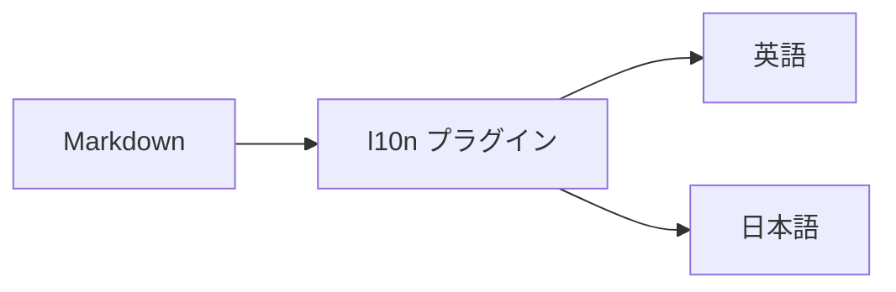
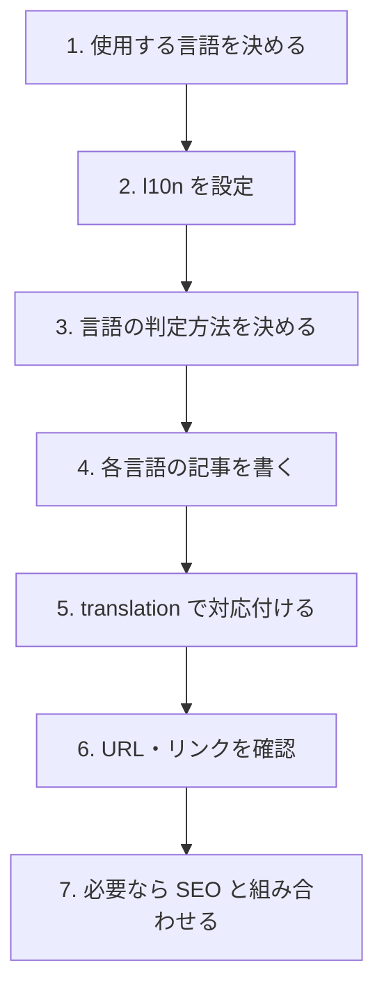

# 多言語サイト

Riebeckite では、`@riebeckite/plugin-l10n` を使って多言語サイトを構築できます。[[glossary/translation|翻訳]]の対象はコンテンツです。Riebeckite 自身の画面に表示される文字列は翻訳しません。

l10n [[glossary/plugin|プラグイン]]は、コンテンツごとの言語を判定し、

- 言語ごとの URL
- 同じコンテンツの翻訳版
- サイト内リンク
- 言語切り替え
- SEO と組み合わせた `hreflang`

などを扱います。



`showcase` [[glossary/preset|プリセット]]では、次の7言語が設定されます。

```text
en
ja
zh-CN
es
de
fr
ko
```

`starter` はサイトの[[glossary/locale|ロケール]]に応じた1言語のページを生成し、`minimal` は英語のみです。翻訳済みのルートが必要になったら l10n を追加してください。すべての言語の記事を用意する必要はありません。実際に利用する言語に合わせて設定できます。

## このページの構成

- [セットアップ](./localization/setup.ja.md)
- [翻訳の対応付け](./localization/translations.ja.md)

## 導入の流れ

多言語サイトを作る場合は、次の順番で考えると分かりやすくなります。



## まとめ

Riebeckite の多言語対応では、次の3つを分けて考えると分かりやすくなります。

```text
lang
  → このコンテンツは何語か

translation
  → どのコンテンツと翻訳関係にあるか

Public Location
  → その言語のコンテンツをどの URL で公開するか
```

言語は、

```text
frontmatter
    ↓
独自の判定処理
    ↓
ファイル名
    ↓
defaultLang
```

の優先順位で判定されます。

翻訳関係は `translation` で明示し、実際に存在する翻訳だけを利用します。存在しない翻訳を Riebeckite が自動生成することはありません。

## オプション

| オプション | 役割 |
| --- | --- |
| `defaultLang` | 接頭辞を付けない URL を使う言語。必須 |
| `languages` | 認識する言語。ここに含めた言語だけをロケールとして扱う |
| `translationKey` | 翻訳グループの ID を持つ frontmatter プロパティ。既定値は `translation` |
| `strict` | 言語の競合と翻訳の重複をビルドの失敗にする |
| `detect` | 独自の判定処理。`{ lang, translationId }` または `undefined` を返す |

詳しいオプションや公開 API は、`@riebeckite/plugin-l10n` のパッケージ README と [プラグイン API](../reference/plugin-api.ja.md) を参照してください。
