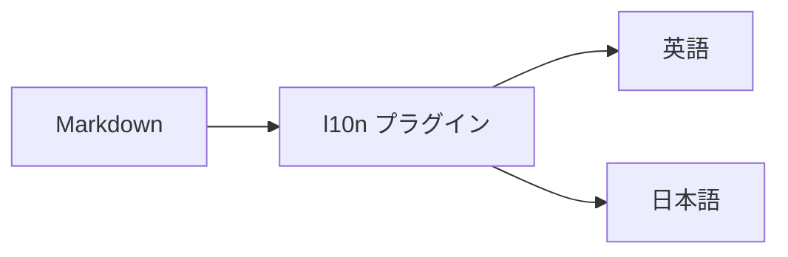
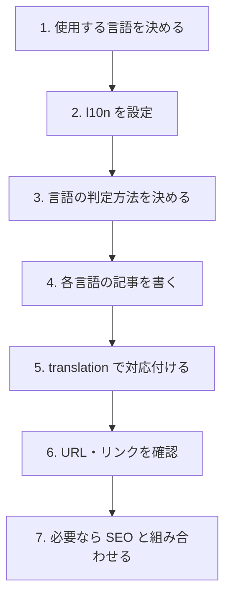

# 多言語サイト

Riebeckite では、`@riebeckite/plugin-l10n` を使って多言語サイトを構築できます。[[glossary/translation|翻訳]]の対象はコンテンツです。Riebeckite 自身の画面に表示される文字列は翻訳しません。

l10n [[glossary/plugin|プラグイン]]は、コンテンツごとの言語を判定し、

- 言語ごとの URL
- 同じコンテンツの翻訳版
- サイト内リンク
- 言語切り替え
- SEO と組み合わせた `hreflang`

などを扱います。



`showcase` [[glossary/preset|プリセット]]では、次の7言語が設定されます。

```text
en
ja
zh-CN
es
de
fr
ko
```

`starter` はサイトの[[glossary/locale|ロケール]]に応じた1言語のページを生成し、`minimal` は英語のみです。翻訳済みのルートが必要になったら l10n を追加してください。すべての言語の記事を用意する必要はありません。実際に利用する言語に合わせて設定できます。

## このページの構成

- [セットアップ](./localization/setup.ja.md)
- [翻訳の対応付け](./localization/translations.ja.md)

## 導入の流れ

多言語サイトを作る場合は、次の順番で考えると分かりやすくなります。



## まとめ

Riebeckite の多言語対応では、次の3つを分けて考えると分かりやすくなります。

```text
lang
  → このコンテンツは何語か

translation
  → どのコンテンツと翻訳関係にあるか

Public Location
  → その言語のコンテンツをどの URL で公開するか
```

言語は、

```text
frontmatter
    ↓
独自の判定処理
    ↓
ファイル名
    ↓
defaultLang
```

の優先順位で判定されます。

翻訳関係は `translation` で明示し、実際に存在する翻訳だけを利用します。存在しない翻訳を Riebeckite が自動生成することはありません。

## 生成ページの言語選択

コンテンツページは `Public Location` が言語を保持しているため、そのまま言語を保てます。一覧ページにはもう1つ判断が必要です。`ja` と `en` の同じ記事があるとき、`/timeline` と `/en/timeline` のどちらに何を出すのか、という判断です。

Riebeckite はプラグインごとのフィルタではなく、共通のポリシーでこれを扱います。

| モード | 結果 |
| --- | --- |
| `current` | ページの言語だけを残す。一覧ページの既定値 |
| `fallback` | ページの言語を残し、その言語の翻訳がないグループにだけ `fallbackLocale` を使う |
| `all` | すべての言語を残す。暗黙の重複排除はしない |

`current` は言語を持たないコンテンツを削除せず、l10n を有効にしていないサイトの動作も変えません。`fallback` は翻訳グループ単位で比較するため、タイトルと日付が同じだけの別記事を統合することはありません。ページ言語の翻訳が欠けている場合、`fallback` には明示的な `fallbackLocale` が必要です。未設定のままグループを黙って除外せず、処理は失敗します。

共通のヘルパーは Core にあります。

```ts
import {
  localizedPagePaths,
  resolvePageLocale,
  selectLocalizedEntries,
} from "@riebeckite/core";

const locale = resolvePageLocale(manifest, "/en/timeline");
const entries = selectLocalizedEntries(manifest.discoverableEntries, {
  mode: "current",
  locale,
  fallbackLocale: manifest.localization?.fallbackLocale,
});
```

プラグインの page type には解決済みの `locale` が渡され、`localizedPagePaths(manifest, "/timeline")` で一覧ページが生成すべきパスを取得できます。

同じポリシーは Content Query と Content Collection にも統合されています。

```ts
queryContentEntries(entries, {
  filter: { locale: { mode: "current", locale: "ja" } },
});
```

一覧を提供する組み込みプラグインは、意味のある箇所で `localeMode` オプションを公開します。既定値は `current` です。これにより、多言語サイトの Timeline、Archive、タグ、検索、Related Posts、Backlinks に日英の同じ記事が並ぶことはありません。検索の `lang:` フィルタは残るため、全言語を明示的に検索できます。

ページ言語の記事が存在しない場合に備えるときは、l10n に `fallbackLocale` を設定します。

```ts
l10n({
  defaultLang: "ja",
  languages: ["ja", "en"],
  fallbackLocale: "en",
});
```

フォールバックされた記事も、自分の言語と URL を保ったまま表示されます。ページ言語と異なる記事を表示する一覧 UI は、共通の `.rr-language-badge` を付けます。

グラフは別扱いです。Local Graph やグラフ表示は Obsidian 互換の関係面を保つため、言語をまたぐリンクを残します。ノードを絞り込むと実在するリンクが消えるため、言語で絞った一覧が必要な場合は一覧プラグインを使います。

## オプション

| オプション | 役割 |
| --- | --- |
| `defaultLang` | 接頭辞を付けない URL を使う言語。必須 |
| `languages` | 認識する言語。ここに含めた言語だけをロケールとして扱う |
| `fallbackLocale` | ページ言語の翻訳がない場合に一覧で使う言語。`languages` に含める |
| `translationKey` | 翻訳グループの ID を持つ frontmatter プロパティ。既定値は `translation` |
| `strict` | 言語の競合と翻訳の重複をビルドの失敗にする |
| `detect` | 独自の判定処理。`{ lang, translationId }` または `undefined` を返す |

詳しいオプションや公開 API は、`@riebeckite/plugin-l10n` のパッケージ README と [プラグイン API](../reference/plugin-api.ja.md) を参照してください。
