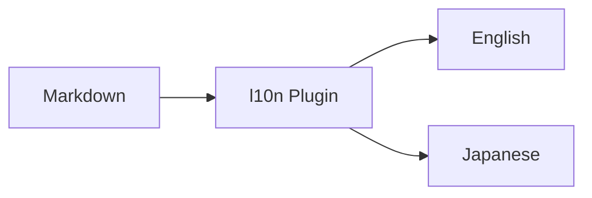
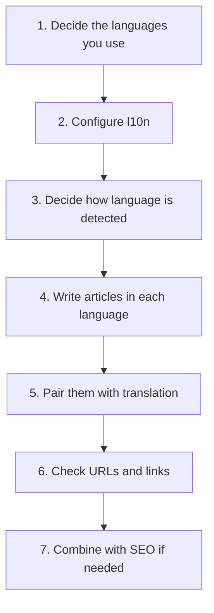

# Localization

Riebeckite localizes **content**. With `@riebeckite/plugin-l10n` it can keep several language versions of the same note side by side, prefix non-default languages in the URL, add a language switcher, and emit `hreflang` links. It does not translate Riebeckite's own interface strings.



The plugin handles per-content language detection, language-specific URLs, translations of the same content, in-site links, the language switcher, and `hreflang` for SEO.

The `showcase` preset registers it with seven languages:

```text
en
ja
zh-CN
es
de
fr
ko
```

`starter` uses a single page language selected from the site locale; `minimal` is English-only. Add l10n only when the site needs translated routes. You do not need articles in every language; configure only the languages you actually use.

## In this section

- [Setup](./localization/setup.md)
- [Translations](./localization/translations.md)

## Introduction flow

When building a multilingual site, it helps to decide things in this order:



## Summary

Riebeckite localization is easier to reason about when you separate three things:

```text
lang
  → what language this content is in

translation
  → which content is a translation of which

Public Location
  → at which URL that language's content is published
```

The language is decided in this precedence order:

```text
frontmatter
    ↓
custom detector
    ↓
filename
    ↓
defaultLang
```

Translation relationships are stated with `translation`, and only translations that actually exist are used. Riebeckite never generates a missing translation automatically.

## Locale selection for generated pages

Content pages keep their language because their `Public Location` already carries it. Listing pages need one more decision: when a site has `ja` and `en` versions of the same note, which of them belongs on `/timeline` and which on `/en/timeline`?

Riebeckite answers this with one shared policy instead of per-plugin filters:

| Mode | Result |
| --- | --- |
| `current` | Keep only the page language. Default for listing pages. |
| `fallback` | Keep the page language; use `fallbackLocale` only for translation groups that have no page-language entry. |
| `all` | Keep every language. The mode never deduplicates entries implicitly. |

`current` never removes content that has no language, and a site without l10n metadata behaves exactly as before. `fallback` compares translation groups, so two notes with the same title and date are still separate notes unless they share a translation identity.

The policy is available through Core helpers:

```ts
import {
  localizedPagePaths,
  resolvePageLocale,
  selectLocalizedEntries,
} from "@riebeckite/core";

const locale = resolvePageLocale(manifest, "/en/timeline");
const entries = selectLocalizedEntries(manifest.discoverableEntries, {
  mode: "current",
  locale,
  fallbackLocale: manifest.localization?.fallbackLocale,
});
```

Plugin page types also receive the resolved `locale` in their context, and `localizedPagePaths(manifest, "/timeline")` returns the paths a localized listing should emit.

The same policy is part of Content Query and Content Collections:

```ts
queryContentEntries(entries, {
  filter: { locale: { mode: "current", locale: "ja" } },
});
```

Built-in listing plugins expose a `localeMode` option where the choice is meaningful. Their default is `current`, so a multilingual site no longer shows both versions of a note in Timeline, Archive, tags, search, Related Posts, or Backlinks. Search keeps its explicit `lang:` filter, so searching across all languages remains possible.

Set `fallbackLocale` on the l10n plugin when a page language may be empty:

```ts
l10n({
  defaultLang: "ja",
  languages: ["ja", "en"],
  fallbackLocale: "en",
});
```

A fallback entry is still rendered with its own language and URL. Listing UIs add the shared `.rr-language-badge` marker when they show a language different from the page language.

Graphs are different. Local Graph and graph views keep links between languages because the graph is the Obsidian-compatible relationship surface; filtering nodes would hide real links. Use a listing plugin when you want a language-scoped list.

## Options reference

| Option | Purpose |
| --- | --- |
| `defaultLang` | The language that keeps unprefixed URLs. Required |
| `languages` | The recognized languages. Only these are treated as locales |
| `fallbackLocale` | Locale used by listings when the page language has no translation. Must be included in `languages` |
| `translationKey` | Frontmatter property that holds the translation identity. Defaults to `translation` |
| `strict` | Turn language conflicts and duplicate translations into build failures |
| `detect` | Custom detection: returns `{ lang, translationId }` or `undefined` |

The full option list and implementation notes are in the plugin README.

## See also

- [Configuration](../reference/configuration.md) — `plugins` and `content`
- [Plugin API](../reference/plugin-api.md) — public-location resolution
- [Content System](../framework/content-system.md) — how resolved locations reach pages
