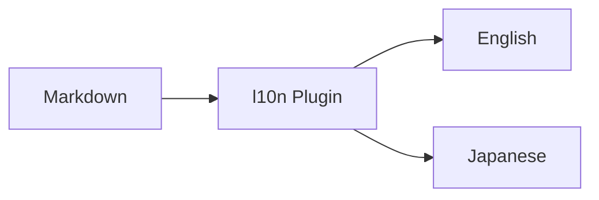
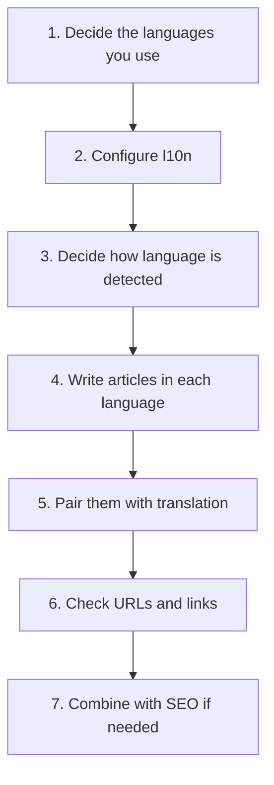

# Localization

Riebeckite localizes **content**. With `@riebeckite/plugin-l10n` it can keep several language versions of the same note side by side, prefix non-default languages in the URL, add a language switcher, and emit `hreflang` links. It does not translate Riebeckite's own interface strings.



The plugin handles per-content language detection, language-specific URLs, translations of the same content, in-site links, the language switcher, and `hreflang` for SEO.

The `showcase` preset registers it with seven languages:

```text
en
ja
zh-CN
es
de
fr
ko
```

`starter` uses a single page language selected from the site locale; `minimal` is English-only. Add l10n only when the site needs translated routes. You do not need articles in every language; configure only the languages you actually use.

## In this section

- [Setup](./localization/setup.md)
- [Translations](./localization/translations.md)

## Introduction flow

When building a multilingual site, it helps to decide things in this order:



## Summary

Riebeckite localization is easier to reason about when you separate three things:

```text
lang
  → what language this content is in

translation
  → which content is a translation of which

Public Location
  → at which URL that language's content is published
```

The language is decided in this precedence order:

```text
frontmatter
    ↓
custom detector
    ↓
filename
    ↓
defaultLang
```

Translation relationships are stated with `translation`, and only translations that actually exist are used. Riebeckite never generates a missing translation automatically.

## Options reference

| Option | Purpose |
| --- | --- |
| `defaultLang` | The language that keeps unprefixed URLs. Required |
| `languages` | The recognized languages. Only these are treated as locales |
| `translationKey` | Frontmatter property that holds the translation identity. Defaults to `translation` |
| `strict` | Turn language conflicts and duplicate translations into build failures |
| `detect` | Custom detection: returns `{ lang, translationId }` or `undefined` |

The full option list and implementation notes are in the plugin README.

## See also

- [Configuration](../reference/configuration.md) — `plugins` and `content`
- [Plugin API](../reference/plugin-api.md) — public-location resolution
- [Content System](../framework/content-system.md) — how resolved locations reach pages
