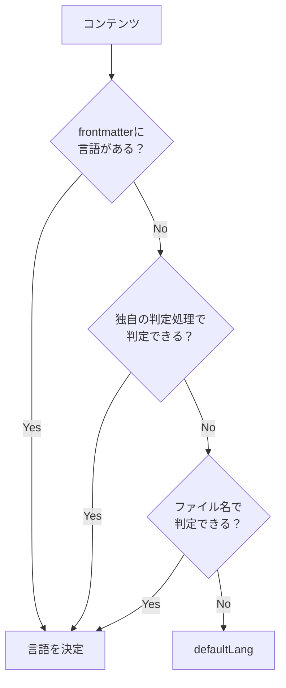

# セットアップ

## 基本設定

`riebeckite.config.ts` に `l10n` プラグインを追加します。

```ts
import { l10n } from "@riebeckite/plugin-l10n";

export default defineConfig({
  plugins: [
    l10n({
      defaultLang: "ja",
      languages: ["ja", "en", "zh-CN"],
    }),
  ],
});
```

この例では、既定の言語が `ja`、利用する言語が `ja`、`en`、`zh-CN` です。`defaultLang` は `languages` に含める必要があります。

`defaultLang` は、コンテンツの言語を他の方法で判定できなかった場合にも使われます。

## コンテンツの言語を決める

l10n プラグインは、それぞれのコンテンツが何語なのかを判定します。

判定には優先順位があります。



優先順位は次のとおりです。

1. frontmatter
2. 独自の判定処理
3. ファイル名
4. `defaultLang`

上の方法で判定できた時点で、そのコンテンツの言語が決まります。

## frontmatter で指定する

最も明示的なのは frontmatter の `lang` です。

```md
---
title: こんにちは
lang: ja
publish: true
---

日本語の記事です。
```

このコンテンツは日本語として扱われます。

ファイルの場所や名前とは別に言語を明示したい場合に利用できます。

## ファイル名で分ける

同じディレクトリに複数言語の記事を置く場合は、ファイル名の末尾で分けます。

たとえば、

```text
README.md
README.ja.md
```

のように配置します。

`README.ja.md` の `.ja` から、そのコンテンツが日本語だと判定できます。`defaultLang` の言語には接尾辞を付けません。

推奨は `.言語` ですが、`-言語` と `_言語` も同じ意味で扱われます。`note.en-US.md` や `note.zh-CN.md` のような BCP 47 タグも使えます。

この方式なら、

```text
docs/
├─ README.md
├─ README.ja.md
├─ installation.md
└─ installation.ja.md
```

のように、元の記事と翻訳版を近くに置いて管理できます。

## ディレクトリでは分けない

言語ごとにディレクトリを分ける構成（`en/note.md`、`ja/note.md`）は、言語判定には使われません。

言語判定の暗黙ルールをファイル名の接尾辞だけに絞ることで、同じ名前の記事が複数言語で存在しても [[glossary/wikilink|WikiLink]] が一意に解決されます。言語はファイル名の接尾辞か、frontmatter の `lang` で指定してください。複数の判定材料が食い違う場合は `L10N_LANGUAGE_CONFLICT` が報告されます。`strict: true` を設定している場合、この警告はビルドの失敗になります。
