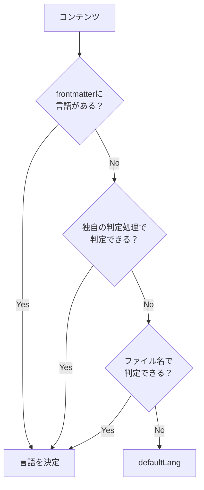

# セットアップ

## 基本設定

`riebeckite.config.ts` に `l10n` プラグインを追加します。

```ts
import { l10n } from "@riebeckite/plugin-l10n";

export default defineConfig({
  plugins: [
    l10n({
      defaultLang: "ja",
      languages: ["ja", "en", "zh-CN"],
    }),
  ],
});
```

この例では、既定の言語が `ja`、利用する言語が `ja`、`en`、`zh-CN` です。`defaultLang` は `languages` に含める必要があります。

`defaultLang` は、コンテンツの言語を他の方法で判定できなかった場合にも使われます。

### 一覧ページのフォールバック

生成される一覧は、既定で現在のページ言語を使います。別の言語にしか存在しない記事を表示したい場合は、`fallbackLocale` を設定します。

```ts
l10n({
  defaultLang: "ja",
  languages: ["ja", "en"],
  fallbackLocale: "en",
});
```

フォールバックは翻訳グループ単位で適用され、タイトルや日付の一致で統合されることはありません。フォールバックされた記事も、自分の言語と URL を保ちます。

## コンテンツの言語を決める

l10n プラグインは、それぞれのコンテンツが何語なのかを判定します。

判定には優先順位があります。



優先順位は次のとおりです。

1. frontmatter
2. 独自の判定処理
3. ファイル名
4. `defaultLang`

上の方法で判定できた時点で、そのコンテンツの言語が決まります。

## frontmatter で指定する

最も明示的なのは frontmatter の `lang` です。

```md
---
title: こんにちは
lang: ja
publish: true
---

日本語の記事です。
```

このコンテンツは日本語として扱われます。

ファイルの場所や名前とは別に言語を明示したい場合に利用できます。

## ファイル名で分ける

同じディレクトリに複数言語の記事を置く場合は、ファイル名の末尾で分けます。

たとえば、

```text
README.md
README.ja.md
```

のように配置します。

`README.ja.md` の `.ja` から、そのコンテンツが日本語だと判定できます。`defaultLang` の言語には接尾辞を付けません。

推奨は `.言語 ` ですが、`-言語 ` と `_言語 ` も同じ意味で扱われます。`note.en-US.md` や `note.zh-CN.md` のような BCP 47 タグも使えます。

この方式なら、

```text
docs/
├─ README.md
├─ README.ja.md
├─ installation.md
└─ installation.ja.md
```

のように、元の記事と翻訳版を近くに置いて管理できます。

## ディレクトリでは分けない

言語ごとにディレクトリを分ける構成（`en/note.md`、`ja/note.md`）は、言語判定には使われません。

言語判定の暗黙ルールをファイル名の接尾辞だけに絞ることで、同じ名前の記事が複数言語で存在しても [[glossary/wikilink|WikiLink]] が一意に解決されます。言語はファイル名の接尾辞か、frontmatter の `lang` で指定してください。複数の判定材料が食い違う場合は `L10N_LANGUAGE_CONFLICT` が報告されます。`strict: true` を設定している場合、この警告はビルドの失敗になります。

## UI の文言

l10n プラグインがローカライズするのは、コンテンツの URL、本文中のリンク、head タグです。フレームワークとプラグインが描画する UI の文言は翻訳されないため、`ui` で指定します。

```ts
export default defineConfig({
  ui: {
    locale: "ja",
    labels: {
      ja: {
        contents: "目次",
        searchPlaceholder: "ノートを検索 (tag:, lang:, path: ...)",
      },
    },
  },
});
```

`ui.locale` を指定すると、コンテンツの言語とは独立に UI の言語を固定できます。日本語のサイトでも UI は英語のままにできます。`ui.labels` は言語コードごとの辞書で、言語コードは大文字と小文字を区別しません。辞書にないキーや、辞書のない言語は、内蔵の英語の文言にフォールバックします。

組み込みの英語ラベルがあるキーは `contents`、`contentsHeading`、`filter`、`filterNavigation`、`collapse`、`expand`、`searchNotes`、`searchPlaceholder`、`searchNotesPlaceholder`、`nearbyNotes`、`seriesNavigation`、`language` です。プラグインが描画する UI の文言には、さらに `sidebarNavigation`、`localGraph`、`openInExplorer`、`localGraphTruncated`、`localGraphTruncatedExplorer`、`explorer`、`explorerPanels`、`clearFilters`、`tags`、`folders`、`notes`、`showingNotes`、`noteGraph`、`localGraphMode`、`globalGraphMode`、`localMode`、`globalMode`、`selectNoteHint`、`history`、`historyChanges`、`historyToggle`、`commitHistory`、`untitledChange`、`search`、`closeSearch`、`searchQuery`、`searchFilterHint`、`searchResults`、`seriesPosition` を指定できます。ガーデンエクスプローラーの詳細パネルには、さらに `selectedNote`、`outgoingLinks`、`backlinks`、`relatedNotes`、`noNotes` を指定できます。`showingNotes`、`globalGraphMode`、`historyChanges`、`seriesPosition` はテンプレートなので、翻訳でも `{...}` のプレースホルダーを残してください。プラグインのコンポーネントは `useUiLabels()` からこの辞書を読むため、プラグイン側のコードを変更する必要はありません。

辞書には、サイト独自のシェル用のキーも追加できます。このサイトでは `documentation`、`tableOfContents`、`menu`、`navigation`、`primaryNavigation`、`secondaryNavigation`、`footerNavigation` を `website/app/lib/ui-labels.ts` で `config.ui.labels` から読んでいます。これらはフレームワークの取り決めではなくシェル側のラベルなので、シェルが自分で辞書を読む構成です。`<html lang>` と記事の日付のロケールはコンテンツの言語に従い、`website/app/components/article/article.tsx` で設定しています。
