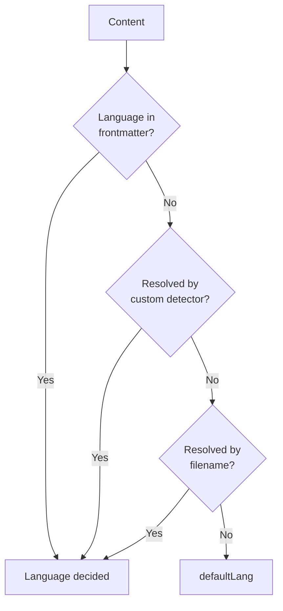

# Setup

## Basic setup

Add the `l10n` plugin to `riebeckite.config.ts`:

```ts
import { l10n } from "@riebeckite/plugin-l10n";

export default defineConfig({
  plugins: [l10n({ defaultLang: "ja", languages: ["ja", "en", "zh-CN"] })],
});
```

`defaultLang` must appear in `languages`. In this example the default is `ja` and the recognized languages are `ja`, `en`, and `zh-CN`.

`defaultLang` is also used when a content's language cannot be determined by any other method.

### Fallback for listing pages

Generated listings default to the current page language. If a note exists only in another language, set `fallbackLocale` to let those listings use it:

```ts
l10n({
  defaultLang: "ja",
  languages: ["ja", "en"],
  fallbackLocale: "en",
});
```

The fallback is applied per translation group, never by matching titles or dates. The fallback note keeps its own language and URL.

## How a note's language is detected

The plugin looks for four signals, in this precedence order:

1. **[[glossary/frontmatter|Frontmatter]]** — `lang:` anywhere in the frontmatter block.
2. **Custom detector** — if you provide `detect`.
3. **Filename** — `note.ja.md` (recommended), and also `note-en.md` / `note_ja.md`, or BCP 47 tags such as `note.en-US.md`, `note.zh-CN.md`.
4. **`defaultLang`** — used when nothing above matched.



The first method that resolves the content decides its language.

The filename suffix is the only implicit signal the plugin infers from the path; a language directory such as `content/en/note.md` is not treated as a locale. Signals can be mixed; a conflict emits `L10N_LANGUAGE_CONFLICT`, which becomes a build failure with `strict: true`.

## Setting the language in frontmatter

The most explicit signal is the frontmatter `lang`:

```md
---
title: Hello
lang: ja
publish: true
---

This is a Japanese article.
```

This content is treated as Japanese. Use it when you want to state the language independently of the file's location or name.

## Splitting by filename

When several languages live in the same directory, split them by filename suffix:

```text
README.md
README.ja.md
```

The `.ja` in `README.ja.md` marks the content as Japanese. The `defaultLang` language does not get a suffix.

`.lang` is recommended, but `-lang` and `_lang` are treated the same way. This keeps the original and its translation close together:

```text
docs/
├─ README.md
├─ README.ja.md
├─ installation.md
└─ installation.ja.md
```

## Directories are not used

A layout that separates languages by directory (`en/note.md`, `ja/note.md`) is **not** used for language detection. Restricting the implicit rule to the filename suffix lets a [[glossary/wikilink|WikiLink]] resolve uniquely even when the same-named article exists in several languages. Specify the language through the filename suffix or the frontmatter `lang`.
