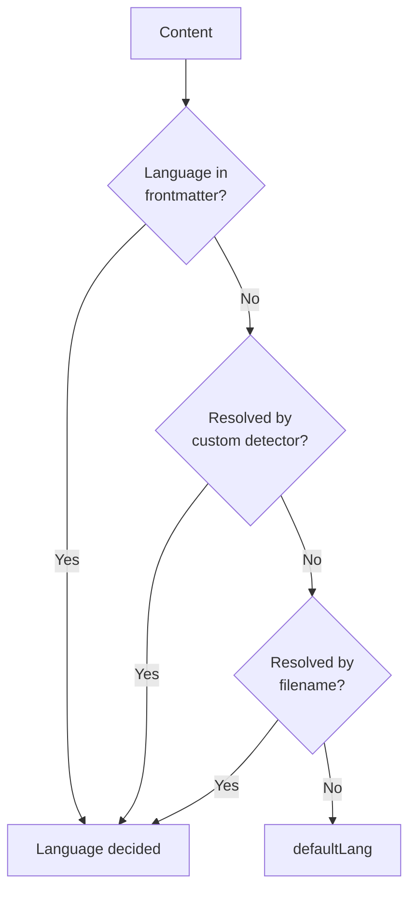

# Setup

## Basic setup

Add the `l10n` plugin to `riebeckite.config.ts`:

```ts
import { l10n } from "@riebeckite/plugin-l10n";

export default defineConfig({
  plugins: [l10n({ defaultLang: "ja", languages: ["ja", "en", "zh-CN"] })],
});
```

`defaultLang` must appear in `languages`. In this example the default is `ja` and the recognized languages are `ja`, `en`, and `zh-CN`.

`defaultLang` is also used when a content's language cannot be determined by any other method.

### Fallback for listing pages

Generated listings default to the current page language. If a note exists only in another language, set `fallbackLocale` to let those listings use it:

```ts
l10n({
  defaultLang: "ja",
  languages: ["ja", "en"],
  fallbackLocale: "en",
});
```

The fallback is applied per translation group, never by matching titles or dates. The fallback note keeps its own language and URL.

## How a note's language is detected

The plugin looks for four signals, in this precedence order:

1. **[[glossary/frontmatter|Frontmatter]]** — `lang:` anywhere in the frontmatter block.
2. **Custom detector** — if you provide `detect`.
3. **Filename** — `note.ja.md` (recommended), and also `note-en.md` / `note_ja.md`, or BCP 47 tags such as `note.en-US.md`, `note.zh-CN.md`.
4. **`defaultLang`** — used when nothing above matched.



The first method that resolves the content decides its language.

The filename suffix is the only implicit signal the plugin infers from the path; a language directory such as `content/en/note.md` is not treated as a locale. Signals can be mixed; a conflict emits `L10N_LANGUAGE_CONFLICT`, which becomes a build failure with `strict: true`.

## Setting the language in frontmatter

The most explicit signal is the frontmatter `lang`:

```md
---
title: Hello
lang: ja
publish: true
---

This is a Japanese article.
```

This content is treated as Japanese. Use it when you want to state the language independently of the file's location or name.

## Splitting by filename

When several languages live in the same directory, split them by filename suffix:

```text
README.md
README.ja.md
```

The `.ja` in `README.ja.md` marks the content as Japanese. The `defaultLang` language does not get a suffix.

`.lang` is recommended, but `-lang` and `_lang` are treated the same way. This keeps the original and its translation close together:

```text
docs/
├─ README.md
├─ README.ja.md
├─ installation.md
└─ installation.ja.md
```

## Directories are not used

A layout that separates languages by directory (`en/note.md`, `ja/note.md`) is **not** used for language detection. Restricting the implicit rule to the filename suffix lets a [[glossary/wikilink|WikiLink]] resolve uniquely even when the same-named article exists in several languages. Specify the language through the filename suffix or the frontmatter `lang`.

## UI strings

The l10n plugin localizes content URLs, in-body links, and head tags; it does not translate the UI strings that the framework and its plugins render. Each plugin ships its own English and Japanese labels next to the component that uses them, so the UI follows the content language without configuration. Use `ui.locale` to pin the UI language:

```ts
export default defineConfig({
  ui: { locale: "ja" },
});
```

To change individual words, override them per plugin namespace, language, and key:

```ts
export default defineConfig({
  ui: {
    labels: {
      search: {
        ja: { searchPlaceholder: "ノートを検索" },
      },
      toc: {
        ja: { contentsHeading: "目次" },
      },
    },
  },
});
```

`ui.labels` maps a plugin namespace to language codes and label keys. A plugin's namespace is its package name without `@riebeckite/plugin-`, for example `search`, `local-graph`, or `garden-explorer`. Language codes match case-insensitively; underscores and hyphens are equivalent, and a full tag such as `ja-JP` or `ja_JP` matches its primary subtag (`ja`) when the exact tag is absent. Namespaces and keys are exact. A missing key falls back to the plugin's dictionary for that language, then to English.

The keys by namespace are:

- `toc`: `contents`, `contentsHeading`
- `navigation`: `filter`, `filterNavigation`, `collapse`, `expand`, `sidebarNavigation`, `siteNavigation`, `menu`
- `search`: `search`, `searchNotes`, `closeSearch`, `searchQuery`, `searchPlaceholder`, `searchFilterHint`, `searchResults`, `loading`, `loadError`, `notFound`, `notFoundActions`, `noResults`, `result`, `results`, `emptyQuery`, `candidatesHeading`, `homeLabel`, `notFoundDescription`, `searchLabel`
- `series`: `seriesNavigation`, `seriesPosition`
- `l10n`: `language`
- `local-graph`: `localGraph`, `nearbyNotes`, `openInExplorer`, `localGraphTruncated`, `localGraphTruncatedExplorer`
- `diff`: `history`, `historyChanges`, `collapse`, `expand`, `historyToggle`, `commitHistory`, `untitledChange`
- `garden-explorer`: `explorer`, `explorerPanels`, `searchNotes`, `searchNotesPlaceholder`, `clearFilters`, `tags`, `folders`, `notes`, `showingNotes`, `noteGraph`, `localGraphMode`, `globalGraphMode`, `localMode`, `globalMode`, `selectNoteHint`, `selectedNote`, `outgoingLinks`, `backlinks`, `relatedNotes`, `noNotes`
- `article-metadata`: `regionLabel`
- `autocardlink`: `copyUrl`, `copy`, `copied`
- `bases`: `tableView`, `cards`, `view`, `baseDefinition`, `matchingNotes`, `noMatchingNotes`, `noMatchingNotesInThisGroup`, `noValue`, `viewsNotAvailableInStaticBuild`
- `calculator`: `calculating`, `result`
- `canvas`: `canvas`, `empty`, `controls-aria`, `zoom-in`, `zoom-out`, `zoom-to-fit`, `zoom-to-selection`, `reset-zoom`
- `code-enhance`: `copyCode`, `copy`, `copied`, `wrap`, `collapse`, `expand`
- `flashcards`: `flashcards`
- `image-compare`: `comparison`, `comparisonPosition`, `before`, `after`
- `marp`: `previousSlide`, `nextSlide`, `fullscreen`, `exitFullscreen`
- `properties`: `properties`
- `qr-code`: `qrCode`
- `sidenotes`: `openLabel`, `ariaLabel`
- `taxonomy`: `relatedTags`, `feeds`, `foldersTitle`, `tagsTitle`
- `timeline`: `language`
- `vault-heatmap`: `summaryFormat`, `noActivity`, `update`, `updates`, `day`, `days`
- `ux`: `readingProgress`
- `site`: `documentation`, `tableOfContents`, `menu`, `navigation`, `primaryNavigation`, `secondaryNavigation`, `footerNavigation`

`showingNotes`, `globalGraphMode`, `historyChanges`, `seriesPosition`, `bases.view`, `timeline.language`, `search.result`, and `search.results` are templates: keep their `{...}` placeholders in an override.

Plugins declare their strings with `defineUiLabels(namespace, { en, ja })` and read them through `useUiLabels(definition)`, so translations live beside the feature that renders them. Your own shell can use the same pair: this site declares `site` labels in `website/labels.ts` and resolves them with `resolveUiLabels(siteLabels, createUiLabelContext(config, language))`, so overrides still go under `ui.labels.site`. `<html lang>` and the article date locale follow the content language and are set in `website/app/components/article/article.tsx`. For the plugin-author side of the system, see [UI labels](../../reference/ui-labels.md).
