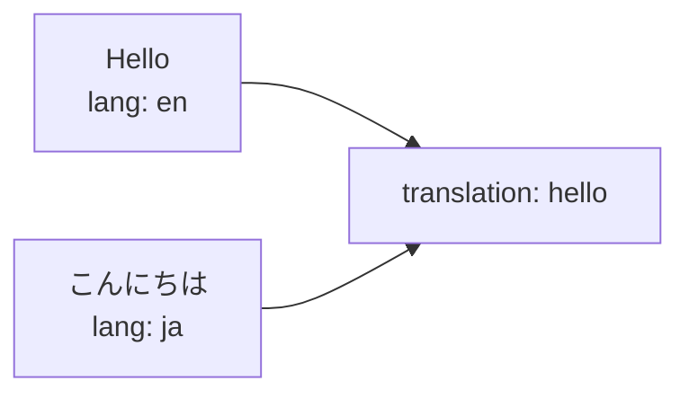
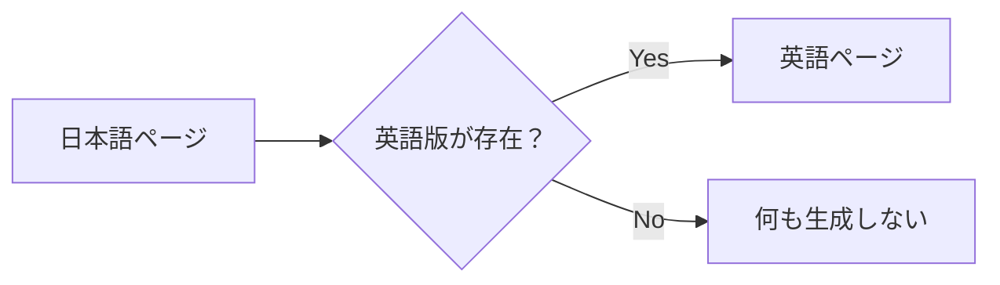
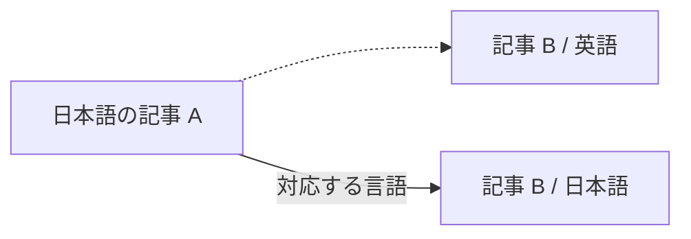

# 翻訳の対応付け

## 翻訳同士を対応付ける

「この日本語記事と、この英語記事は同じコンテンツの翻訳版」という関係は、frontmatter の `translation` で表します。

たとえば日本語版を、

```md
---
title: こんにちは
publish: true
lang: ja
translation: hello
---

日本語の記事です。
```

とします。

対応する英語版にも同じ `translation` を指定します。

```md
---
title: Hello
publish: true
lang: en
translation: hello
---

This is the English version.
```

両方に、

```yaml
translation: hello
```

があるため、同じコンテンツの翻訳として扱われます。



同じ翻訳グループと言語の組み合わせが重複すると、`L10N_DUPLICATE_TRANSLATION` が報告されます。`strict: true` ではビルドが失敗します。パスや名前が無関係なファイル同士を対応付ける場合は `translation` を使ってください。

翻訳グループの ID を読み取る frontmatter プロパティは、l10n プラグインの `translationKey` で変更できます。既定値は `translation` です。

```ts
l10n({
  defaultLang: "ja",
  languages: ["ja", "en"],
  translationKey: "translationId",
});
```

プラグインが知らない独自の規則を使う場合は、`detect` を指定します。`detect` が返す言語は frontmatter の次、ファイル名より前に検討されます。翻訳グループの ID も明示できます。

```ts
l10n({
  defaultLang: "ja",
  languages: ["ja", "en", "fr"],
  detect: ({ path }) =>
    path.startsWith("French/") ? { lang: "fr", translationId: "hello" } : undefined,
});
```

## `lang` と `translation` の違い

この2つは役割が異なります。

| フィールド | 意味 |
| --- | --- |
| `lang` | このページが何語なのか |
| `translation` | どのページ同士が翻訳関係なのか |

たとえば、

```yaml
lang: ja
translation: getting-started
```

なら、

```text
このページの言語
  → 日本語

翻訳グループ
  → getting-started
```

という意味になります。

`translation` 自体は言語名ではありません。

同じ内容を表すページ同士で共通の値を使います。

## 翻訳が存在しない場合

すべてのコンテンツにすべての言語版を用意する必要はありません。

たとえば、

```text
article-a.md       日本語
article-a.en.md    English
article-b.md       日本語
```

のように、一部の言語版だけが存在しても構いません。

`article-b` の英語版が存在しない場合、Riebeckite が英語ページを自動生成することはありません。



l10n プラグインは既存の翻訳関係を扱いますが、コンテンツ自体を翻訳する機能ではありません。

## URL

l10n プラグインはコンテンツの言語情報を使って公開 URL を扱います。

つまり、[[glossary/localization|多言語化]]は単に画面へ言語名を表示するだけではなく、

```text
コンテンツ
  ↓
言語判定
  ↓
Public Location
  ↓
URL
```

まで含めて処理されます。

既定の言語は Core が解決した URL（`/about` など）をそのまま使います。それ以外の言語には接頭辞が付きます（`/en/about` など）。プラグインは既存の公開位置リゾルバーを拡張するもので、新しいルーターを追加するわけではありません。そのため `@riebeckite/plugin-permalink` などの URL プラグインと組み合わせられます。

サイト側でファイル名から独自に URL を組み立てるのではなく、Riebeckite が解決した Public Location を利用してください。公開位置の仕組みについては [コンテンツシステム](../../framework/content-system.ja.md) を参照してください。

翻訳が存在しない場合のフォールバックページは生成されません。内部のヘルパーは、翻訳の欠落を次のように報告します。

- `getLocalization(manifest, slug)` は、実在するノートについてのみ `availableLanguages` と言語ごとのリンク `translations` を返します。
- `getLocalizedContent(manifest, slug, lang)` は、翻訳がなければ `null` を返します。

## サイト内リンク

多言語サイトでは、本文中のリンクも言語を考慮して扱われます。

たとえば日本語の記事から別の記事へ移動するとき、対応する日本語版が存在する場合は、その言語に対応したリンクとして扱えます。



これによって、記事本文のリンクだけ別言語のページへ戻ってしまう、といった問題を避けられます。

[[glossary/content-graph|コンテンツグラフ]]を構築する前に、WikiLink のリンク先は、対応する翻訳が存在すればリンク元の記事と同じ言語へ切り替えられます。存在しなければ元のリンク先のままです。描画時には、Obsidian の WikiLink（`@riebeckite/plugin-obsidian-markdown` が解決した後）と Markdown リンクの両方が、現在のページと同じ言語の翻訳へ書き換えられます。クエリ文字列とフラグメントは保持されます。外部 URL、フラグメントだけのリンク、存在しないリンク先、アセットの URL は変更されません。

## 言語切り替え

同じ `translation` を持つコンテンツは、言語切り替えの候補になります。

たとえば、

```text
translation: hello

├─ lang: en
├─ lang: ja
└─ lang: de
```

というコンテンツが存在すれば、それぞれを同じコンテンツの別言語版として扱えます。

**実際に存在する翻訳だけが候補になります**。存在しない言語版のフォールバックページは自動生成されません。

`l10n(...)` は既存の翻訳をグループ化し、`getLocalization(manifest, slug)` と `<LanguageSwitcher />` コンポーネントを公開します。サイトは好きな場所に切り替え [[glossary/ui|UI]] を配置できます。l10n 専用の統合は必要ありません。実際の翻訳が2つ未満のページでは、このコンポーネントは何も描画しません。

```tsx
import { LanguageSwitcher, getLocalization } from "@riebeckite/plugin-l10n";

const localization = getLocalization(manifest, entry.slug);
<LanguageSwitcher localization={localization} />;
```

`SiteProvider` と、公開済みの `entry` を持つ `Article` がある場合、`<LanguageSwitcher />` は現在の多言語情報を自分で解決します。[[glossary/theme|テーマ]]は `.rr-l10n-switcher` ルートフックを通じて標準の言語切替 UI を調整できます。

## SEO

SEO プラグインと組み合わせることで、翻訳関係を `hreflang` として出力できます。

概念的には、

```text
英語ページ
   ↕
翻訳関係
   ↕
日本語ページ
   ↓
SEO
   ↓
hreflang
```

という関係です。

これによって検索エンジンに同じコンテンツの別言語版であることを伝えられます。翻訳された各エントリには、実在する翻訳ごとに1つの `<link rel="alternate" hreflang="…">` が、Core の head タグ拡張ポイントを通じて追加されます。サイトのシェルがこれらのタグを描画し、リクエストに応じて `<html lang>` を選びます。

## おすすめの構成

英語と日本語の2言語で運用する場合は、たとえば次のようにできます。

```text
content/
├─ getting-started.md
├─ getting-started.ja.md
├─ installation.md
├─ installation.ja.md
└─ faq.ja.md
```

そして翻訳関係を frontmatter で明示します。

英語版は次のとおりです。

```md
---
title: Getting Started
lang: en
translation: getting-started
publish: true
---
```

日本語版は次のとおりです。

```md
---
title: はじめに
lang: ja
translation: getting-started
publish: true
---
```

翻訳がまだ存在しない `faq.ja.md` は、日本語だけで公開しても構いません。
