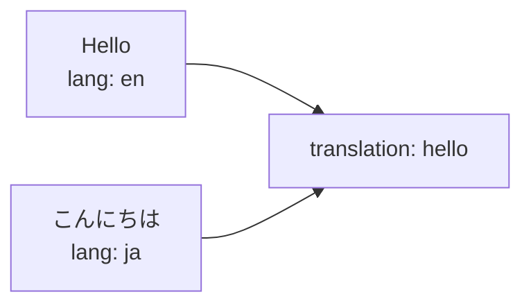
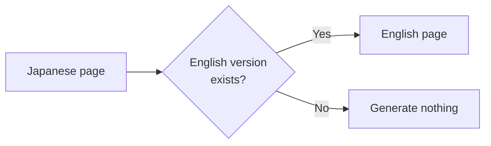
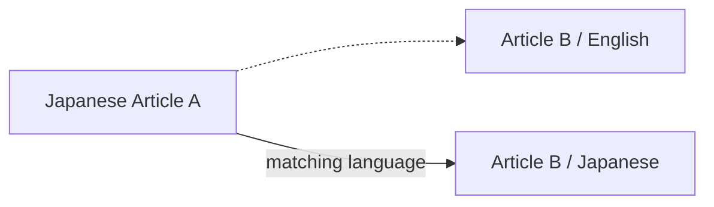

# Translations

## Grouping translations

[[glossary/translation|Translation]] identity is independent of the file's path or name. Give the same `translation` value to every language version.

For example, the Japanese version:

```md
---
title: こんにちは
publish: true
lang: ja
translation: hello
---

日本語の記事です。
```

And the matching English version:

```md
---
title: Hello
publish: true
lang: en
translation: hello
---

This is the English version.
```

Because both carry

```yaml
translation: hello
```

they are treated as translations of the same content.



A duplicate translation identity and language emits `L10N_DUPLICATE_TRANSLATION` (again a build failure under `strict: true`). Use `translation` when the files have unrelated paths or names.

To read the identity from a different frontmatter property, set `translationKey` in the l10n plugin options; the default is `translation`:

```ts
l10n({
  defaultLang: "ja",
  languages: ["ja", "en"],
  translationKey: "translationId",
});
```

For a convention the plugin does not know, supply `detect`. Its language is considered after frontmatter and before filename, and its `translationId` is explicit:

```ts
l10n({
  defaultLang: "ja",
  languages: ["ja", "en", "fr"],
  detect: ({ path }) =>
    path.startsWith("French/") ? { lang: "fr", translationId: "hello" } : undefined,
});
```

## `lang` vs `translation`

The two fields have different roles:

| Field | Meaning |
| --- | --- |
| `lang` | What language this page is written in |
| `translation` | Which pages are translations of one another |

For example,

```yaml
lang: ja
translation: getting-started
```

means:

```text
Language of this page
  → Japanese

Translation group
  → getting-started
```

`translation` is not itself a language name; pages that represent the same content share the same value.

## When a translation is missing

You do not need every language version for every piece of content:

```text
article-a.md       Japanese
article-a.en.md    English
article-b.md       Japanese
```

is fine. When `article-b` has no English version, Riebeckite does not generate an English page for it automatically.



The l10n plugin works with existing translation relationships; it is not a content translator.

## URLs

The l10n plugin uses each content's language to resolve its public URL. [[glossary/localization|Localization]] is therefore not just a language label in the [[glossary/ui|UI]]:

```text
Content
  ↓
Language detection
  ↓
Public Location
  ↓
URL
```

The default language keeps Core's resolved URL (`/about`); other languages are prefixed (`/en/about`). The plugin augments the existing content-location resolver rather than adding a router, so it composes with URL plugins such as `@riebeckite/plugin-permalink`.

Do not build a URL from the filename yourself on the site side; use the [[glossary/public-location|Public Location]] Riebeckite resolved. See [Content System](../../framework/content-system.md) for how public locations work.

No fallback pages are generated. If a translation is missing, the original target stays linked and internal helpers report the absence:

- `getLocalization(manifest, slug)` returns `availableLanguages` and language-to-href `translations` only for notes that exist.
- `getLocalizedContent(manifest, slug, lang)` returns `null` for a missing translation.

## In-site links

On a multilingual site, links in the body text also take the language into account. When a Japanese article links to another article that has a Japanese version, the link can be resolved to that language:



This avoids a link in an article body dropping the reader back into another language.

Before the content graph is built, WikiLink targets are switched to the source note's language when that translation exists; otherwise the original target remains. The rendered article rewrites both Obsidian WikiLinks (after `@riebeckite/plugin-obsidian-markdown` resolves them) and Markdown links to an existing translation in the current page's language, preserving query strings and fragments. External, fragment-only, unknown, and asset URLs are left unchanged.

## Language switcher

Content that shares the same `translation` becomes a candidate for the language switcher. For content with

```text
translation: hello

├─ lang: en
├─ lang: ja
└─ lang: de
```

each can be treated as another language version of the same content. **Only translations that actually exist are candidates.** No fallback page is generated for a language that is missing.

`l10n(...)` groups the existing translations and publishes `getLocalization(manifest, slug)` plus the `<LanguageSwitcher />` component. The Site renders the switcher where it wants; no l10n-specific integration is needed. The component renders nothing on a page with fewer than two real translations.

```tsx
import { LanguageSwitcher, getLocalization } from "@riebeckite/plugin-l10n";

const localization = getLocalization(manifest, entry.slug);
<LanguageSwitcher localization={localization} />;
```

With `SiteProvider` and an `Article` carrying its public `entry`, `<LanguageSwitcher />` resolves the current localization itself. Themes can restyle it through the `.rr-l10n-switcher` root hook.

## SEO

Combined with the SEO plugin, translation relationships can be emitted as `hreflang`:

```text
English page
   ↕
translation relationship
   ↕
Japanese page
   ↓
SEO
   ↓
hreflang
```

This tells search engines that the pages are language versions of the same content. Each translated entry receives one `<link rel="alternate" hreflang="…">` per existing translation through Core's head-tag extension point. The site shell renders those tags and selects `<html lang>` for a request.

## Recommended layout

For an English/Japanese site, a layout such as the following works well:

```text
content/
├─ getting-started.md
├─ getting-started.ja.md
├─ installation.md
├─ installation.ja.md
└─ faq.ja.md
```

Then state the translation relationship in frontmatter. The English version:

```md
---
title: Getting Started
lang: en
translation: getting-started
publish: true
---
```

The Japanese version:

```md
---
title: はじめに
lang: ja
translation: getting-started
publish: true
---
```

`faq.ja.md`, which has no translation yet, can be published in Japanese alone.
