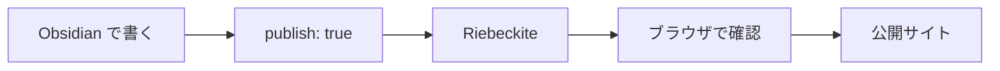

# Obsidian のノートをサイトにする

Riebeckite では、普段使っている [[glossary/obsidian-vault|Obsidian Vault]] をそのまま記事の置き場所として利用できます。

既存の Vault を Riebeckite 用に作り直したり、Markdown を別の形式へ変換したりする必要はありません。

基本的な流れは次のとおりです。



Riebeckite に Vault の場所を指定し、公開したいノートだけに `publish: true` を付けるのが基本です。

## このページの構成

- [セットアップ](./obsidian/setup.ja.md)
- [Vaultの置き場所](./obsidian/placement.ja.md)
- [記事の書き方](./obsidian/writing.ja.md)
- [トラブルシューティング](./obsidian/troubleshooting.ja.md)

## まとめ

Obsidian と Riebeckite の関係はシンプルです。

```text id="f1sfdm"
Obsidian Vault
      ↓
Markdown
      ↓
Riebeckite
      ↓
publish: true のNote
      ↓
Public Site
```

既存 Vault を Riebeckite 用に作り直す必要はありません。

最初から始めるなら、次の構成が使えます。

```text id="7vtvgj"
my-site/content/
  → Obsidian Vault
```

既存 Vault があるなら、次の構成が使えます。

```text id="7w2i31"
notes/
  → 既存Vault

my-site/
  → Riebeckite Site
```

Vault の場所と[[glossary/visibility|公開範囲]]は分けて考えます。

- `content.directory` → どの Vault を読むか
- `exclude` → 何をコンテンツとして読み込まないか
- `publish: true` → 何をサイトに公開するか

この3つを分けて設定すれば、普段の Obsidian Vault に非公開のノートを残したまま、必要な記事だけを Riebeckite で公開できます。

### 次に読むもの

- [記事の書き方ガイド](./writing-content.ja.md)
- [コンテンツとサイトを分ける](./content-repositories.ja.md)
- [Content System](../framework/content-system.ja.md)
