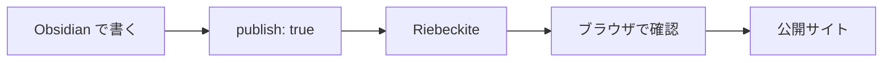
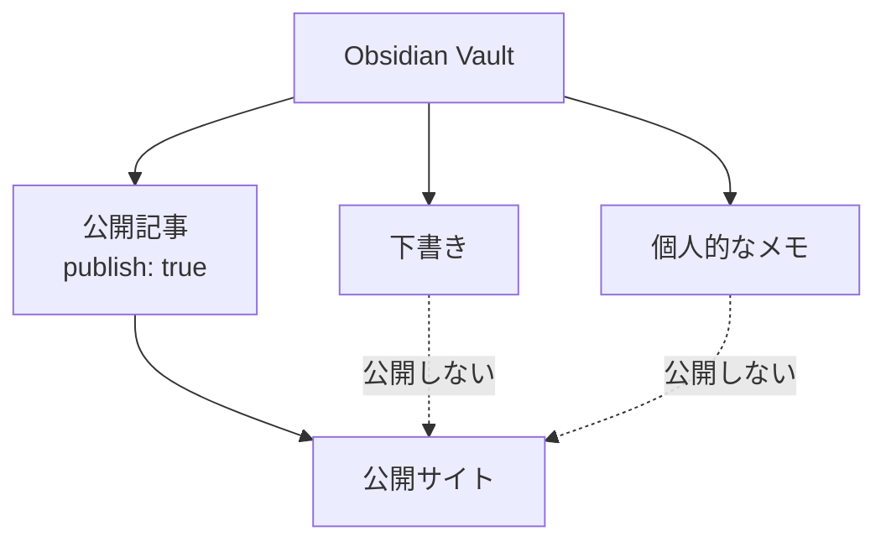
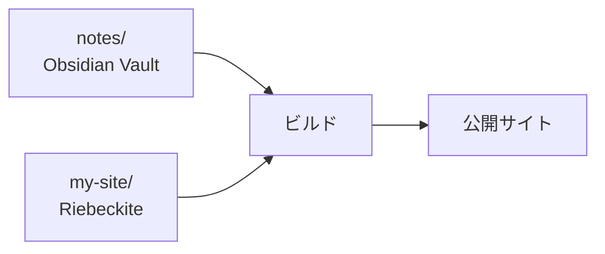
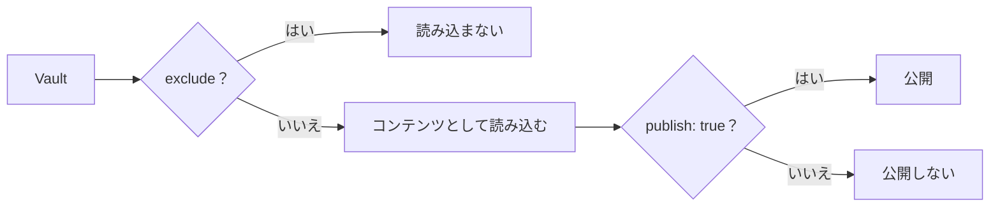
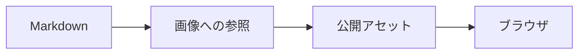
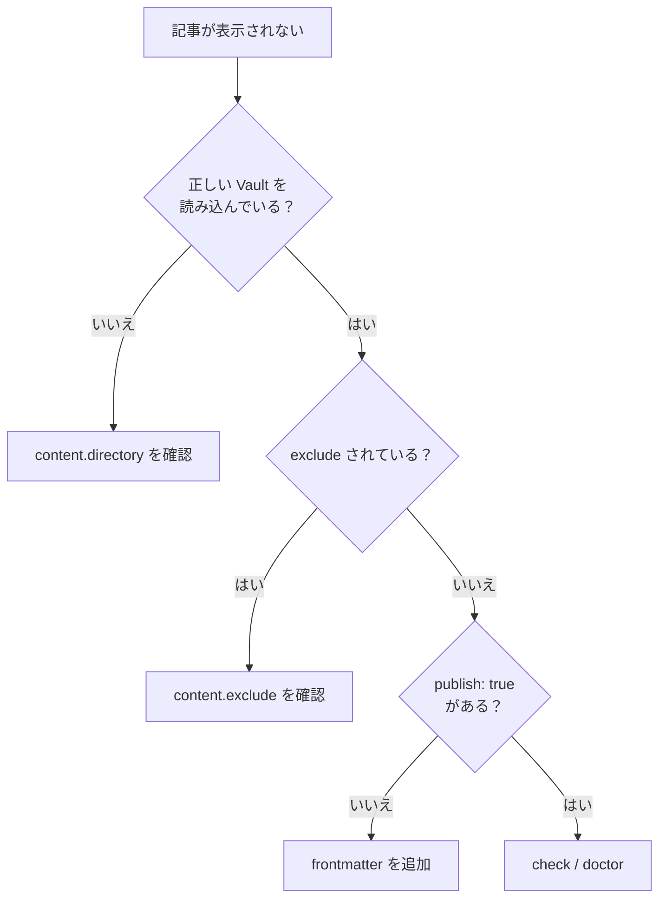
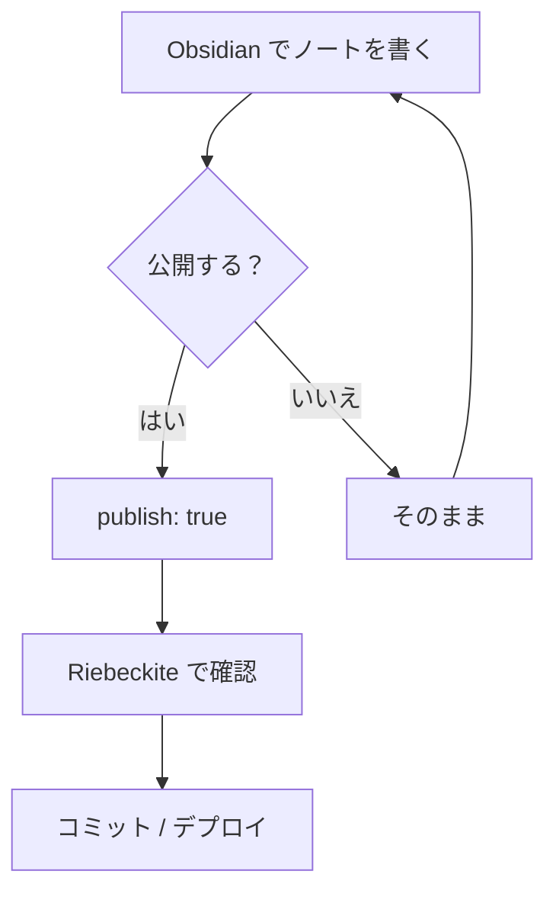

# Obsidian のノートをサイトにする

Riebeckite では、普段使っている Obsidian Vault をそのまま記事の置き場所として利用できます。

既存の Vault を Riebeckite 用に作り直したり、Markdown を別の形式へ変換したりする必要はありません。

基本的な流れは次のとおりです。



Riebeckite に Vault の場所を指定し、公開したいノートだけに `publish: true` を付けるのが基本です。

## 既存の Vault はそのまま使える

Obsidian Vault は Markdown ファイルが入ったフォルダです。

Riebeckite も指定されたフォルダから Markdown を読み込むため、`content.directory` に Vault の場所を指定すればコンテンツとして利用できます。

たとえば、次のような既存 Vault を、そのまま Riebeckite から読み込めます。

```text id="ztw0m3"
notes/
├─ Welcome.md
├─ Programming/
│  └─ Flutter.md
├─ private/
│  └─ memo.md
└─ .obsidian/
```

次のコマンドを実行しても、Riebeckite が Vault の Markdown を整理したり、勝手に書き換えたりすることはありません。

```text id="52h4vi"
dev
check
doctor
inspect
build
```

ノートの編集はこれまでどおり Obsidian で行います。

## Templater のテンプレートを除外する

Vault で Obsidian Templater プラグインを設定している場合、Riebeckite は `.obsidian/plugins/templater-obsidian/data.json` を読み、設定された `templates_folder` を Markdown の走査や frontmatter の解析より前に除外します。そのため、テンプレートはコンテンツのマニフェスト、SSG、開発サーバーに入りません。

Riebeckite は Templater のコードを実行しません。通常のノートに Templater の式が含まれていても、そのノートを除外することはありません。Templater の設定またはテンプレートフォルダを取得できない場合は自動では除外しません。フォルダを明示的に除外したい場合は `content.exclude` を使います。

## 公開するノートを選ぶ

既定の公開ルールでは、frontmatter に次の設定があるノートだけを公開します。

```yaml id="mm8gy2"
publish: true
```

たとえば、次のようにします。

```md id="6kpm95"
---
title: 公開する記事
publish: true
---

この記事は公開されます。
```

一方、次のノートには `publish: true` がないため、公開対象になりません。

```md id="c04z4a"
---
title: 個人的なメモ
---

これは個人的なメモです。
```



そのため、公開記事と個人的なノートを同じ Vault に置いたまま運用できます。

## Vault をサイトの内外に置く

Vault は、サイトの中に置く方法と、外に置く方法の2つから選べます。

### パターンA：サイトの `content/` を Vault にする

最も簡単な方法です。

Riebeckite のサイトにある次のフォルダを、そのまま Obsidian Vault として開きます。

```text id="bgatph"
content/
```

サイト全体は次のようになります。

```text id="f7zqjr"
my-site/
├─ content/              ← Obsidianで開く
│  ├─ Welcome.md
│  └─ Articles/
│     └─ FirstArticle.md
│
├─ riebeckite.config.ts
└─ package.json
```

この場合は標準設定のまま利用できます。

```ts id="7o5xhd"
content: {
  directory: "content",
},
```

初めて Riebeckite と Obsidian を組み合わせるなら、この方法が最も単純です。

```text id="ohx0fd"
my-site/content/
       ↓
Obsidian Vault
       ↓
Riebeckite Content
```

同じフォルダが両方の役割を持ちます。

### パターンB：既存の Vault をそのまま使う

すでに Obsidian Vault がある場合は、サイトの外に置いたまま利用できます。

たとえば、次のような構成にします。

```text id="k06dgu"
workspace/
├─ notes/                ← 既存のObsidian Vault
│  ├─ Welcome.md
│  ├─ Programming/
│  └─ .obsidian/
│
└─ my-site/              ← Riebeckite Site
   ├─ app/
   ├─ riebeckite.config.ts
   └─ package.json
```

`my-site/riebeckite.config.ts` から Vault を指定します。

```ts id="czcujq"
content: {
  directory: "../notes",
},
```

これだけで `notes/` を Riebeckite のコンテンツディレクトリとして利用できます。



Vault をサイトのディレクトリへコピーする必要はありません。

リポジトリ自体も分けたい場合は、[コンテンツとサイトを分ける](./content-repositories.ja.md) を参照してください。

## どちらを選ぶ？

迷った場合は、次の基準で選べます。

| 状況 | おすすめ |
| --- | --- |
| 初めて Riebeckite を使う | `content/` を Vault にする |
| すでに Vault がある | 既存の Vault を指定する |
| Vault とサイトの Git 履歴を分けたい | リポジトリを分ける |
| Vault をプライベートリポジトリにしたい | リポジトリを分ける |

既存 Vault があるなら、Riebeckite のためだけに移動する必要はありません。

## Obsidian で記事を書く

公開する記事には、最低限 `title` と `publish` を指定します。

```md id="9y29hw"
---
title: 記事のタイトル
publish: true
---

本文を書きます。
```

本文は通常の Markdown として書けます。

```md id="wm76s7"
# 見出し

本文を書きます。

## 次の見出し

さらに本文を書きます。
```

Obsidian の WikiLink も利用できます。

```md id="5d4bby"
詳しくは [[別の記事]] を参照してください。
```

対応するプラグインが、Riebeckite のコンテンツ情報を使って公開先のリンクを解決します。

## ファイル名と公開 URL は一致するとは限らない

ファイル名は、コンテンツの識別や既定の公開 URL を決める材料になります。

たとえば、次のような分かりやすい名前にしておくと、Vault とサイトの両方で管理しやすくなります。

```text id="x1m3cc"
getting-started.md
```

ただし、Riebeckite では最終的な URL は解決済みの公開先として扱われます。

そのため、次のように考えないでください。

```text id="12x76m"
ファイルの物理Path
=
常に公開URL
```

プラグインや設定によって公開 URL が変わる場合があります。

URL の仕組みを詳しく知りたい場合は、[Content System](../framework/content-system.ja.md) を参照してください。

## Obsidian の設定をコンテンツから外す

Vault には通常、次のディレクトリがあります。

```text id="wm1hpc"
.obsidian/
```

これは Obsidian 自体の設定であり、記事ではありません。必要に応じて `content.exclude` で除外できます。

```ts id="0vwyam"
content: {
  directory: "../notes",

  exclude: [
    ".obsidian/**",
  ],
},
```

テンプレートや非公開ディレクトリもコンテンツとして読み込みたくない場合は、次のように指定できます。

```ts id="xemlcl"
content: {
  directory: "../notes",

  exclude: [
    ".obsidian/**",
    "Templates/**",
    "private/**",
  ],
},
```

## `exclude` と `publish: true` は役割が違う

この2つは役割が異なります。



`exclude` は、Riebeckite にコンテンツとして読み込ませないものを指定します。

`publish: true` は、読み込んだコンテンツのうち公開するものを指定します。

たとえば、明らかにサイトで扱わない次のディレクトリは `exclude` し、それ以外のノートは `publish: true` で公開を選ぶ、という使い方ができます。

```text id="z7yyqm"
.obsidian/
Templates/
private/
```

## 非公開のメモを同じ Vault に置く

非公開のノートや下書きを同じ Vault に置く場合は、`publish: true` を付けません。

```md id="0n1eqs"
---
title: 個人的なメモ
---

公開しない内容です。
```

既定の公開ルールなら、このノートはサイトに公開されません。

一方、公開記事は次のように書きます。

```md id="d8iz87"
---
title: 公開記事
publish: true
---

公開する内容です。
```

非公開の Vault を扱う場合は、公開するものだけを明示する運用にすると管理しやすくなります。

## 公開記事から非公開ノートへのリンクに注意する

公開記事から、次のように非公開ノートへリンクしてしまうことがあります。

```md id="tm0f93"
[[個人的なメモ]]
```

公開前に、次のコマンドなどで問題がないか確認してください。

```sh id="4ehd60"
npm exec riebeckite doctor
```

サイト内リンクの整合性を診断するプラグインを利用している場合は、公開先が存在しない WikiLink なども検出できます。

## 画像と添付ファイルを Vault 内で管理する

画像や添付ファイルも Vault 内で管理できます。

たとえば、次のようにします。

```text id="tyn3v3"
notes/
├─ article.md
└─ images/
   └─ photo.jpg
```

Markdown からは、次のように参照できます。

```md id="mmg4ki"

```

Obsidian の添付ファイル用フォルダを使う場合も、そのフォルダは Vault の中に置いてください。

ここでは、Markdown から画像を参照できることと、画像ファイル自体が公開サイトに存在することを分けて考える必要があります。



Vault の外にあるファイルは、ビルド時に見つからないことがあります。また、ビルド後の公開出力に存在しないファイルは表示できません。

添付ファイルをサイトへ公開する構成では、公開対象のアセットが実際に出力へ含まれていることも確認してください。

## 名前が重複するとリンクが曖昧になる

Riebeckite は `[[リンク]]` をノートのパス、エイリアス、添付ファイル名から解決します。同じ名前のノート、エイリアス、添付ファイルが複数あると、名前だけの `[[note]]` では対象を1つに特定できません。

このとき Riebeckite は推測せず、リンクを未解決のままにし、`doctor` が曖昧なリンクとして報告します。

```text id="dup1aa"
x/dup.md
y/dup.md
```

```md id="dup2bb"
[[dup]]        ← 曖昧
[[x/dup]]      ← Path を指定しているので x/dup.md に解決
```

公開するリンクが必ず1つの対象を指すように、フォルダを含むパスを書くか、どちらかのファイル名を変更してください。

## サイトを確認する

記事を書いたら、Riebeckite のサイトのディレクトリで開発サーバーを起動します。

```sh id="uejsnw"
npm exec riebeckite dev
```

ブラウザで公開対象の記事を確認します。

問題がないか確認するには、次のコマンドを実行します。

```sh id="b4s9ol"
npm exec riebeckite check
npm exec riebeckite doctor
```

Riebeckite が実際にどのコンテンツを認識しているか確認したい場合は、次のコマンドを利用できます。

```sh id="h7xl6g"
npm exec -- riebeckite inspect content --list
```

## 記事が表示されないとき

記事が表示されない場合は、次の順番で確認すると原因を絞りやすくなります。



解決済みのコンテンツディレクトリは、次のコマンドで確認できます。

```sh id="99glhk"
npm exec riebeckite inspect config
```

読み込まれているコンテンツは、次のコマンドで確認できます。

```sh id="csgeqn"
npm exec -- riebeckite inspect content --list
```

## 普段の使い方

設定が終われば、特別な操作はほとんど必要ありません。



つまり、普段の執筆方法はこれまでとほぼ同じです。Obsidian で書き、公開したいノートにだけ `publish: true` を付けます。

Riebeckite は、その Vault を公開サイトのコンテンツソースとして利用します。

## まとめ

Obsidian と Riebeckite の関係はシンプルです。

```text id="f1sfdm"
Obsidian Vault
      ↓
Markdown
      ↓
Riebeckite
      ↓
publish: true のNote
      ↓
Public Site
```

既存 Vault を Riebeckite 用に作り直す必要はありません。

最初から始めるなら、次の構成が使えます。

```text id="7vtvgj"
my-site/content/
  → Obsidian Vault
```

既存 Vault があるなら、次の構成が使えます。

```text id="7w2i31"
notes/
  → 既存Vault

my-site/
  → Riebeckite Site
```

Vault の場所と公開範囲は分けて考えます。

- `content.directory` → どの Vault を読むか
- `exclude` → 何をコンテンツとして読み込まないか
- `publish: true` → 何をサイトに公開するか

この3つを分けて設定すれば、普段の Obsidian Vault に非公開のノートを残したまま、必要な記事だけを Riebeckite で公開できます。

### 次に読むもの

- [記事の書き方ガイド](./writing-content.ja.md)
- [コンテンツとサイトを分ける](./content-repositories.ja.md)
- [Content System](../framework/content-system.ja.md)
