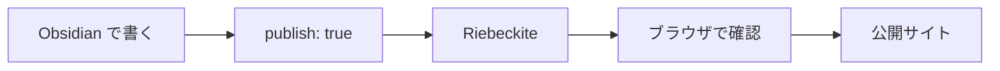

# Obsidian のノートをサイトにする

Riebeckite では、普段使っている [[glossary/obsidian-vault|Obsidian Vault]] をそのまま記事の置き場所として利用できます。

既存の Vault を Riebeckite 用に作り直したり、Markdown を別の形式へ変換したりする必要はありません。

まず Vault をつないで1ページ公開するところから始める場合は、[Obsidian Vault を使う](../getting-started/obsidian-vault.ja.md) を参照してください。

基本的な流れは次のとおりです。



Riebeckite に Vault の場所を指定し、公開したいノートだけに `publish: true` を付けるのが基本です。

## このページの構成

- [セットアップ](./obsidian/setup.ja.md)
- [Vault の置き場所](./obsidian/placement.ja.md)
- [記事の書き方](./obsidian/writing.ja.md)
- [トラブルシューティング](./obsidian/troubleshooting.ja.md)

## 互換性の概要

Riebeckite は Vault の Markdown をそのまま読み、別形式への変換を求めません。対応範囲は次のとおりです。

| 領域 | 対応 | 内容 |
| --- | --- | --- |
| Markdown | 完全 | GFM、frontmatter、表、数式、脚注 |
| WikiLink | 完全 | ノート、エイリアス、フォルダ、見出し、ブロック ID、同一ページ参照。[Wikilink](../plugins/obsidian-markdown.ja.md) を参照。 |
| ノート埋め込み | 一部 | ノート全体・見出し・ブロック ID。ネストした埋め込みは深さ 3 まで。 |
| 画像 | 完全 | `![[image.png]]`、`![[image.png|300]]`、`![[image.png|300x200]]`、`![[image.png|代替テキスト]]`。 |
| PDF とメディア | 一部 | PDF のページ・高さ指定、動画・音声の再生開始位置。再生可否はブラウザのコーデックに依存します。 |
| Callout | 完全 | 標準・ネストした Callout、独自タイトル、`details` による折りたたみ。クライアントスクリプトなし。 |
| コメント | 完全 | `%% ... %%` を除去。コードスパンとフェンスは保持します。 |
| Dataview | 一部 | DQL の `LIST`・`TABLE`・`TASK`・`CALENDAR`、インラインフィールド、`FLATTEN`、タスク単位の絞り込み。DataviewJS は未対応。[Dataview](../plugins/dataview.ja.md) を参照。 |
| Bases | 一部 | 表・カード・リストと、filters・formulas・summaries・grouping。kanban と map は案内を描画します。[Bases](../plugins/bases.ja.md) を参照。 |

この表は検証済みの動作を表します。将来の目標ではありません。各プラグインのページに、個別の互換性マトリクスと残る制限を記載しています。

## まとめ

Obsidian と Riebeckite の関係はシンプルです。

```text id="f1sfdm"
Obsidian Vault
      ↓
Markdown
      ↓
Riebeckite
      ↓
publish: true のNote
      ↓
Public Site
```

既存 Vault を Riebeckite 用に作り直す必要はありません。

最初から始めるなら、次の構成が使えます。

```text id="7vtvgj"
my-site/content/
  → Obsidian Vault
```

既存 Vault があるなら、次の構成が使えます。

```text id="7w2i31"
notes/
  → 既存Vault

my-site/
  → Riebeckite Site
```

Vault の場所と[[glossary/visibility|公開範囲]]は分けて考えます。

- `content.directory` → どの Vault を読むか
- `exclude` → 何をコンテンツとして読み込まないか
- `publish: true` → 何をサイトに公開するか

この3つを分けて設定すれば、普段の Obsidian Vault に非公開のノートを残したまま、必要な記事だけを Riebeckite で公開できます。

### 次に読むもの

- [記事の書き方ガイド](./writing-content.ja.md)
- [コンテンツとサイトを分ける](./content-repositories.ja.md)
- [Obsidian 向け Riebeckite](../obsidian-plugin/README.ja.md)（現時点では設定のみ）
- [Content System](../framework/content-system.ja.md)
