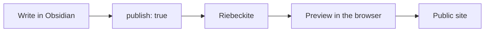

# Publishing Obsidian notes

Riebeckite can use your everyday Obsidian vault as the place where articles
live. You do not have to rebuild an existing vault for Riebeckite, or convert
your Markdown into another format.

To connect a vault and publish your first note, start with [Use Your Obsidian Vault](../getting-started/obsidian-vault.md).

The basic flow is:



Point Riebeckite at the vault and add `publish: true` only to the notes you
want to make public.

## In this section

- [Setup](./obsidian/setup.md)
- [Where to put the vault](./obsidian/placement.md)
- [Writing notes](./obsidian/writing.md)
- [Troubleshooting](./obsidian/troubleshooting.md)

## Check before publishing

```sh
npm exec riebeckite check
npm exec riebeckite doctor
npm exec riebeckite build
```

`check` validates configuration, `doctor` inspects content and links, and `build` writes the publishable files.

## Summary

The relationship between Obsidian and Riebeckite is simple.

```text
Obsidian vault
      |
Markdown
      |
Riebeckite
      |
Notes with publish: true
      |
Public site
```

You do not have to rebuild an existing vault for Riebeckite. If you are
starting fresh, you can use:

```text
my-site/content/
  -> Obsidian vault
```

If you already have a vault:

```text
notes/
  -> existing vault

my-site/
  -> Riebeckite site
```

**Keep the vault location and the publication scope separate.**

- `content.directory` -> which vault to read
- `exclude` -> what not to read as content
- `publish: true` -> what to publish to the site

By setting these three separately, you can keep private notes in your everyday
Obsidian vault while publishing only the articles you want with Riebeckite.

### Next steps

- [Writing content](./writing-content.md)
- [Separating content from the site](./content-repositories.md)
- [Content System](../framework/content-system.md)
