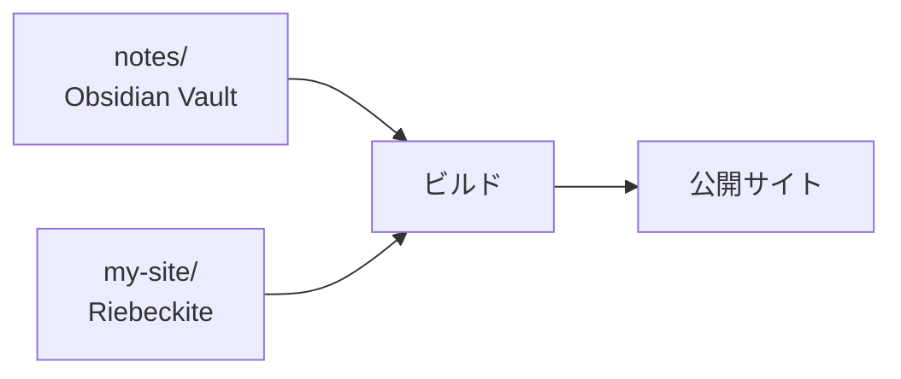

# Vaultの置き場所

## Vault をサイトの内外に置く

Vault は、サイトの中に置く方法と外に置く方法の2つから選べます。

### 一体型：サイトの `content/` を Vault にする

最も簡単な方法です。

Riebeckite のサイトにある次のフォルダを、そのまま Obsidian Vault として開きます。

```text id="bgatph"
content/
```

サイト全体は次のようになります。

```text id="f7zqjr"
my-site/
├─ content/              ← Obsidianで開く
│  ├─ Welcome.md
│  └─ Articles/
│     └─ FirstArticle.md
│
├─ riebeckite.config.ts
└─ package.json
```

この場合は標準設定のまま利用できます。

```ts id="7o5xhd"
content: {
  directory: "content",
},
```

初めて Riebeckite と Obsidian を組み合わせるなら、この方法が最も単純です。

```text id="ohx0fd"
my-site/content/
       ↓
Obsidian Vault
       ↓
Riebeckite Content
```

同じフォルダが両方の役割を持ちます。

### ディレクトリ分離型：既存の Vault をそのまま使う

すでに Obsidian Vault がある場合は、サイトの外に置いたまま利用できます。

たとえば、次のような構成にします。

```text id="k06dgu"
workspace/
├─ notes/                ← 既存のObsidian Vault
│  ├─ Welcome.md
│  ├─ Programming/
│  └─ .obsidian/
│
└─ my-site/              ← Riebeckite Site
   ├─ app/
   ├─ riebeckite.config.ts
   └─ package.json
```

`my-site/riebeckite.config.ts` から Vault を指定します。

```ts id="czcujq"
content: {
  directory: "../notes",
},
```

これだけで `notes/` を Riebeckite のコンテンツディレクトリとして利用できます。



Vault をサイトのディレクトリへコピーする必要はありません。

リポジトリ自体も分けたい場合は、[コンテンツとサイトを分ける](../content-repositories.ja.md) を参照してください。

## どちらを選ぶ？

迷った場合は、次の基準で選べます。

| 状況 | おすすめ |
| --- | --- |
| 初めて Riebeckite を使う | `content/` を Vault にする |
| すでに Vault がある | 既存の Vault を指定する |
| Vault とサイトの Git 履歴を分けたい | リポジトリを分ける |
| Vault をプライベートリポジトリにしたい | リポジトリを分ける |

既存 Vault があるなら、Riebeckite のためだけに移動する必要はありません。
