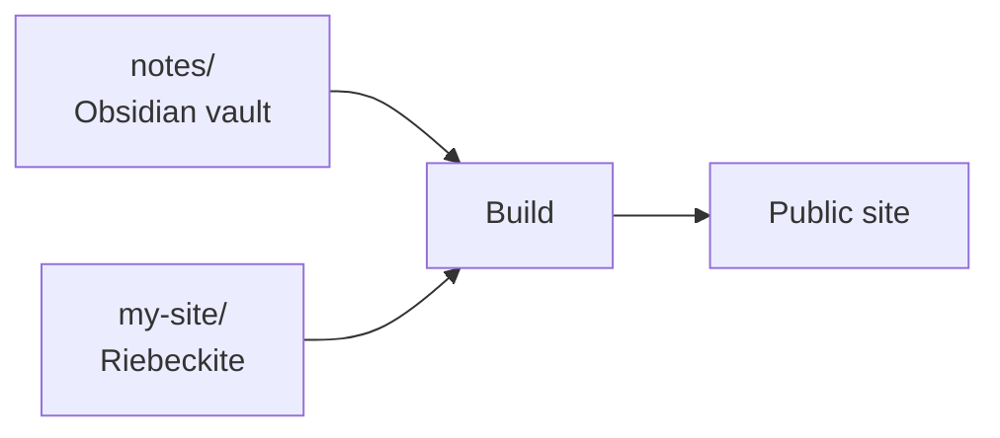

# Where to put the vault

## Two layouts

There are two broad ways to place the vault.

### Integrated: make the site's `content/` the vault

This is the simplest setup. Open the generated site's `content/` folder as an Obsidian vault.

```text
my-site/
|- content/              <- open this folder in Obsidian
|  |- Welcome.md
|  `- Articles/
|     `- FirstArticle.md
|
|- riebeckite.config.ts
`- package.json
```

The default configuration works for this layout.

```ts
content: {
  directory: "content",
},
```

If you are combining Riebeckite and Obsidian for the first time, this is the
simplest approach.

```text
my-site/content/
       |
Obsidian vault
       |
Riebeckite content
```

The same folder plays both roles.

Use this layout first if you only want to try Riebeckite.

### Separate directories: keep the vault and site in separate folders

If you already have an Obsidian vault, place the site next to it.

```text
workspace/
|- notes/                <- existing Obsidian vault
|  |- Welcome.md
|  |- Programming/
|  `- .obsidian/
|
`- my-site/              <- Riebeckite site
   |- app/
   |- riebeckite.config.ts
   `- package.json
```

In `my-site/riebeckite.config.ts`, point `content.directory` at the vault.

```ts
content: {
  directory: "../notes",
},
```

`../notes` means "the `notes` folder one level above the site". For more advanced separation, see [Separating content from the site](../content-repositories.md).



You do not need to copy the vault into the site directory.

This layout is safe for an existing vault as long as you understand the publish rule: only notes with `publish: true` become public by default. Riebeckite reads the vault during preview and build; it does not reorganize the vault or edit Markdown files for you.

If you also want to separate the repositories themselves, see
[Separating content from the site](../content-repositories.md).

## Which layout to choose?

When unsure, use these criteria.

| Situation | Recommendation |
| --- | --- |
| New to Riebeckite | Make `content/` the vault |
| You already have a vault | Point `content.directory` at the existing vault |
| You want separate Git history for vault and site | Separate the repositories |
| You want the vault in a private repository | Separate the repositories |

If you already have a vault, you do not need to move it just for Riebeckite.
