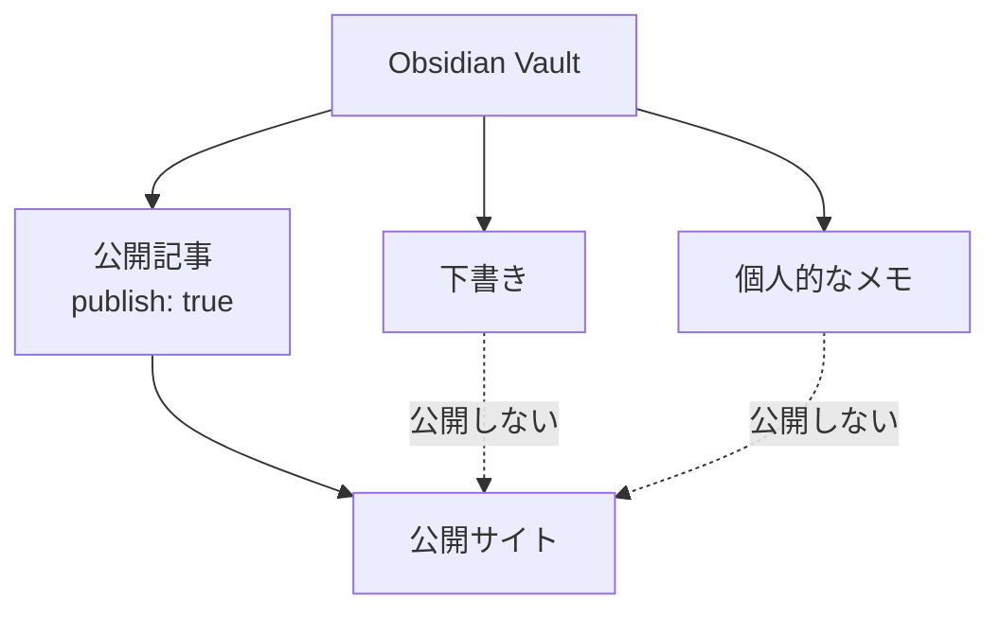

# セットアップ

## 既存の Vault はそのまま使える

Obsidian Vault は Markdown ファイルが入ったフォルダです。

Riebeckite も指定されたフォルダから Markdown を読み込むため、`content.directory` に Vault の場所を指定すればコンテンツとして利用できます。

たとえば、次のような既存 Vault を、そのまま Riebeckite から読み込めます。

```text id="ztw0m3"
notes/
├─ Welcome.md
├─ Programming/
│  └─ Flutter.md
├─ private/
│  └─ memo.md
└─ .obsidian/
```

次のコマンドを実行しても、Riebeckite が Vault の Markdown を整理したり、勝手に書き換えたりすることはありません。

```text id="52h4vi"
dev
check
doctor
inspect
build
```

ノートの編集はこれまでどおり Obsidian で行います。

## Templater のテンプレートを除外する

Vault で Obsidian Templater [[glossary/plugin|プラグイン]]を設定している場合、Riebeckite は `.obsidian/plugins/templater-obsidian/data.json` を読み、設定された `templates_folder` を Markdown の走査や frontmatter の解析より前に除外します。そのため、テンプレートはコンテンツの[[glossary/manifest|マニフェスト]]に入らず、[[glossary/ssg|SSG]]や開発サーバーにも入りません。

Riebeckite は Templater のコードを実行しません。通常のノートに Templater の式が含まれていても、そのノートを除外することはありません。Templater の設定またはテンプレートフォルダを取得できない場合は自動では除外しません。フォルダを明示的に除外したい場合は `content.exclude` を使います。

## 公開するノートを選ぶ

既定の公開ルールでは、frontmatter に次の設定があるノートだけを公開します。

```yaml id="mm8gy2"
publish: true
```

たとえば、次のようにします。

```md id="6kpm95"
---
title: 公開する記事
publish: true
---

この記事は公開されます。
```

一方、次のノートには `publish: true` がないため、公開対象になりません。

```md id="c04z4a"
---
title: 個人的なメモ
---

これは個人的なメモです。
```



そのため、公開記事と個人的なノートを同じ Vault に置いたまま運用できます。
