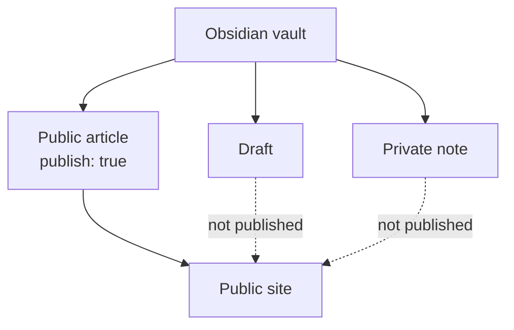

# Setup

## The basic idea

Riebeckite turns Markdown files from a configured folder into a site. An Obsidian vault is also a Markdown folder, so you can point `content.directory` at the vault.

You do not have to rebuild an existing vault for Riebeckite. Riebeckite reads Markdown from the configured folder; it does not rewrite your notes as part of normal `dev`, `check`, `doctor`, `inspect`, or `build` commands. Keep using Obsidian as your editor, and opt in only the notes you want to publish.

Each note decides whether it is published through frontmatter.

```md
---
title: Published note
publish: true
---
```

Notes without `publish: true` are not published by the default explicit publish strategy. This lets you keep private notes and public articles in the same vault.

## Using an existing vault as-is

An Obsidian vault is a folder full of Markdown files, and Riebeckite also reads
Markdown from a specified folder, so pointing `content.directory` at the vault
is enough to use it as content.

For example, an existing vault such as:

```text
notes/
|- Welcome.md
|- Programming/
|  `- Flutter.md
|- private/
|  `- memo.md
`- .obsidian/
```

can be read by Riebeckite without changes. Running the usual:

```text
dev
check
doctor
inspect
build
```

does not reorganize the vault or rewrite its Markdown on your behalf. You keep
editing notes in Obsidian exactly as before.

## Templater templates

When the vault has the Obsidian Templater plugin configured, Riebeckite reads
`.obsidian/plugins/templater-obsidian/data.json` and excludes the configured
`templates_folder` before scanning Markdown or parsing frontmatter. Templates
therefore do not enter the content manifest, [[glossary/ssg|SSG]], or the development server.

Riebeckite does not execute Templater code. A Templater expression in an
ordinary note remains ordinary Markdown and does not exclude that note. If the
Templater setting or its template folder is unavailable, no automatic exclusion
is applied; use `content.exclude` when you want to exclude a folder explicitly.

## Choosing which notes to publish

The default publish rule makes a note public only when its frontmatter
contains:

```yaml
publish: true
```

For example:

```md
---
title: Published note
publish: true
---

This note is published.
```

By contrast:

```md
---
title: Private note
---

This is a private note.
```

has no `publish: true`, so it is not published.



This is why you can keep published articles and private notes in the same
vault.
