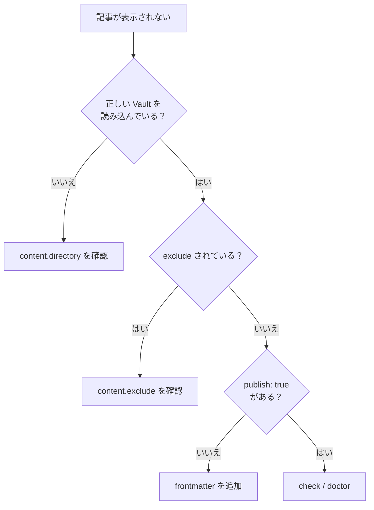
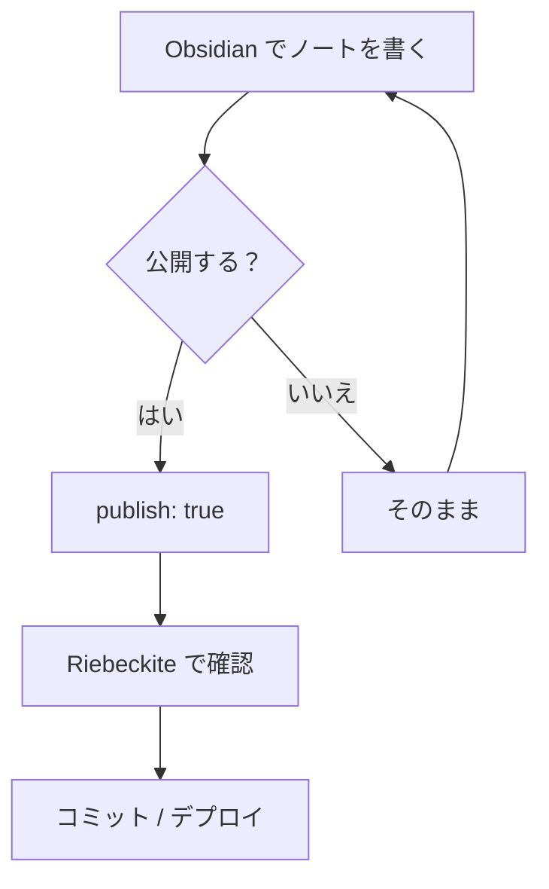

# トラブルシューティング

## サイトを確認する

記事を書いたら、Riebeckite のサイトのディレクトリで開発サーバーを起動します。

```sh id="uejsnw"
npm exec riebeckite dev
```

ブラウザで公開対象の記事を確認します。

問題がないか確認するには、次のコマンドを実行します。

```sh id="b4s9ol"
npm exec riebeckite check
npm exec riebeckite doctor
```

Riebeckite が実際にどのコンテンツを認識しているかを確認したい場合は、次のコマンドを利用できます。

```sh id="h7xl6g"
npm exec -- riebeckite inspect content --list
```

## 記事が表示されないとき

記事が表示されない場合は、次の順番で確認すると原因を絞りやすくなります。



解決済みのコンテンツディレクトリは、次のコマンドで確認できます。

```sh id="99glhk"
npm exec riebeckite inspect config
```

読み込まれているコンテンツは、次のコマンドで確認できます。

```sh id="csgeqn"
npm exec -- riebeckite inspect content --list
```

## 普段の使い方

設定が終われば、特別な操作はほとんど必要ありません。



つまり、普段の執筆方法はこれまでとほぼ同じです。Obsidian で書き、公開したいノートにだけ `publish: true` を付けます。

Riebeckite は、その Vault を公開サイトの[[glossary/content-source|コンテンツソース]]として利用します。
