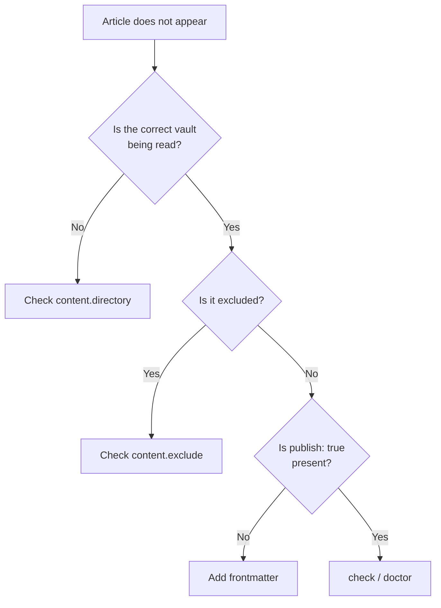
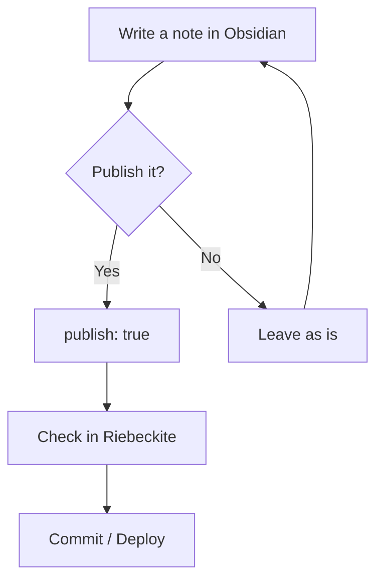

# Troubleshooting

## Checking the site

Once you have written an article, start the development server in the
Riebeckite site directory.

```sh
npm exec riebeckite dev
```

Check the published article in the browser. To verify that there are no
problems:

```sh
npm exec riebeckite check
npm exec riebeckite doctor
```

To see which content Riebeckite actually recognizes:

```sh
npm exec -- riebeckite inspect content --list
```

## When an article does not appear

When an article does not appear, checking in the following order narrows down
the cause.



The resolved content directory can be confirmed with:

```sh
npm exec riebeckite inspect config
```

The content that was read can be confirmed with:

```sh
npm exec -- riebeckite inspect content --list
```

## Everyday use

After setup, almost no special operation is needed.



In other words, your everyday writing process stays almost the same. **Write in
Obsidian and add `publish: true` only to the notes you want to publish.**
Riebeckite uses that vault as the content source for the public site.
