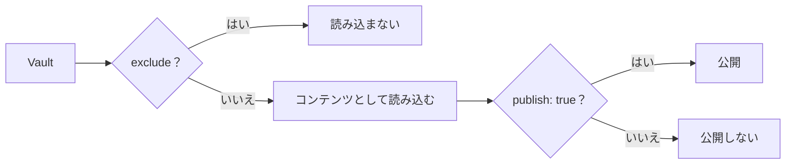
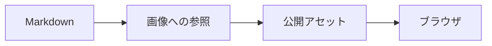

# 記事の書き方

## Obsidian で記事を書く

公開する記事には、最低限 `title` と `publish` を指定します。

```md id="9y29hw"
---
title: 記事のタイトル
publish: true
---

本文を書きます。
```

本文は通常の Markdown として書けます。

```md id="wm76s7"
# 見出し

本文を書きます。

## 次の見出し

さらに本文を書きます。
```

Obsidian の [[glossary/wikilink|WikiLink]] も利用できます。

```md id="5d4bby"
詳しくは [[別の記事]] を参照してください。
```

対応するプラグインが、Riebeckite のコンテンツ情報を使ってリンクを[[glossary/public-location|公開先]]へ解決します。

## ファイル名と公開 URL は一致するとは限らない

ファイル名は、コンテンツの識別や既定の公開 URL を決める材料になります。

たとえば、次のような分かりやすい名前にしておくと、Vault とサイトの両方で管理しやすくなります。

```text id="x1m3cc"
getting-started.md
```

ただし、Riebeckite では最終的な URL は解決済みの公開先として扱われます。

そのため、次のように考えないでください。

```text id="12x76m"
ファイルの物理Path
=
常に公開URL
```

プラグインや設定によって公開 URL が変わる場合があります。

URL の仕組みを詳しく知りたい場合は、[Content System](../../framework/content-system.ja.md) を参照してください。

## Obsidian の設定をコンテンツから外す

Vault には通常、次のディレクトリがあります。

```text id="wm1hpc"
.obsidian/
```

これは Obsidian 自体の設定であり、記事ではありません。必要に応じて `content.exclude` で除外できます。

```ts id="0vwyam"
content: {
  directory: "../notes",

  exclude: [
    ".obsidian/**",
  ],
},
```

テンプレートや非公開ディレクトリもコンテンツとして読み込みたくない場合は、次のように指定できます。

```ts id="xemlcl"
content: {
  directory: "../notes",

  exclude: [
    ".obsidian/**",
    "Templates/**",
    "private/**",
  ],
},
```

## `exclude` と `publish: true` は役割が違う

この2つは役割が異なります。



`exclude` は、Riebeckite にコンテンツとして読み込ませないものを指定します。

`publish: true` は、読み込んだコンテンツのうち公開するものを指定します。

たとえば、明らかにサイトで扱わない次のディレクトリは `exclude` し、それ以外のノートは `publish: true` で公開を選ぶ、という使い方ができます。

```text id="z7yyqm"
.obsidian/
Templates/
private/
```

## 非公開のメモを同じ Vault に置く

非公開のノートや[[glossary/draft|下書き]]を同じ Vault に置く場合は、`publish: true` を付けません。

```md id="0n1eqs"
---
title: 個人的なメモ
---

公開しない内容です。
```

既定の公開ルールなら、このノートはサイトに公開されません。

一方、公開記事は次のように書きます。

```md id="d8iz87"
---
title: 公開記事
publish: true
---

公開する内容です。
```

非公開の Vault を扱う場合は、公開するものだけを明示する運用にすると管理しやすくなります。

## 公開記事から非公開ノートへのリンクに注意する

公開記事から、次のように非公開ノートへリンクしてしまうことがあります。

```md id="tm0f93"
[[個人的なメモ]]
```

公開前に、次のコマンドなどで問題がないか確認してください。

```sh id="4ehd60"
npm exec riebeckite doctor
```

サイト内リンクの整合性を診断するプラグインを利用している場合は、公開先が存在しない WikiLink なども検出できます。

## 画像と添付ファイルを Vault 内で管理する

画像や添付ファイルも Vault 内で管理できます。

たとえば、次のようにします。

```text id="tyn3v3"
notes/
├─ article.md
└─ images/
   └─ photo.jpg
```

Markdown からは、次のように参照できます。

```md id="mmg4ki"

```

Obsidian の添付ファイル用フォルダを使う場合も、そのフォルダは Vault の中に置いてください。

ここでは、Markdown から画像を参照できることと、画像ファイル自体が公開サイトに存在することを分けて考える必要があります。



Vault の外にあるファイルは、ビルド時に見つからないことがあります。また、ビルド後の公開出力に存在しないファイルは表示できません。

添付ファイルをサイトへ公開する構成では、公開対象のアセットが実際に出力へ含まれていることも確認してください。

## 名前が重複するとリンクが曖昧になる

Riebeckite は `[[リンク]]` をノートのパス、[[glossary/alias|エイリアス]]、添付ファイル名から解決します。同じ名前のノート、エイリアス、添付ファイルが複数あると、名前だけの `[[note]]` では対象を1つに特定できません。

このとき Riebeckite は推測せず、リンクを未解決のまま残します。`doctor` は、そうしたリンクを曖昧なリンクとして報告します。

```text id="dup1aa"
x/dup.md
y/dup.md
```

```md id="dup2bb"
[[dup]]        ← 曖昧
[[x/dup]]      ← Path を指定しているので x/dup.md に解決
```

公開するリンクが必ず1つの対象を指すように、フォルダを含むパスを書くか、どちらかのファイル名を変更してください。
