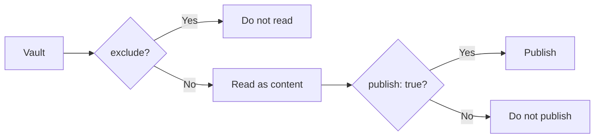
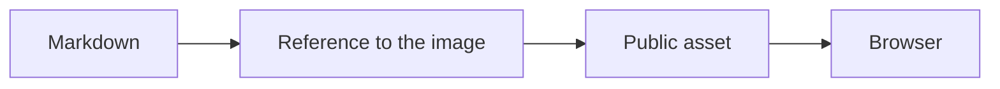

# Writing notes

## Writing notes in Obsidian

For a note you want to publish, add at least these frontmatter fields.

```md
---
title: Article title
publish: true
---

Write the article body here.
```

Write the body as normal Markdown.

```md
# Heading

Write the article body here.

## Next heading

Write more of the article body here.
```

Obsidian WikiLinks also work.

```md
See [[another note]] for details.
```

The corresponding plugin resolves the public link using Riebeckite's content
information.

### File names and URLs

The file name becomes part of the URL. For example, `content/my-note.md` becomes `/my-note`. Non-English file names can work, but short lowercase English names are easier to share as URLs.

A clear name such as:

```text
getting-started.md
```

is easier to manage in both the vault and the site.

However, Riebeckite treats the final URL as a resolved public location, so do
not assume:

```text
physical path of the file
=
public URL
```

A plugin or configuration may change the public location. To learn how URLs
work, see the [Content System](../../framework/content-system.md).

## Obsidian configuration files

A vault normally contains:

```text
.obsidian/
```

This is Obsidian's own configuration, not an article. You can exclude it from
`content.exclude` when needed.

```ts
content: {
  directory: "../notes",

  exclude: [
    ".obsidian/**",
  ],
},
```

If you also do not want templates or a private directory read as content:

```ts
content: {
  directory: "../notes",

  exclude: [
    ".obsidian/**",
    "Templates/**",
    "private/**",
  ],
},
```

## `exclude` and `publish: true`

These two settings play different roles.



`exclude` specifies **what Riebeckite should not read as content**.

`publish: true` specifies **which of the content that was read should be
published**.

For example, directories that the site clearly will not handle:

```text
.obsidian/
Templates/
private/
```

can be excluded, while the remaining notes opt into publication with
`publish: true`.

## Keeping private notes private

Do not add `publish: true` to private notes.

```md
---
title: Private note
---

This content is not published.
```

Under the default publish rule, this note is not published to the site. A
public article, on the other hand, is written as:

```md
---
title: Public article
publish: true
---

This content is published.
```

When you work with a private vault, it is easier to manage if you **explicitly
mark only the notes you want to publish**.

## Links from public articles to private notes

A public article may accidentally link to a private note:

```md
[[Private note]]
```

Before publishing, check for problems with:

```sh
npm exec riebeckite doctor
```

If you use a plugin that diagnoses the consistency of in-site links, it can
also detect WikiLinks whose public destination does not exist.

The private note itself will not be published. Avoid linking from public articles to private notes, and run `doctor` before publishing.

## Images and attachments

Keep images and attachments inside the vault.

```text
notes/
|- article.md
`- images/
   `- photo.jpg
```

Reference them from Markdown:

```md

```

If you use an Obsidian attachments folder, keep that folder inside the vault. Files outside the vault may not be found during the build.

Here it is important to separate two things: **being able to reference an image
from Markdown** and **the image file itself existing in the public site**.



Files outside the vault, or files that are not present in the build's public
output, cannot be displayed. When you publish attachments to the site, also
confirm that the published assets are actually included in the output.

## Duplicate names and ambiguous links

Riebeckite resolves `[[links]]` against note paths, aliases, and attachment names. When two notes, two aliases, or two attachments share the same name, a bare name cannot identify one target. Riebeckite never guesses: the link stays unresolved and `doctor` reports it as ambiguous.

```text
x/dup.md
y/dup.md
```

```md
[[dup]]     <- ambiguous
[[x/dup]]   <- explicit, resolves to x/dup.md
```

Add the folder to the link, or rename one of the files, so every published link points at exactly one target.
