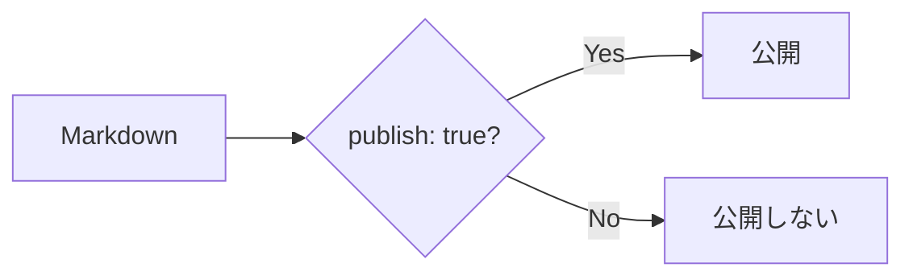
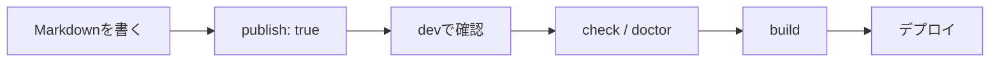

# 記事の書き方ガイド

Riebeckite で公開する記事の基本的な書き方を説明します。

Markdown に慣れていなくても、

```text
記事ファイルを作る
      ↓
タイトルを書く
      ↓
本文を書く
      ↓
ブラウザで確認
      ↓
公開
```

まで進められる内容です。

## 記事を置く場所

標準では、記事を `content/` に置きます。

```text
my-site/
├─ content/
│  ├─ index.md
│  └─ first-post.md
│
├─ riebeckite.config.ts
└─ package.json
```

たとえば、

```text
content/first-post.md
```

を作れば、Riebeckite が記事として読み込みます。

`content/` 以外のフォルダを使うこともできます。既存の Obsidian Vault などを使いたい場合は [Obsidian のノートをサイトにするガイド](./obsidian.ja.md) を参照してください。

## 最初の記事を書く

まず、

```text
content/first-post.md
```

を作ります。

内容は次のようにします。

```md
---
title: 最初の記事
publish: true
---

# 最初の記事

はじめての記事です。

Riebeckite で Markdown を公開してみます。
```

これだけで、公開できる最小の記事になります。

## frontmatter

記事の先頭にある、

```md
---
title: 最初の記事
publish: true
---
```

の部分を **frontmatter** と呼びます。

frontmatter には、記事そのものではなく、記事についての情報を書きます。

```text
Markdown ファイル
│
├─ frontmatter
│    ├─ title
│    └─ publish
│
└─ 本文
     ├─ 見出し
     ├─ 段落
     ├─ リンク
     └─ 画像
```

最初は次の2つを覚えておけば十分です。

| 項目 | 意味 |
| --- | --- |
| `title` | 記事のタイトル |
| `publish: true` | この記事を公開する |

たとえば、

```md
---
title: Flutter を始めた
publish: true
---
```

なら、「Flutter を始めた」というタイトルの記事を公開します。

## 記事を公開する

既定の公開ルールでは、

```yaml
publish: true
```

がある記事だけが公開されます。

公開する記事は、

```md
---
title: 公開する記事
publish: true
---

この記事は公開します。
```

とします。

## 下書きにする

まだ公開したくない記事には `publish: true` を付けません。

```md
---
title: まだ出さない記事
---

書きかけの記事です。
```

このファイルはコンテンツとして管理できますが、既定の公開ルールでは公開ページになりません。



そのため、

```text
content/
├─ published-post.md
├─ draft-post.md
└─ another-draft.md
```

のように、公開記事と下書きを同じ `content/` に置いておくこともできます。

## Markdown の基本

本文は通常の Markdown で書きます。

### 見出し

```md
# 大見出し

## 中見出し

### 小見出し
```

`#` の数によって見出しの階層が変わります。

### 段落

普通に文章を書けば段落になります。

```md
最初の段落です。

空行を入れると、次の段落になります。
```

### 箇条書き

```md
- Flutter
- TypeScript
- HonoX
```

番号付きのリストも書けます。

```md
1. 記事を書く
2. ブラウザで確認する
3. 公開する
```

### 強調

```md
**太字**

*斜体*
```

### コード

文章中のコードはバッククォートで囲みます。

```md
`publish: true` を追加します。
```

複数行のコードはコードブロックにできます。

````md
```ts
const message = "Hello";
console.log(message);
```
````

## リンクを書く

外部サイトへのリンクは通常の Markdown リンクを使います。

```md
[Example](https://example.com)
```

サイト内の記事へリンクする場合も Markdown リンクを利用できます。

```md
[プロフィール](/about)
```

## Wikiリンク

Obsidian 形式の WikiLink に対応したプラグインを利用している構成では、

```md
[[about]]
```

のようなリンクも利用できます。

表示する文字を変更する場合は、

```md
[[about|プロフィール]]
```

と書けます。

```text
[[about]]
      ↓
対応するコンテンツを解決
      ↓
公開先のURL
```

Riebeckite では、最終的なサイト内リンクは解決済みのコンテンツ情報を使って扱われます。

そのため、プラグインや多言語設定などによって公開 URL が変わる場合でも、対応する仕組みからリンクを解決できます。

## ファイル名と URL

標準的な構成では、コンテンツの[[logical-path|論理パス]]が公開先を決める基準になります。

たとえば基本的な構成では、

| ファイル | 公開先の例 |
| --- | --- |
| `content/index.md` | `/` |
| `content/about.md` | `/about` |
| `content/posts/first.md` | `/posts/first` |

のようになります。

そのため、ファイル名には、

```text
about.md
getting-started.md
first-post.md
```

のような分かりやすい名前を付けると管理しやすくなります。

英小文字・数字・ハイフンを使った名前にしておくのも扱いやすい方法です。

ただし、Riebeckite では、

```text
ファイルパス
      ↓
コンテンツ
      ↓
Public Location
      ↓
公開URL
```

として公開先が解決されます。

そのため、

**ファイルの物理パスが常にそのまま URL になるわけではありません**。

プラグインや設定によって Public Location が変更されることがあります。

詳しい仕組みは [コンテンツシステム](../framework/content-system.ja.md) を参照してください。

## 画像を使う

Markdown では次のように画像を書けます。

```md

```

`[]` の中には、画像が表示できない場合にも内容が分かる説明を書いてください。

たとえば、

```md

```

のようにします。

## 画像ファイルについて

Markdown に画像へのリンクを書くだけでは、画像ファイルそのものが自動的に存在することにはなりません。

```text
Markdown
   ↓
画像URL
   ↓
公開サイトに画像が存在
   ↓
ブラウザーで表示
```

利用しているサイト構成に合わせて、画像が公開出力に含まれるようにしてください。

Obsidian Vault の添付ファイルを利用する場合は [Obsidian のノートをサイトにするガイド](./obsidian.ja.md) も参照してください。

## 記事を書いてみる

ここまでを組み合わせると、たとえば次のような記事を書けます。

```md
---
title: Riebeckite を使ってみた
publish: true
---

# Riebeckite を使ってみた

Riebeckite で最初のサイトを作ってみました。

## 使ったもの

- Markdown
- Riebeckite
- HonoX

## 関連記事

詳しい設定は [[configuration|設定についての記事]] にまとめています。

## 外部リンク

[Riebeckite の GitHub](https://github.com/Rerurate514/riebeckite)
```

frontmatter の後は、通常の Markdown として記事を書いていけば問題ありません。

## 公開前にブラウザで確認する

記事を書いたら開発サーバーを起動します。

```sh
npm exec riebeckite dev
```

ブラウザーで記事を開き、

- タイトル
- 見出し
- 本文
- リンク
- 画像
- コードブロック

などが想定どおり表示されているか確認します。

## 問題がないか確認する

公開前には、

```sh
npm exec riebeckite check
npm exec riebeckite doctor
```

を実行します。

役割は次のように異なります。

| コマンド | 主に確認すること |
| --- | --- |
| `check` | 設定やプラグインの設定が正しいか |
| `doctor` | コンテンツやサイトに問題がないか |
| `dev` | ブラウザーで実際の表示を確認する |

サイト内リンクの整合性を診断するプラグインを利用している場合は、存在しない内部リンクなども確認できます。

## どの記事が認識されているか確認する

記事が表示されない場合は、

```sh
npm exec -- riebeckite inspect content --list
```

を利用できます。

これによって、Riebeckite がどのコンテンツを認識しているか確認できます。

記事が見つからない場合は、

```text
content.directory
      ↓
exclude
      ↓
コンテンツとして認識
      ↓
publish条件
      ↓
公開サイト
```

の順番で確認すると原因を切り分けやすくなります。

## サイトをビルドする

ブラウザーで確認して問題がなければ、サイトをビルドします。

```sh
npm exec riebeckite build
```

基本的な流れは、



となります。

## 最初はこれだけ覚えればよい

Riebeckite で記事を書くために、最初からすべての機能を覚える必要はありません。

まずは、

```md
---
title: 記事のタイトル
publish: true
---

# 記事のタイトル

本文を書きます。
```

という形だけ覚えておけば記事を公開できます。

その後、必要に応じて、

```text
Markdown
WikiLink
画像
frontmatter
プラグイン
多言語対応
```

などを追加していけば十分です。

## まとめ

Riebeckite で記事を書く基本的な流れはシンプルです。

```text
content/ に .md を作る
        ↓
title を付ける
        ↓
publish: true を付ける
        ↓
Markdown で本文を書く
        ↓
dev で確認
        ↓
check / doctor
        ↓
build
```

公開する記事と下書きを分けるために、まず覚えておきたいのは、

```yaml
publish: true
```

です。

そして、記事の公開 URL は最終的に Riebeckite が解決した **Public Location** で決まります。通常の記事を書く段階では URL の仕組みを意識しすぎる必要はありません。

### 次に読むもの

- [サイト公開までの最短ガイド](../getting-started/deployment.ja.md)
- [Obsidian のノートをサイトにするガイド](./obsidian.ja.md)
- [多言語サイト](./localization.ja.md)
- [Configuration](../reference/configuration.ja.md)
