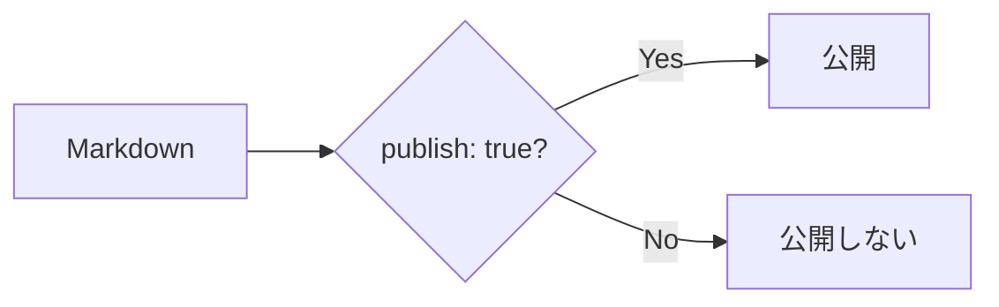

# 基本

## 記事を置く場所

標準では、記事を `content/` に置きます。

```text
my-site/
├─ content/
│  ├─ index.md
│  └─ first-post.md
│
├─ riebeckite.config.ts
└─ package.json
```

たとえば、

```text
content/first-post.md
```

を作れば、Riebeckite が記事として読み込みます。

`content/` 以外のフォルダを使うこともできます。既存の [[glossary/obsidian-vault|Obsidian Vault]] などを使いたい場合は [Obsidian のノートをサイトにするガイド](../obsidian.ja.md) を参照してください。

## 最初の記事を書く

まず、

```text
content/first-post.md
```

を作ります。

内容は次のようにします。

```md
---
title: 最初の記事
publish: true
---

# 最初の記事

はじめての記事です。

Riebeckite で Markdown を公開してみます。
```

これだけで、公開できる最小の記事になります。

## frontmatter

記事の先頭にある、

```md
---
title: 最初の記事
publish: true
---
```

の部分を **frontmatter** と呼びます。

frontmatter には、本文ではなく、記事についての情報を書きます。

```text
Markdown ファイル
│
├─ frontmatter
│    ├─ title
│    └─ publish
│
└─ 本文
     ├─ 見出し
     ├─ 段落
     ├─ リンク
     └─ 画像
```

最初は次の2つを覚えておけば十分です。

| 項目 | 意味 |
| --- | --- |
| `title` | 記事のタイトル |
| `publish: true` | この記事を公開する |

たとえば、

```md
---
title: Flutter を始めた
publish: true
---
```

なら、「Flutter を始めた」というタイトルの記事を公開します。

## 記事を公開する

既定の公開ルールでは、

```yaml
publish: true
```

がある記事だけが公開されます。

公開する記事は、

```md
---
title: 公開する記事
publish: true
---

この記事は公開します。
```

とします。

## 下書きにする

まだ公開したくない記事には `publish: true` を付けません。

```md
---
title: まだ出さない記事
---

書きかけの記事です。
```

このファイルはコンテンツとして管理できますが、既定の公開ルールでは公開ページになりません。



そのため、

```text
content/
├─ published-post.md
├─ draft-post.md
└─ another-draft.md
```

のように、公開記事と[[glossary/draft|下書き]]を同じ `content/` に置いておくこともできます。
