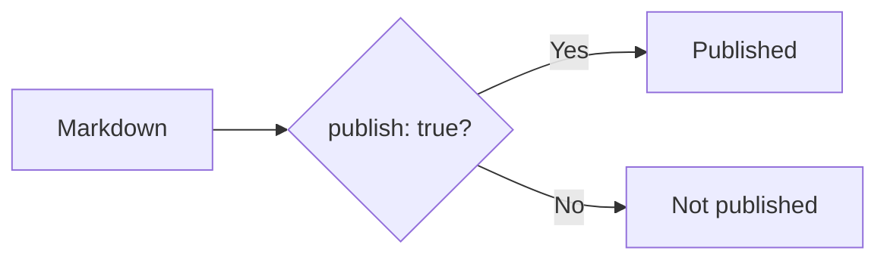

# Basics

## Where articles live

By default, articles live in the `content/` folder.

```text
my-site/
├─ content/
│  ├─ index.md
│  └─ first-post.md
│
├─ riebeckite.config.ts
└─ package.json
```

`first-post.md` is shown at `/first-post`. `index.md` is a useful name for the top page.

You can also use a folder other than `content/`. If you want to publish an existing Obsidian vault, see [Publishing Obsidian notes](../obsidian.md).

## The smallest article

A published article starts with frontmatter.

```md
---
title: First post
publish: true
---

# First post

Write the article body here.
```

- `title`: the article title used by the site
- `publish: true`: marks the article as published

Files without `publish: true` can be kept as drafts.

## Frontmatter

The block at the top of the file,

```md
---
title: First post
publish: true
---
```

is called **frontmatter**. [[glossary/frontmatter|Frontmatter]] describes the article, not the article content itself.

```text
Markdown File
│
├─ Frontmatter
│    ├─ title
│    └─ publish
│
└─ Body
     ├─ Heading
     ├─ Paragraph
     ├─ Link
     └─ Image
```

To begin with, two fields are enough:

| Field | Meaning |
| --- | --- |
| `title` | The article title |
| `publish: true` | Publish this article |

For example,

```md
---
title: Getting started with Flutter
publish: true
---
```

publishes an article titled "Getting started with Flutter".

## Published articles and drafts

By default, only articles with

```yaml
publish: true
```

are published.

Published article:

```md
---
title: Published article
publish: true
---
```

[[glossary/draft|Draft]]:

```md
---
title: Draft article
---
```

Drafts are not emitted as public pages.



Because of this, you can keep published articles and drafts together in the same `content/` folder:

```text
content/
├─ published-post.md
├─ draft-post.md
└─ another-draft.md
```
