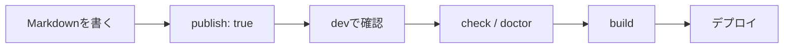

# ワークフロー

## 記事を書いてみる

ここまでを組み合わせると、たとえば次のような記事を書けます。

```md
---
title: Riebeckite を使ってみた
publish: true
---

# Riebeckite を使ってみた

Riebeckite で最初のサイトを作ってみました。

## 使ったもの

- Markdown
- Riebeckite
- HonoX

## 関連記事

詳しい設定は [[configuration|設定についての記事]] にまとめています。

## 外部リンク

[Riebeckite の GitHub](https://github.com/Rerurate514/riebeckite)
```

frontmatter の後は、通常の Markdown として記事を書いていけば問題ありません。

## 公開前にブラウザで確認する

記事を書いたら開発サーバーを起動します。

```sh
npm exec riebeckite dev
```

ブラウザーで記事を開き、

- タイトル
- 見出し
- 本文
- リンク
- 画像
- コードブロック

などが想定どおり表示されているか確認します。

## 問題がないか確認する

公開前には、

```sh
npm exec riebeckite check
npm exec riebeckite doctor
```

を実行します。

役割は次のように異なります。

| コマンド | 主に確認すること |
| --- | --- |
| `check` | 設定やプラグインの設定が正しいか |
| `doctor` | コンテンツやサイトに問題がないか |
| `dev` | ブラウザーで実際の表示を確認する |

サイト内リンクの整合性を診断するプラグインを利用している場合は、存在しない内部リンクなども確認できます。

## どの記事が認識されているか確認する

記事が表示されない場合は、

```sh
npm exec -- riebeckite inspect content --list
```

を利用できます。

このコマンドで、Riebeckite がどのコンテンツを認識しているか確認できます。

記事が見つからない場合は、

```text
content.directory
      ↓
exclude
      ↓
コンテンツとして認識
      ↓
publish条件
      ↓
公開サイト
```

の順番で確認すると原因を切り分けやすくなります。

## サイトをビルドする

ブラウザーで確認して問題がなければ、サイトをビルドします。

```sh
npm exec riebeckite build
```

基本的な流れは、



となります。
