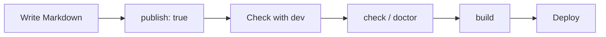

# Workflow

## A complete example

Combining everything so far, an article can look like this:

```md
---
title: Trying Riebeckite
publish: true
---

# Trying Riebeckite

I built my first site with Riebeckite.

## What I used

- Markdown
- Riebeckite
- HonoX

## Related articles

The details are collected in [[configuration|the configuration article]].

## External links

[Riebeckite on GitHub](https://github.com/Rerurate514/riebeckite)
```

After the frontmatter, you can write the article as ordinary Markdown.

## Check before publishing

After adding articles, run these commands from the site folder.

```sh
npm exec riebeckite check
npm exec riebeckite doctor
npm exec riebeckite dev
```

Use `dev` to preview the site in a browser and check the title, headings, body, links, images, and code blocks. When it looks good, build it.

```sh
npm exec riebeckite build
```

The roles differ:

| Command | Main check |
| --- | --- |
| `check` | Whether the config and plugin settings are correct |
| `doctor` | Whether the content and site have problems |
| `dev` | Whether the actual rendering looks right in the browser |

If you use a plugin that diagnoses in-site links, it can also find internal links that point to pages that do not exist.

## Checking which articles are recognized

If an article does not appear, use:

```sh
npm exec -- riebeckite inspect content --list
```

This shows which content Riebeckite recognizes. When an article cannot be found, checking in this order makes the cause easier to isolate:

```text
content.directory
      ↓
exclude
      ↓
Recognized as content
      ↓
publish condition
      ↓
Public site
```

## Build the site

Once the browser preview looks right, build the site.

```sh
npm exec riebeckite build
```

The basic flow is:


