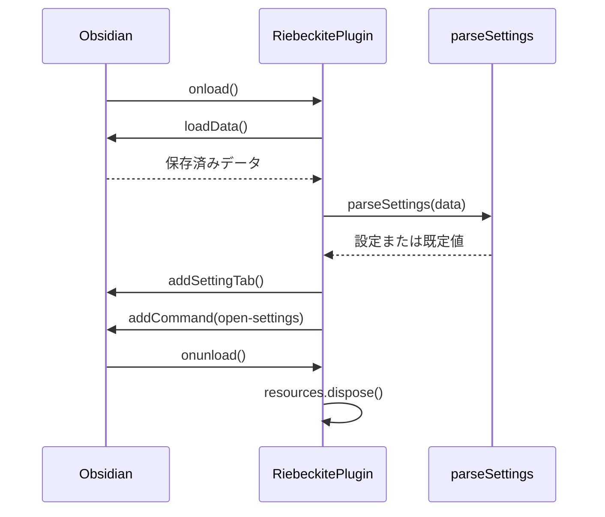

# プラグインのアーキテクチャ

プラグインは、Obsidian 向けの小さなパッケージです。プラグインの組み立ては `src/main.ts` だけで行い、Riebeckite のモノレポとは別にビルドします。`workspace:` による Riebeckite への依存はありません。

## ファイルの責務

- `src/main.ts` は唯一の組み立て起点です。Obsidian SDK を読み込み、設定を読み込んで設定タブとコマンドを登録し、無効化時にリソースを破棄します。
- `src/settings/settings.ts` は保存する設定のモデルと検証を担当します。Obsidian は読み込みません。
- `src/settings/settings-tab.ts` は設定画面を担当し、保存はプラグインへ委譲します。
- `src/lifecycle/resource-registry.ts` は手動で登録したリソースを、登録と逆順に1回だけ破棄します。
- `scripts/` はビルド、マニフェストとリリースファイルの検証、バージョン同期を担当します。
- `test/` は設定、破棄、リリースファイルを対象にした Node のテストです。

Obsidian SDK を読み込むのは組み立て起点と設定タブだけです。設定の検証は Obsidian に依存しないため、Obsidian なしでテストできます。

## 読み込みの流れ

`onload` の途中で例外が起きると、`catch` がエラーを記録して通知を表示します。プラグインは読み込まれた状態のままですが、失敗した箇所より後の登録処理は実行されません。

## コマンドと設定画面

**Riebeckite: Open settings** コマンドは、`app.setting.open()` で Obsidian の設定画面を開き、`app.setting.openTabById(this.manifest.id)` でプラグインのタブを選択します。設定画面の API は公開型定義に含まれていないため、この呼び出しでは `this.app` を拡張した型へキャストしています。将来の Obsidian で API が変わった場合は、`minAppVersion` の引き上げが必要です。

設定画面には、見出し、ローカル開発サーバーとの連携が未接続である旨、**Local server URL** の入力欄を表示します。入力が変わるたびに `updateSettings` を呼びます。

## 設定の検証

`parseSettings(value: unknown)` は、保存済みデータを信頼しない入力として扱い、次の場合は既定値を返します。

- 値がオブジェクトでない、または `null`
- `serverUrl` が文字列でない
- 文字列が URL として解釈できない
- プロトコルが `http:` でも `https:` でもない

有効な URL は `URL.toString()` で正規化し、末尾のスラッシュを1つ除きます。`updateSettings` は変更を現在の設定へマージし、検証してから `saveData` で保存します。

検証はエラーではなく既定値を返すため、`updateSettings` に無効な値が届くと、保存されるのは既定値です。読み込み時に無効なデータが見つかった場合、メモリ上の設定は既定値になり、ファイルは次に保存するまで書き換えません。

## リソースの破棄

`addSettingTab` と `addCommand` で登録したリソースは Obsidian が管理します。`ResourceRegistry` は、Obsidian が管理しないリソース（タイマー、ソケット、購読など）のために用意しています。

`onunload` が `dispose` を呼ぶと、一覧を空にして、登録と逆順に破棄します。一覧が空になるため、2回呼んでも安全です。現在の実装では登録されるリソースがないため、`dispose` は実行時に何もしません。

## ビルドとリリース

esbuild は `src/main.ts` を CommonJS の `main.js` へまとめます。ターゲットは ES2021 です。`obsidian`、Electron、CodeMirror、Lezer、Node の組み込みモジュールは、実行時に Obsidian が提供するため外部のままにします。開発ビルドはインラインのソースマップを付け、入口を監視します。本番ビルドは圧縮し、ソースマップを出力しません。

`pnpm check:manifest` は `manifest.json`、`package.json`、`versions.json` のバージョンが揃っていることを検証します。`pnpm build:release` はビルド、マニフェスト検証、リリース対象ファイルの検証を順に実行します。`v<version>` タグを push すると、リリースワークフローがタグを検証し、`main.js` と `manifest.json` を GitHub Release へ添付します。

## テスト

`pnpm test` は `test/*.test.ts` を Node のテストランナーで実行します。

| テスト | 検証する契約 |
| --- | --- |
| `settings.test.ts` | 無効なデータは既定値になり、有効な URL は正規化される |
| `resource-registry.test.ts` | 破棄は逆順に1回だけ実行される |
| `release-files.test.ts` | マニフェストのバージョンが揃い、リリースファイルを受け付ける |

テストは、プラグインのリポジトリにある Obsidian での手動確認を代替しません。Obsidian 上で、設定タブが開くことと URL が保存されることを確認します。プラグインを再度有効化したときに、コマンドが1つだけ登録されることも確認します。

## 接続機能を追加するときの境界

保存した URL は現時点では設定値にすぎません。接続機能を追加するときは、最小限のアダプターから始め、次の点を守ります。

- レスポンスを検証する。
- 接続状態を設定画面に表示する。
- 生成したリソースを `ResourceRegistry` へ登録し、`onunload` で破棄する。

サーバー呼び出しが存在しない機能を、利用可能であるかのように表示してはいけません。
