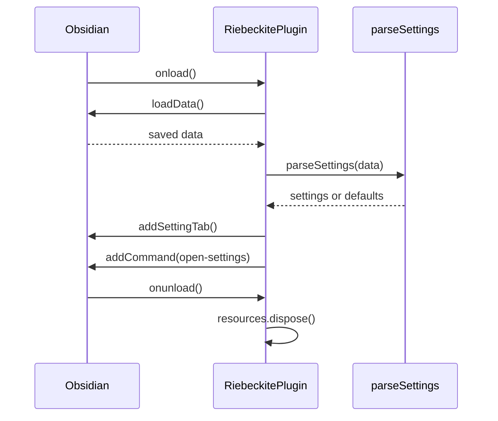

# Plugin architecture

The plugin is a small Obsidian package with a single composition root. It builds
separately from the Riebeckite monorepo and has no `workspace:` dependency on
it.

## Responsibilities

- `src/main.ts` is the only composition root. It imports the Obsidian SDK,
  loads settings, registers the settings tab and the command, and disposes
  resources on unload.
- `src/settings/settings.ts` holds the persisted model and validation. It does
  not import Obsidian.
- `src/settings/settings-tab.ts` owns the settings UI and delegates persistence
  to the plugin.
- `src/lifecycle/resource-registry.ts` disposes manually registered resources
  once, in reverse order.
- `scripts/` builds the plugin, validates the manifest and release files, and
  synchronizes versions.
- `test/` holds Node test runner suites for settings, disposal, and release
  files.

Only the composition root and the settings tab import the Obsidian SDK. Settings
validation stays framework-independent, so it can be tested without Obsidian.

## Load sequence

If a step in `onload` throws, the `catch` block logs the error and shows a
notice. The plugin stays loaded, but the remaining registration steps do not
run.

## Command and settings UI

The **Riebeckite: Open settings** command opens the Obsidian settings window
with `app.setting.open()` and selects the plugin tab with
`app.setting.openTabById(this.manifest.id)`. The settings API is not part of the
public type definitions, so the plugin casts `this.app` for this call. If a
future Obsidian release changes the API, raise `minAppVersion`.

The settings tab renders a heading, a note that local development server
integration is not connected, and the **Local server URL** field. Each change to
the field calls `updateSettings`.

## Settings validation

`parseSettings(value: unknown)` treats persisted data as untrusted input and
returns the defaults when:

- the value is not an object, or is `null`
- `serverUrl` is not a string
- the string does not parse as a URL
- the protocol is neither `http:` nor `https:`

A valid URL is normalized with `URL.toString()`, and one trailing slash is
removed. `updateSettings` merges the change into the current settings, validates
the result, and writes it with `saveData`.

Validation returns defaults instead of an error. As a result, `updateSettings`
stores an invalid value as the default. On load, invalid saved data becomes the
default in memory without rewriting the file.

## Lifecycle

Obsidian owns the resources registered by `addSettingTab` and `addCommand`.
`ResourceRegistry` exists for resources that Obsidian does not track, such as
timers, sockets, or subscriptions added by a connection feature.

`onunload` calls `dispose`, which empties the list and disposes the items in
reverse registration order. A second call is safe because the list is already
empty. No resource is registered in the current implementation, so `dispose`
has no effect at runtime.

## Build and release

esbuild bundles `src/main.ts` into a CommonJS `main.js` with target ES2021.
`obsidian`, Electron, CodeMirror, Lezer, and Node built-ins stay external
because Obsidian provides them at runtime. Development builds keep inline source
maps and watch the entry; production builds minify and omit source maps.

`pnpm check:manifest` verifies that `manifest.json`, `package.json`, and
`versions.json` agree. `pnpm build:release` builds the plugin, checks the
manifest, and verifies that the release files are non-empty. Pushing a
`v<version>` tag runs the release workflow, which validates the tag and attaches
`main.js` and `manifest.json` to a GitHub Release.

## Tests

`pnpm test` runs the Node test runner against `test/*.test.ts`.

| Test | Contract |
| --- | --- |
| `settings.test.ts` | Invalid data returns defaults; a valid URL is normalized |
| `resource-registry.test.ts` | Disposal runs once, in reverse order |
| `release-files.test.ts` | Manifest versions agree; release files are accepted |

The tests do not replace the manual Obsidian checks in the plugin repository.
Confirm in Obsidian that the settings tab opens, the URL persists, and the
command is registered once after the plugin is re-enabled.

## Future connection boundary

The stored URL is configuration only. A future connection should start with the
smallest adapter and follow these rules:

- Validate responses.
- Show connection state in the settings tab.
- Register every resource with `ResourceRegistry` so `onunload` can release it.

The plugin should not present a feature as available before the server call
exists.
