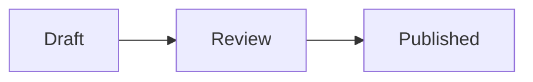

# Mermaid (Pele)

Render `mermaid` code blocks to static SVG with [Pele](https://pele.run/), Obsidian's lightweight Mermaid-compatible renderer.

[日本語](./mermaid-pele.ja.md)

## Install

```sh
npm install @riebeckite/plugin-mermaid-pele pele
```

## Configure

```ts
import { defineConfig } from "@riebeckite/core";
import { mermaidPele } from "@riebeckite/plugin-mermaid-pele";

export default defineConfig({
  plugins: [mermaidPele({ theme: "auto" })],
});
```

`theme` accepts only `"auto"`, which is also the default. Pele SVG uses CSS variables, so Riebeckite light and dark theme tokens change its colors without regenerating the SVG.

## Write diagrams

````md

````

The plugin replaces the block with a static `<figure class="rr-mermaid-pele">`. It needs no client JavaScript, Puppeteer, or Chromium and works during HonoX SSG. Invalid diagrams remain as an accessible error and their escaped source is available in a disclosure; they do not abort the whole build.

## Theme and layout

The plugin owns the `rr-mermaid-pele` structure, overflow behavior, and Pele variable mapping. Themes supply public `--rb-color-*` and `--rb-font-*` tokens; sites retain control over page layout. SVGs are responsive, retain their natural aspect ratio, and scroll horizontally only when a diagram still cannot fit.

## Compatibility and security

Pele supports Mermaid 12.1.0 built-in diagram types, including flowcharts, sequence, class, state, ER, Gantt, charts, C4, and newer beta diagrams. Its layout and appearance intentionally differ from Mermaid. Mermaid external plugins such as ZenUML and arbitrary HTML labels are unsupported.

Pele escapes text, filters styles and URLs, blocks scripts, event handlers, `foreignObject`, and `javascript:` URLs. This plugin disables diagram images and additionally rejects unsafe SVG output. Standard safe links remain available.

Do not enable this plugin together with `@riebeckite/plugin-mermaid`. Riebeckite emits a clear configuration error rather than selecting a renderer by plugin order. To migrate, replace the `mermaid()` entry with `mermaidPele()`; Markdown fences do not change.

## Cache behavior

The normal processed-content cache stores the generated SVG. Its key includes the Markdown source, plugin configuration, and plugin cache contract. Unchanged Mermaid fences therefore do not re-render on incremental builds. Theme CSS changes only alter CSS variables and do not regenerate SVG.

## Troubleshooting

- **A diagram is shown as an error:** validate it in the [Pele playground](https://pele.run/playground); Pele reports source locations for syntax errors.
- **A diagram looks different from Mermaid:** Pele uses its own deterministic layout engine. Keep `@riebeckite/plugin-mermaid` when Mermaid-specific layout or external plugins are required.
- **Both Mermaid plugins are enabled:** remove one plugin; they intentionally cannot share the same fences.
