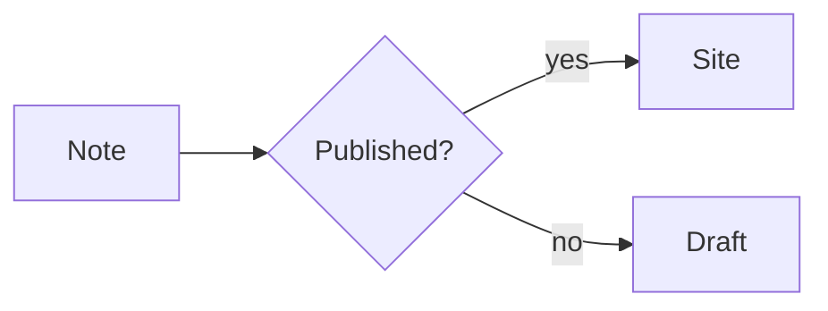
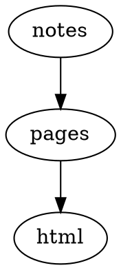
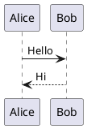

# Plugin Showcase

The Plugin catalog lives in [Plugins](./README.md). This page shows what each Plugin actually produces. Each entry pairs the Markdown source with the result rendered by Riebeckite.

> The generated `showcase` preset lets you try examples like these locally.

## Obsidian Markdown

### Callouts — [`obsidian-markdown`](./obsidian-markdown.md)

#### Source

````md
> [!tip] Try it
> A callout is a block quote with a `[!type]` marker.

> [!info] Info
> Informational callouts use the same block quote syntax.

> [!warning] Warning
> Warnings are available without extra configuration.

> [!question] Question
> Use a question callout for an open point.
````

#### Rendered

> [!tip] Try it
> A callout is a block quote with a `[!type]` marker.

> [!info] Info
> Informational callouts use the same block quote syntax.

> [!warning] Warning
> Warnings are available without extra configuration.

> [!question] Question
> Use a question callout for an open point.

### WikiLinks and embeds — [`obsidian-markdown`](./obsidian-markdown.md)

#### Source

````md
A WikiLink to [[README]] and to [[plugins/README|Plugin catalog]].

A note embed:

![[head-tag]]

An image embed:

![[riebeckite-logo-horizontal.png]]
````

#### Rendered

A WikiLink to [[README]] and to [[plugins/README|Plugin catalog]].

A note embed:

![[head-tag]]

An image embed:

![[riebeckite-logo-horizontal.png]]

Block references such as `![[head-tag#^block]]` work when the target note has a block id.

### Hard breaks — [`hard-breaks`](./hard-breaks.md)

`hardBreaks()` turns every soft line break into `<br>`. It is opt-in, and this site does not enable it, so the lines below stay in one paragraph.

#### Source

````md
First line
Second line
Third line
````

#### Rendered

First line
Second line
Third line

Enable `hardBreaks()` to keep each line on its own row.

## Generated pages

### Timeline — [`timeline`](./timeline.md)

#### Source

````md
---
title: First release
date: 2026-01-15
---
````

#### Rendered

[Open the Timeline](/timeline)

### Glossary — [`glossary`](./glossary.md)

#### Source

````md
---
title: Static site generation
glossary: true
term: SSG
definition: Generates HTML before deployment.
---
````

#### Rendered

[Open the Glossary](/glossary)

### Archive — [`archive`](./archive.md)

Monthly listing pages generated from the dates in note frontmatter. Pages live under `/archive/<yyyy>/<mm>`.

#### Rendered

[Open the October 2026 archive](/archive/2026/10)

## Code

### Code with a toolbar — [`code-enhance`](./code-enhance.md)

Line numbers, a filename bar, line highlighting, and a copy button.

#### Source

````md
```ts title="hello.ts"
export function hello(name: string): string {
  return `Hello, ${name}`;
}
```
````

#### Rendered

```ts title="hello.ts"
export function hello(name: string): string {
  return `Hello, ${name}`;
}
```

### Code tabs — [`code-tabs`](./code-tabs.md)

Adjacent code fences with `tab="..."` become a single tab group.

#### Source

````md
```ts tab="React"
const greeting = "Hello from React";
```

```js tab="Vanilla"
console.log("Hello from JavaScript");
```
````

#### Rendered

```ts tab="React"
const greeting = "Hello from React";
```

```js tab="Vanilla"
console.log("Hello from JavaScript");
```

### Code annotations — [`code-annotations`](./code-annotations.md)

 Use a `diff` fence with the target language to render additions and removals.

#### Source

````md
```diff js
const kept = true;
+ const added = "new line";
- const removed = false;
```
````

#### Rendered

```diff js
const kept = true;
+ const added = "new line";
- const removed = false;
```

### Source files — [`source-files`](./source-files.md)

Publish selected text files as pages, embed the full file, or embed a line range.

#### Source

````md
[[source-file-example.ts]]

![[source-file-example.ts]]

![[source-file-example.ts#L3-L5]]
````

#### Rendered

[[source-file-example.ts]]

![[source-file-example.ts]]

![[source-file-example.ts#L3-L5]]

## Inline

### Highlight — [`highlight`](./highlight.md)

Text wrapped in `==...==` is emphasized inline.

#### Source

````md
This sentence contains an ==emphasized== span; the rest stays unchanged.
````

#### Rendered

This sentence contains an ==emphasized== span; the rest stays unchanged.

### Sidenotes — [`sidenotes`](./sidenotes.md)

Footnote syntax becomes a side note next to the body.

#### Source

````md
We reference a side note here.[^1]

[^1]: This is the side note body.
````

#### Rendered

We reference a side note here.[^1]

[^1]: This is the side note body.

### Shortcodes — [`shortcodes`](./shortcodes.md)

`::name` and `:::name` directives insert badges, keyboard keys, notes, and more.

#### Source

````md
::badge[Stable]{variant=success}

::kbd[Ctrl+Shift+P]

:::note[Note]
You can write body text as-is.
:::
````

#### Rendered

::badge[Stable]{variant=success}

::kbd[Ctrl+Shift+P]

:::note[Note]
You can write body text as-is.
:::

## Diagrams

### Mermaid (Pele) — [`mermaid-pele`](./mermaid-pele.md)

#### Source

````md

````

#### Rendered


### Mermaid (headless browser) — [`mermaid`](./mermaid.md)

The `mermaid` plugin renders the same `mermaid` fence to SVG with a headless browser at build time. This site uses Mermaid (Pele) instead, so the build does not need Chromium.

### D2 — [`d2`](./d2.md)

#### Source

````md
```d2
site: Riebeckite
content -> build -> deploy
```
````

#### Rendered

```d2
site: Riebeckite
content -> build -> deploy
```

### Graphviz / DOT — [`graphviz`](./graphviz.md)

#### Source

````md

````

#### Rendered


### Chart.js — [`chartjs`](./chartjs.md)

#### Source

````md
```chart
{
  "type": "bar",
  "data": {
    "labels": ["Mon", "Tue", "Wed"],
    "datasets": [{ "label": "Visits", "data": [12, 19, 8] }]
  }
}
```
````

#### Rendered

```chart
{
  "type": "bar",
  "data": {
    "labels": ["Mon", "Tue", "Wed"],
    "datasets": [{ "label": "Visits", "data": [12, 19, 8] }]
  }
}
```

### Vega-Lite — [`vega-lite`](./vega-lite.md)

#### Source

````md
```vega-lite
{
  "title": "Revenue",
  "data": { "values": [{ "category": "A", "value": 28 }, { "category": "B", "value": 55 }] },
  "mark": "bar",
  "encoding": {
    "x": { "field": "category", "type": "nominal" },
    "y": { "field": "value", "type": "quantitative" }
  }
}
```
````

#### Rendered

```vega-lite
{
  "title": "Revenue",
  "data": { "values": [{ "category": "A", "value": 28 }, { "category": "B", "value": 55 }] },
  "mark": "bar",
  "encoding": {
    "x": { "field": "category", "type": "nominal" },
    "y": { "field": "value", "type": "quantitative" }
  }
}
```

### WaveDrom — [`wavedrom`](./wavedrom.md)

#### Source

````md
```wavedrom
{ "signal": [
  { "name": "clk", "wave": "p......" },
  { "name": "bus", "wave": "x.34.5x", "data": "head body tail" }
] }
```
````

#### Rendered

```wavedrom
{ "signal": [
  { "name": "clk", "wave": "p......" },
  { "name": "bus", "wave": "x.34.5x", "data": "head body tail" }
] }
```

### Markmap — [`markmap`](./markmap.md)

#### Source

````md
```markmap
# Project

## Design

### Notation
### Rendering

## Delivery
```
````

#### Rendered

```markmap
# Project

## Design

### Notation
### Rendering

## Delivery
```

### Marp slides — [`marp`](./marp.md)

#### Source

````md
```marp title="Intro deck"
# First slide

- a bullet

---

# Second slide
```
````

#### Rendered

```marp title="Intro deck"
# First slide

- a bullet

---

# Second slide
```

### Maps — [`map`](./map.md)

A static fallback renders first, then expands to an interactive map where JavaScript is available.

#### Source

````md
```map
center: 35.6812, 139.7671
zoom: 13
label: Tokyo Station
markers:
  - 35.6812, 139.7671 | Tokyo Station
  - 35.6586, 139.7454 | Tokyo Tower
```
````

#### Rendered

```map
center: 35.6812, 139.7671
zoom: 13
label: Tokyo Station
markers:
  - 35.6812, 139.7671 | Tokyo Station
  - 35.6586, 139.7454 | Tokyo Tower
```

### QR codes — [`qr-code`](./qr-code.md)

Generated as inline SVG at build time.

#### Source

````md
```qr
# caption: Project page
https://example.com/
```
````

#### Rendered

```qr
# caption: Project page
https://example.com/
```

### PlantUML — [`plantuml`](./plantuml.md)

The diagram becomes an image URL pointing at a PlantUML server at build time. Viewing it requires reaching that server.

#### Source

````md

````

#### Rendered


### Canvas — [`canvas`](./canvas.md)

Write JSON Canvas directly in a code fence, or embed a Canvas file with `![[diagram.canvas]]`.

#### Source

````md
```canvas
{
  "nodes": [
    { "id": "note", "type": "text", "x": 0, "y": 0, "width": 240, "height": 100, "text": "Note" }
  ],
  "edges": []
}
```
````

#### Rendered

```canvas
{
  "nodes": [
    { "id": "note", "type": "text", "x": 0, "y": 0, "width": 240, "height": 100, "text": "Note" }
  ],
  "edges": []
}
```

## Media

### Audio and video — [`media`](./media.md)

Audio and video attachments render with the native browser players. The sample below is a short silent WAV.

#### Source

````md
![[media-example.wav]]
````

#### Rendered

![[media-example.wav]]

### Attachments — [`attachment`](./attachment.md)

A plain WikiLink becomes a download link, and an embedded WikiLink becomes an attachment card.

#### Source

````md
[[attachment-example.txt]]

![[attachment-example.txt]]
````

#### Rendered

[[attachment-example.txt]]

![[attachment-example.txt]]

### PDF — [`pdf`](./pdf.md)

Embedded PDFs render in the browser's native PDF viewer.

#### Source

````md
![[pdf-example.pdf]]
````

#### Rendered

![[pdf-example.pdf]]

### Rich embeds — [`rich-embed`](./rich-embed.md)

Turn a URL into an embed for YouTube, Vimeo, Spotify, CodePen, Gist, and more.

#### Source

````md
```embed
https://www.youtube.com/watch?v=dQw4w9WgXcQ
title: Demo video
caption: A short caption
aspect: 16/9
```
````

#### Rendered

```embed
https://www.youtube.com/watch?v=dQw4w9WgXcQ
title: Demo video
caption: A short caption
aspect: 16/9
```

### Gallery cards — [`gallery`](./gallery.md)

#### Source

````md
```gallery
columns: 3
items:
  - title: Default
    description: A clean, typographic theme.
    href: https://riebeckite.dev/docs/themes/default
  - title: Minimal
    description: Stripped back to the essentials.
    href: https://riebeckite.dev/docs/themes/minimal
  - title: Gruvbox
    description: A warm, high-contrast palette.
    href: https://riebeckite.dev/docs/themes/gruvbox
```
````

#### Rendered

```gallery
columns: 3
items:
  - title: Default
    description: A clean, typographic theme.
    href: https://riebeckite.dev/docs/themes/default
  - title: Minimal
    description: Stripped back to the essentials.
    href: https://riebeckite.dev/docs/themes/minimal
  - title: Gruvbox
    description: A warm, high-contrast palette.
    href: https://riebeckite.dev/docs/themes/gruvbox
```

### Excalidraw — [`excalidraw`](./excalidraw.md)

Embedding an Excalidraw note replaces it with an SVG in the browser. This site embeds the drawing in `assets/HW.md`.

#### Source

````md
![[HW]]
````

#### Rendered

![[HW]]

### Responsive image — [`responsive-image`](./responsive-image.md)

Embedding an image with `![[...]]` expands to a `<picture>` element with multiple size candidates when the variants exist.

#### Source

````md
![[riebeckite-logo-horizontal.png]]
````

#### Rendered

![[riebeckite-logo-horizontal.png]]

### Lightbox — [`lightbox`](./lightbox.md)

Click the image to open it in an accessible dialog.

#### Source

````md
![[riebeckite-logo.png]]
````

#### Rendered

![[riebeckite-logo.png]]

### AutoCardLink — [`autocardlink`](./autocardlink.md)

A `cardlink` fence with a URL and metadata becomes a link card.

#### Source

````md
```cardlink
url: https://example.com/riebeckite
title: Riebeckite
description: A tool that builds a static site from Markdown
host: example.com
```
````

#### Rendered

```cardlink
url: https://example.com/riebeckite
title: Riebeckite
description: A tool that builds a static site from Markdown
host: example.com
```

## Knowledge and data

### Citations — [`citations`](./citations.md)

Inline citations become numbered links, and the page gets a References section at the end.

#### Source

````md
Riebeckite builds on Markdown[@gruber2004] and ships its own plugin model.[@riebeckite2026]

Several sources can be cited together.[@riebeckite2026; @gruber2004]
````

#### Rendered

Riebeckite builds on Markdown[@gruber2004] and ships its own plugin model.[@riebeckite2026]

Several sources can be cited together.[@riebeckite2026; @gruber2004]

### Dataview — [`dataview`](./dataview.md)

#### Source

````md
```dataview
TABLE file.name AS "Name", status
FROM #project
WHERE status = "active"
SORT file.name asc
LIMIT 10
```
````

#### Rendered

```dataview
TABLE file.name AS "Name", status
FROM #project
WHERE status = "active"
SORT file.name asc
LIMIT 10
```

### Query — [`query`](./query.md)

#### Source

````md
```query
sort:
  field: title
  order: asc
limit: 5
```
````

#### Rendered

```query
sort:
  field: title
  order: asc
limit: 5
```

### Bases — [`bases`](./bases.md)

#### Source

````md
```base
filters:
  and:
    - file.hasTag("featured")
properties:
  file.name:
    displayName: Title
views:
  - type: table
    name: Featured
    limit: 10
```
````

#### Rendered

```base
filters:
  and:
    - file.hasTag("featured")
properties:
  file.name:
    displayName: Title
views:
  - type: table
    name: Featured
    limit: 10
```

### Meta Bind — [`meta-bind`](./meta-bind.md)

Inline inputs and views use page-local state. The initial values come from frontmatter.

#### Source

````md
Progress: `INPUT[slider(minValue(0), maxValue(10), stepSize(1)):showcase_progress]`

Double progress: `VIEW[{showcase_progress} * 2]`

```meta-bind
INPUT[select(option(low), option(medium), option(high)):showcase_priority]
VIEW[{showcase_priority}]
```
````

#### Rendered

Progress: `INPUT[slider(minValue(0), maxValue(10), stepSize(1)):showcase_progress]`

Double progress: `VIEW[{showcase_progress} * 2]`

```meta-bind
INPUT[select(option(low), option(medium), option(high)):showcase_priority]
VIEW[{showcase_priority}]
```

### Kanban boards — [`kanban`](./kanban.md)

Put `##` column headings and task lists in the body to get a board.

#### Source

````md
## Backlog

- [ ] Draft the release notes
- [ ] Link to [[README]]

## Done

- [x] Publish the fixture
````

#### Rendered

```kanban
## Backlog

- [ ] Draft the release notes
- [ ] Link to [[README]]

## Done

- [x] Publish the fixture
```

### Flashcards — [`flashcards`](./flashcards.md)

A `flashcards` fence of `front :: back` pairs becomes a study deck. It still reads as a static list without JavaScript.

#### Source

````md
```flashcards
What is Riebeckite? :: A tool that builds a static site from Markdown

What is the unit of publishing? :: A note
```
````

#### Rendered

```flashcards
What is Riebeckite? :: A tool that builds a static site from Markdown

What is the unit of publishing? :: A note
```

### ExcaliBrain — [`excalibrain`](./excalibrain.md)

Shows each note's relationships across seven regions. The body of the `excalibrain` fence is ignored; the fence only marks where to draw, and the map is assembled from the page's own links.

#### Source

````md
```excalibrain
```
````

#### Rendered

```excalibrain
```

The map above is built from this page's WikiLinks. Because each Plugin page is linked with a Markdown relative link, only pages named by WikiLink appear under `child`. `parent` lists pages that WikiLink to this page, and `sibling` lists pages that those `parent` pages WikiLink to.

## Plugins that act on the page or site

These Plugins cannot be expressed by a single Markdown fragment. Most are visible on this page as the search box, table of contents, color mode toggle, and so on; opt-in entries need configuration before they appear.

| Plugin | What to look for |
| --- | --- |
| [`search`](./search.md) | A search box that filters the site |
| [`toc`](./toc.md) | A table of contents that follows scroll position |
| [`backlinks`](./backlinks.md) | A list of notes that reference this note |
| [`related-posts`](./related-posts.md) | Related notes at the bottom of a note |
| [`properties`](./properties.md) | A list of frontmatter properties |
| [`article-metadata`](./article-metadata.md) | Publication date, reading time, and tags in the article header |
| [`icons`](./icons.md) | Icons from Obsidian Iconize and Iconic in navigation, search, tags, and property panels (opt-in) |
| [`navigation`](./navigation.md) | Site navigation built from config or the vault |
| [`ux`](./ux.md) | Reading progress, back-to-top, and TOC scroll-spy |
| [`text-fragment`](./text-fragment.md) | Copy link and copy quote actions for selected text |
| [`meta-bind`](./meta-bind.md) | Inline inputs and views backed by page-local state |
| [`breadcrumbs`](./breadcrumbs.md) | Page hierarchy breadcrumbs |
| [`share`](./share.md) | Share controls for a note |
| [`hover-preview`](./hover-preview.md) | A hover preview of link targets |
| [`local-graph`](./local-graph.md) | A mini graph of nearby notes |
| [`garden-explorer`](./garden-explorer.md) | The explorer Page Type with a graph and search |
| [`taxonomy`](./taxonomy.md) | The tag and folder listing Page Types |
| [`docs`](./docs.md) | The Docs sidebar and previous/next links |
| [`folder-pages`](./folder-pages.md) | An index Page Type for each folder |
| [`lightbox`](./lightbox.md) | Click to enlarge an image |
| [`diff`](./diff.md) / [`changelog`](./changelog.md) | Per-note git history |
| [`l10n`](./l10n.md) | The language switcher on translated pages |
| [`color-mode`](./color-mode.md) | Light / dark / system switching |

## Plugins that act at build time or on metadata

These Plugins do not appear in the body. Their results show up as generated files, head tags, or redirects. Some are opt-in and not enabled on this site; the table describes what they generate.

| Plugin | What it generates |
| --- | --- |
| [`seo`](./seo.md) | sitemap.xml / robots.txt / feeds, plus canonical and OGP head tags |
| [`citations`](./citations.md) | Numbered citations and a References section |
| [`webmention`](./webmention.md) | webmentions.json and the send/receive endpoints |
| [`alias`](./alias.md) | Redirects from alternative names |
| [`series`](./series.md) | Previous/next navigation and landing pages from `series` frontmatter |
| [`recent-posts`](./recent-posts.md) | A list of recent notes, placed by the site |
| [`daily-notes`](./daily-notes.md) | Short snippets from Daily Notes, placed by the site |
| [`rename`](./rename.md) | Redirects from old paths |
| [`deploy`](./deploy.md) | Deployment config files for each host |
| [`diagnostics`](./diagnostics.md) | Diagnostics for orphan notes and unused assets |
| [`quality`](./quality.md) | Quality checks such as heading order and duplicate ids |
| [`hard-breaks`](./hard-breaks.md) | Converts soft line breaks to `<br>` at build time (opt-in) |
| [`mermaid`](./mermaid.md) | Build-time SVG via a headless browser (this site uses Mermaid (Pele)) |
| [`permalink`](./permalink.md) | Stable public URLs from frontmatter ids and redirects |
| [`analytics`](./analytics.md) | Collector configuration and the client event script |
| [`discord-embed`](./discord-embed.md) | Discord link-preview metadata |
| [`image-optimizer`](./image-optimizer.md) | WebP / AVIF variants used by Responsive Image |
| [`svg-optimizer`](./svg-optimizer.md) | Optimized SVG bytes at the same path |

See [Plugins in Depth](/series/plugins-in-depth-en) for a live series.

## Developer tools

These Plugins support authoring rather than rendering.

| Plugin | What it does |
| --- | --- |
| [`generator`](./generator.md) | Creates a local Plugin with `riebeckite create plugin` |
| [`page-type-generator`](./page-type-generator.md) | Creates a standalone page through a Plugin's `pageTypes` API |
| [`component-generator`](./component-generator.md) | Creates a typed Hono JSX component |

## Related

- [Plugin catalog](./README.md)
- [Writing a Plugin](./writing-a-plugin.md)
- [Plugin API](../reference/plugin-api.md)
